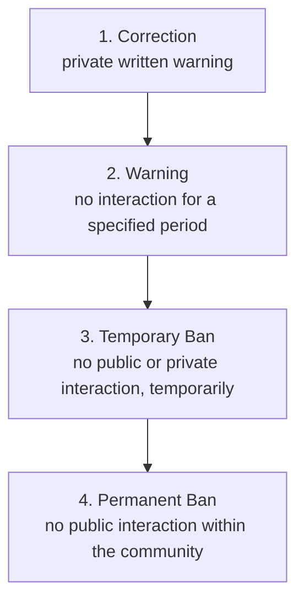
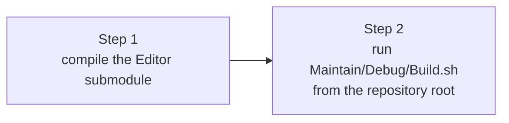
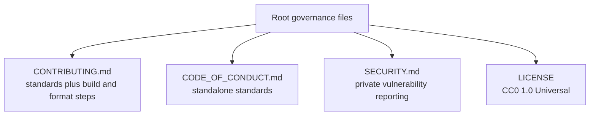

# Contributing Guidelines

[README.md](README.md) - [Documentation/GitHub/README.md](Documentation/GitHub/README.md)

Welcome to our community! We are committed to creating a welcoming and inclusive
environment for all contributors.

These Contributing Guidelines cover two things:

- The code of conduct you agree to by participating
- The practical steps for building and formatting a change

Please read and adhere to the following code of conduct before you get started.

## Contents 🧭

1. [Our Pledge](#our-pledge)
2. [Our Standards](#our-standards)
3. [Enforcement Responsibilities](#enforcement-responsibilities)
4. [Scope](#scope)
5. [Enforcement](#enforcement)
6. [Enforcement Guidelines](#enforcement-guidelines)
7. [Building & Running](#building--running)
8. [Related Documents](#related-documents)
9. [Attribution](#attribution)

---

## Our Pledge 🌱

We, as members, contributors, and leaders, pledge to make participation in our
community a harassment-free experience for everyone, regardless of:

- Age
- Body size
- Visible or invisible disability
- Ethnicity
- Sex characteristics
- Gender identity and expression
- Level of experience
- Education
- Socio-economic status
- Nationality
- Personal appearance
- Race
- Caste
- Color
- Religion
- Sexual identity and orientation

We pledge to act and interact in ways that contribute to an open, welcoming,
diverse, inclusive, and healthy community.

## Our Standards 📐

The Pledge above becomes concrete in the two lists below:

- The first names the conduct we want
- The second names the conduct that has no place here

### Expected Behavior ✅

Examples of behavior that contributes to a positive environment for our
community include:

- Demonstrating empathy and kindness toward other people
- Being respectful of differing opinions, viewpoints, and experiences
- Giving and gracefully accepting constructive feedback
- Accepting responsibility and apologizing to those affected by our mistakes,
  and learning from the experience
- Focusing on what is best not just for us as individuals, but for the overall
  community

### Unacceptable Behavior 🚫

Examples of unacceptable behavior include:

- The use of sexualized language or imagery, and sexual attention or advances of
  any kind
- Trolling, insulting, or derogatory comments, and personal or political attacks
- Public or private harassment
- Publishing others' private information, such as a physical or email address,
  without their explicit permission
- Other conduct which could reasonably be considered inappropriate in a
  professional setting

## Enforcement Responsibilities 🛡️

Community leaders are responsible for clarifying and enforcing our standards of
acceptable behavior and will take appropriate and fair corrective action in
response to any behavior that they deem inappropriate, threatening, offensive,
or harmful.

Community leaders have the right and responsibility to take these actions on
contributions that are not aligned with this Code of Conduct:

- Remove
- Edit
- Reject

That applies to these contribution types:

- Comments
- Commits
- Code
- Wiki edits
- Issues
- Other contributions

Community leaders will communicate reasons for moderation decisions when
appropriate.

## Scope 🌐

This Code of Conduct applies within all community spaces, and also applies when
an individual is officially representing the community in public spaces.

Examples of representing our community include:

- Using an official e-mail address
- Posting via an official social media account
- Acting as an appointed representative at an online or offline event

## Enforcement 📮

Instances of abusive, harassing, or otherwise unacceptable behavior may be
reported to the community leaders responsible for enforcement at
Community@Editor.Land. All complaints will be reviewed and investigated quickly
and fairly.

All community leaders are obligated to respect the privacy and security of the
reporter of any incident.

**`Report`**

```text
To:      Community@Editor.Land
Subject: Code of Conduct report
```

> [!NOTE]
>
> Say what happened, where, when, and who was involved; anything further is a
> bonus.

## Enforcement Guidelines ⚖️

Community leaders will follow these Community Impact Guidelines in determining
the consequences for any action they deem in violation of this Code of Conduct.

**`Ladder`**

```text
1. Correction     -> private written warning
2. Warning        -> no interaction for a specified period
3. Temporary Ban  -> no public or private interaction, temporarily
4. Permanent Ban  -> no public interaction within the community
```

> [!NOTE]
>
> Each rung below answers a heavier community impact than the rung above it.



### 1. Correction ✏️

**Community Impact**: Use of inappropriate language or other behavior deemed
unprofessional or unwelcome in the community.

**Consequence**: A private, written warning from community leaders, providing
clarity around the nature of the violation and an explanation of why the
behavior was inappropriate. A public apology may be requested.

### 2. Warning ⚠️

**Community Impact**: A violation through a single incident or series of
actions.

**Consequence**: A warning with consequences for continued behavior. No
interaction with the people involved, including unsolicited interaction with
those enforcing the Code of Conduct, for a specified period of time. This
includes avoiding interactions in community spaces as well as external channels
like social media. Violating these terms may lead to a temporary or permanent
ban.

### 3. Temporary Ban 🕒

**Community Impact**: A serious violation of community standards, including
sustained inappropriate behavior.

**Consequence**: A temporary ban from any sort of interaction or public
communication with the community for a specified period of time. No public or
private interaction with the people involved, including unsolicited interaction
with those enforcing the Code of Conduct, is allowed during this period.
Violating these terms may lead to a permanent ban.

### 4. Permanent Ban ⛔

**Community Impact**: Demonstrating a pattern of violation of community
standards, including sustained inappropriate behavior, harassment of an
individual, or aggression toward or disparagement of classes of individuals.

**Consequence**: A permanent ban from any sort of public interaction within the
community.

---

## Building & Running 🏗️

To build `Land` from source, follow the comprehensive guide in
[`Documentation/GitHub/Building.md`](https://github.com/CodeEditorLand/Land/tree/Current/Documentation/GitHub/Building.md).

It covers:

- All prerequisites
- The two-step build process
- Environment configuration
- Troubleshooting

For a quick summary, see the main
[`README.md`](https://github.com/CodeEditorLand/Land/tree/Current/README.md):

- Project overview
- Quick start

**`Terminal`**

```sh
export Trace=all Record=1 Disable=false
./Maintain/Debug/Build.sh --profile debug-electron-bundled
```

> [!NOTE]
>
> Step 2 of the build, run from the repository root once the Editor submodule
> has been compiled.



### Formatting Your Change 🧹

Every change is formatted by
[`Maintain/Format.sh`](https://github.com/CodeEditorLand/Land/tree/Current/Maintain/Format.sh),
which drives these formatters from one entry point:

- `shfmt`
- `Prettier`
- `rustfmt`
- The Markdown table formatter

Run it before you open a pull request.

**`Terminal`**

```sh
sh Maintain/Format.sh            # Run all formatters
sh Maintain/Format.sh rust       # Format Rust only
sh Maintain/Format.sh prettier   # Format TS/JS/JSON/MD only
```

> [!NOTE]
>
> Each subcommand is optional; with no argument the script runs every formatter
> in turn.

### Link Convention 🔗

Documentation in this repository links to source files by their full address on
the `Current` branch, so a quoted line keeps working outside the repository.

**`Link form`**

```md
[`README.md`](README.md)
[`Documentation/GitHub/Building.md`](Documentation/GitHub/Building.md)
```

> [!NOTE]
>
> Those two relative forms resolve only inside a checkout; prose above uses the
> absolute `tree/Current` equivalents instead.

## Related Documents 📚

These Contributing Guidelines sit alongside three other governance files at the
root of the `Land` repository.

| Document | Purpose |
| -------- | ------- |
| [`CONTRIBUTING.md`](https://github.com/CodeEditorLand/Land/tree/Current/CONTRIBUTING.md) | This document: community standards, plus how to build and format |
| [`CODE_OF_CONDUCT.md`](https://github.com/CodeEditorLand/Land/tree/Current/CODE_OF_CONDUCT.md) | The same standards kept as a standalone document |
| [`SECURITY.md`](https://github.com/CodeEditorLand/Land/tree/Current/SECURITY.md) | Private reporting of security vulnerabilities |
| [`LICENSE`](https://github.com/CodeEditorLand/Land/tree/Current/LICENSE) | The terms the project is released under |

**`Governance`**

```text
CONTRIBUTING.md      this document
CODE_OF_CONDUCT.md   community standards, standalone
SECURITY.md          private vulnerability reporting
LICENSE              CC0 1.0 Universal
```

> [!NOTE]
>
> Conduct concerns go to Community@Editor.Land; security reports go to
> Security@Editor.Land instead.



## Attribution 📜

This Code of Conduct is adapted from the [`Contributor Covenant`][homepage],
version 2.1, available at
[`https://www.contributor-covenant.org/version/2/1/code_of_conduct.html`][v2.1].
Community Impact Guidelines were inspired by [Mozilla's code of conduct
enforcement ladder][Mozilla CoC].

For answers to common questions about this code of conduct, see the FAQ at
[`https://www.contributor-covenant.org/faq`][FAQ]. Translations are available at
[`https://www.contributor-covenant.org/translations`][translations].

[homepage]: https://www.contributor-covenant.org
[v2.1]: https://www.contributor-covenant.org/version/2/1/code_of_conduct.html
[Mozilla CoC]: https://github.com/mozilla/diversity
[FAQ]: https://www.contributor-covenant.org/faq
[translations]: https://www.contributor-covenant.org/translations

Thank you for being part of our community and helping us create a safe and
respectful environment for everyone!

---

**Project Maintainers:** Source Open
([Source/Open@Editor.Land](mailto:Source/Open@Editor.Land)) |
[GitHub Repository](https://github.com/CodeEditorLand/Land) |
[Report an Issue](https://github.com/CodeEditorLand/Land/issues)
