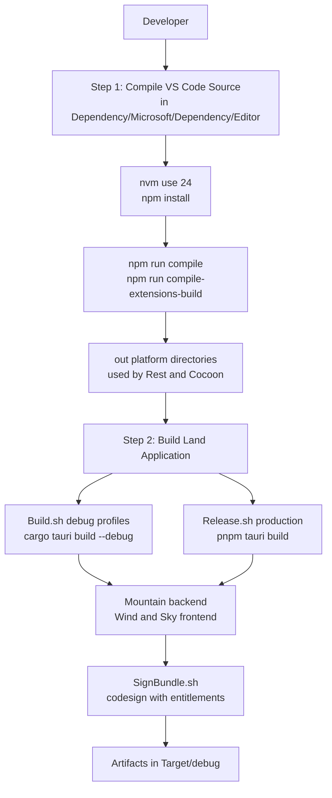

# Building Land

Step-by-step instructions for building the `Land` code editor from source. This document covers:

- The complete two-step build process
- Prerequisites
- Environment configuration
- Element-specific build notes

---

## Prerequisites ⚙️

Before building, ensure you have the following installed:

- `Rust` (1.95.0+ - workspace MSRV for all `Rust` elements) - [rustup.rs](https://rustup.rs/)
- `Node.js` (v24 required for building the `VS Code` Editor submodule) - [nodejs.org](https://nodejs.org/)
- `pnpm` (package manager) - `npm install -g pnpm`
- `Git` (with `LFS` support) - `git lfs install`
- `Protocol Buffer` compiler (optional, only if modifying `.proto` files)

Use `nvm` to install and select the required `Node.js` version:

```sh
nvm install 24
nvm use 24
```

> [!NOTE]
>
> `Node.js` 24 is required specifically to compile the `VS Code` Editor submodule (Step 1 below). The pinned version is tracked in `Dependency/Microsoft/Dependency/Editor/.nvmrc`.

### Shell Environment ⚙️

The `Dependency/Microsoft/Dependency/Editor` submodule's `npm install` fetches large platform-specific binaries for its test infrastructure:

- `Electron` (~200 MB) - needed only for running integration tests
- `Playwright` `Chromium` (~300 MB) - needed only for running integration tests

Neither binary is needed for compiling. Without the flags below, `npm install` will stall indefinitely on the download.

Add to your shell profile (`~/.zshrc`, `~/.bashrc`, or equivalent) and reload:

```sh
# Skip large binary downloads - only needed for e2e tests, not compilation
export ELECTRON_SKIP_BINARY_DOWNLOAD=1
export PLAYWRIGHT_SKIP_BROWSER_DOWNLOAD=1
```

```sh
source ~/.zshrc # or restart your terminal
```

---

## Build Overview 📋

The `Land` build is a two-step linear flow. Do NOT pull submodules recursively:

- Each submodule is managed independently on its own branch

The two steps are:

1. Compile `VS Code` Source
   - Build the `VS Code` platform code that `Cocoon` consumes
   - Run in `Dependency/Microsoft/Dependency/Editor`
2. Build `Land` Application
   - Compile the native `Rust` backend (`Mountain`)
   - Bundle the `TypeScript` frontend (`Wind` and `Sky`) into a runnable `Tauri` application



---

## Step 1: Compile VS Code Source 📦

The `VS Code` source is vendored as a `Git` submodule in `Dependency/Microsoft/Dependency/Editor`.

- This step is mandatory
- `Land` cannot build without it
- `Cocoon` (the extension host) and `Output` (the platform bundle) both consume the compiled output produced here

> [!IMPORTANT]
>
> You must be on `Node.js` 24 for this step. The submodule's `.nvmrc` pins the exact version (`24.22.1`). Switch before running any of the commands below.

```sh
cd Dependency/Microsoft/Dependency/Editor

# Switch to the required Node version (reads .nvmrc automatically)
nvm use 24

# Required by the VS Code build system
export NODE_ENV=development

# Reset to the expected upstream commit and clean all built files
git fetch --all
git reset --hard Parent/main
git clean -dfx

# Install dependencies and compile
npm install
npm run compile
npm run compile-extensions-build
```

> [!NOTE]
>
> The `Dependency/Microsoft/Dependency/Editor` submodule uses `npm`, not `pnpm`. Do not substitute `pnpm install` here. The submodule's `package-lock.json` and `.npmrc` are `npm`-native.

> [!IMPORTANT]
>
> The `compile-extensions-build` step produces the `out-<platform>` directories that `Rest` bundles into `@codeeditorland/output`. Without it, `Cocoon` will fail to locate the `VS Code` platform code at runtime.

---

## Step 2: Build Land Application 🚀

Return to the repository root and invoke the build script with the desired profile.

```sh
cd Land # back to repository root

# For a debug build with bundled electron
export Trace=all Record=1 Disable=false
./Maintain/Debug/Build.sh --profile debug-electron-bundled

# For a production build
export Trace= Record= Disable=
sh Maintain/Release.sh --profile production
```

### Build Profiles 📦

The `Build.sh` script accepts several profiles that control feature flags and optimization levels. See [`BuildMatrix.md`](BuildMatrix.md) for the full matrix of environment variables and tier configurations.

| Profile | Workbench | Coverage | Notes |
| ------- | --------- | -------- | ----- |
| `debug` | `Browser` | `70-80%` | Default debug |
| `debug-mountain` | `Mountain` | `80-90%` | Recommended for daily development |
| `debug-electron` | `Electron` | `95%+` | Full feature set |
| `debug-electron-rest` | `Electron` + `OXC` | `95%+` | Fastest `TypeScript` compile |
| `debug-electron-minimal` | `Electron` | No built-in extensions | Atom J1 |
| `debug-mountain-only` | `Mountain` | No `Cocoon` subprocess | Atom N3 |
| `debug-cocoon-headless` | `Mountain` + `Cocoon` | `Wind` preload disabled | Atom N3b |
| `debug-kernel` | None | Pure `Mountain`, no built-ins, no `Cocoon`, no `Wind` | Atom N3c |
| `debug-electron-compiled` | `Electron` | Single-binary embedded resources | Debug symbols + `Compile=true` |
| `debug-mountain-compiled` | `Mountain` | Single-binary embedded resources | Debug symbols + `Compile=true` |
| `debug-electron-bundled` | `Electron` | `Vite`/`Astro` compiled workbench | Full bundled `Electron` debug build |
| `debug-browser-bundled` | `Browser` | `Vite`/`Astro` compiled workbench | |
| `debug-sessions-bundled` | `Sessions` | `Vite`/`Astro` compiled workbench | |
| `debug-workbench-bundled` | Base workbench | `Vite`/`Astro` compiled workbench | |
| `debug-bundled-all` | All four | Single `Rollup` pass | |
| `production` (`Release.sh`) | `Electron` | Optimized release | `Release.sh` also provides `release` and `web-browser` |

The `production` profile is provided by `Maintain/Release.sh`, not `Build.sh`. `Release.sh` also provides `release` and `web-browser`.

### Release Script ⚙️

`Maintain/Release.sh` provides three profiles:

| Profile | `RUST_LOG` |
| ------- | ---------- |
| `production` | `info` |
| `release` | `warn` |
| `web-browser` | `warn` |

`Release.sh` exports the following values per profile:

- `Mountain=true` or `Browser=true` - workbench selection
- `Bundle=true`
- `Clean=true`
- `Compile=true`
- `Debug=false`
- `Level=silent`
- `Dependency=Microsoft/VSCode`
- `NODE_ENV=production`
- `NODE_VERSION=22`
- `NODE_OPTIONS=--max-old-space-size=8192`

The script ends with `./Target/release/Maintain -- pnpm tauri build`. The `production` profile uses `.env.Land.Production` via `Maintain/Script/TierEnvironment.sh`.

---

## Environment Variables ⚙️

`Land` uses a tier-gated system of environment variables to control build and runtime behavior. All variables are read from `.env.Land*` files in the repository root. Copy `.env.Land.Sample` to `.env.Land` to customize your local environment. `.env.Land.Sample` is the checked-in sample file.

For a complete reference, see [`EnvironmentVariables.md`](EnvironmentVariables.md).

Common variables:

| Variable | Default | Description |
| -------- | ------- | ----------- |
| `ProductVersion` | `1.118.0` | `Land` version and feature tier gate |
| `Bundle` | (unset) | Set to `true` to trigger `Rest` bundling |
| `NetworkMountainPort` | `50051` | `gRPC` port for `Mountain` backend |
| `NetworkCocoonPort` | `50052` | `gRPC` port for `Cocoon` extension host |
| `TierFileSystem` | `Layer2` | Filesystem implementation tier |
| `TierFileWatcher` | `Layer4` | File watching implementation tier |
| `TierRemoteProcedureCall` | `gRPC` | `IPC` transport mechanism |
| `TierIPC` | `Mountain` | `IPC` routing: `Mountain` / `NodeDeferred` / `Node` |

---

## Build Artifacts 📦

After a successful build, artifacts are placed in:

```text
Land/
+-- Element/
|   +-- Mountain/Target/...        # Native Tauri app bundle
|   +-- Air/Target/...             # Background daemon binary
|   +-- Output/Target/...          # Bundled JavaScript platform code
|   +-- Cocoon/Compiled/...        # Built extension host
|   `-- Sky/Target/...             # UI static assets
`-- Maintain/Debug/Build.sh        # Build orchestration script
```

---

## Running the Application 🚀

```sh
# From the repository root (after a debug-electron build)
cd Land
./Element/Mountain/Target/debug/Mountain

# After a debug-electron-bundled build
./Element/Mountain/Target/debug/Mountain

# The .app bundle (for Finder launch or codesign verification)
open Element/Mountain/Target/debug/bundle/macos/Mountain.app
```

Launch the built binary directly from the Build Artifacts paths shown above. The `Build.sh` script has no run flag; its only flags are `-p`/`--profile`, `-f`/`--flavor`, and `-h`/`--help`.

```sh
./Element/Mountain/Target/debug/Mountain
```

> [!NOTE]
>
> All debug profiles write to `Target/debug/`. The profile name affects what environment variables are set and which `Sky` assets are produced - not the target directory name.

`Build.sh` ends with `./Target/release/Maintain -- cargo tauri build --debug` and calls `Maintain/Script/SignBundle.sh` at the end of every build.

---

## Element-Specific Build Instructions 🗺️

Each `Element` may have additional build details. Refer to the specific `README.md` for element-specific workflows:

| Element | Build Instructions |
| ------- | ------------------ |
| `Air` | [`Element/Air/README.md`](https://github.com/CodeEditorLand/Air/tree/Current/README.md) - Background daemon build & daemon lifecycle |
| `Grove` | [`Element/Grove/README.md`](https://github.com/CodeEditorLand/Grove/tree/Current/README.md) - Native `Rust`/`WASM` extension host build |
| `Mist` | [`Element/Mist/README.md`](https://github.com/CodeEditorLand/Mist/tree/Current/README.md) - `DNS` server build & testing |
| `Rest` | [`Element/Rest/README.md`](https://github.com/CodeEditorLand/Rest/tree/Current/README.md) - `CLI` compiler usage |
| `SideCar` | [`Element/SideCar/README.md`](https://github.com/CodeEditorLand/SideCar/tree/Current/README.md) - Download tool for runtime binaries |
| `Sky` | [`Element/Sky/README.md`](https://github.com/CodeEditorLand/Sky/tree/Current/README.md) - `Astro` UI development |
| `Wind` | [`Element/Wind/README.md`](https://github.com/CodeEditorLand/Wind/tree/Current/README.md) - `Effect-TS` service layer |
| `Cocoon` | [`Element/Cocoon/README.md`](https://github.com/CodeEditorLand/Cocoon/tree/Current/README.md) - Extension host details |

---

## Troubleshooting 🔬

### `npm install` stalls or never completes 🔬

The `Dependency/Microsoft/Dependency/Editor` submodule includes packages that download large platform-specific binaries during installation:

- `electron` (~200 MB) - a devDependency of the `Copilot` extension, only needed for running `Electron` integration tests
- `@playwright/browser-chromium` (~300 MB) - only needed for running browser-based e2e tests

Neither binary is needed for compilation. Without the skip flags, `npm install` will stall indefinitely downloading them on every fresh install.

Fix: add these to your shell profile and reload:

```sh
export ELECTRON_SKIP_BINARY_DOWNLOAD=1
export PLAYWRIGHT_SKIP_BROWSER_DOWNLOAD=1
```

### `Playwright` lockfile blocks install 🔬

If `npm install` fails with:

```text
Error: An active lockfile is found at: ~/Library/Caches/ms-playwright/__dirlock
```

A previous install was interrupted and left a stale lockfile. Remove it:

```sh
rm -rf ~/Library/Caches/ms-playwright/__dirlock
```

Then re-run `npm install`.

### `npm warn Unknown project config` messages 🔬

`npm install` prints several harmless warnings:

```text
npm warn Unknown project config "target"
npm warn Unknown project config "disturl"
npm warn Unknown project config "runtime"
npm warn Unknown project config "build_from_source"
```

These come from upstream `VS Code`'s `.npmrc`, which uses keys that `npm` 11+ considers non-standard. The keys are still read correctly by the build tooling (`node-gyp`, native module compilers) that actually uses them. No action needed.

### Compilation errors in `Dependency/Editor` 🔬

If the `VS Code` compilation fails, ensure you have cleaned the directory properly and are on `Node.js` 24:

```sh
cd Dependency/Microsoft/Dependency/Editor
nvm use 24
export NODE_ENV=development
git clean -dfx
rm -rf node_modules
npm install
npm run compile
```

### `Rest` binary not found 🔬

Set `REST_BINARY_PATH` to point to the compiled `rest` binary:

```sh
export REST_BINARY_PATH=/path/to/rest
```

### Missing environment variables 🔬

The build reads `.env.Land` from the repository root. If variables appear missing, verify the file exists and is formatted correctly. See [`EnvironmentVariables.md`](EnvironmentVariables.md) for syntax.

### Port conflicts 🔬

If `NetworkMountainPort` or `NetworkCocoonPort` are already in use (from a previous run), kill the orphaned processes or change the port numbers in `.env.Land`.

### App crashes immediately on macOS (Permission denied / code signing) 🔬

`Tauri`'s ad-hoc signature does not embed the entitlements from `Element/Mountain/Entitlements.plist`. Without the correct entitlements, `Cocoon`'s `V8` `JIT` crashes, extension helpers fail to spawn, and file pickers silently do nothing.

Re-sign the `.app` after any `tauri build`:

```sh
BundleLevel=debug sh Maintain/Script/SignBundle.sh
```

The script runs `xattr -cr` to strip quarantine bits, then re-signs with `codesign --force --deep --sign -` using the entitlements file. `Build.sh` calls this automatically at the end of every build. The script reads `BundleLevel` (`debug` or `release`), `CopyToDesktop`, and `MountainDir` (default `Element/Mountain`).

---

## Rebuilding & Clean 📦

To perform a clean rebuild:

```sh
# Clean Rust artifacts
cd Element/Mountain
cargo clean

# Clean TypeScript builds
cd Element/Sky
rm -rf .tina .astro Target

# Clean VS Code recompilation
cd Dependency/Microsoft/Dependency/Editor
git clean -dfx
rm -rf node_modules out

# Rebuild everything
cd Land
./Maintain/Debug/Build.sh --profile debug-electron-bundled
```

---

## CI/CD & Automation ⚙️

The build script is used by `CI` pipelines. See `Maintain/.GitHub/Workflows/` for pre-configured `GitHub Actions` definitions. All `CI` builds set environment variables via the `.env.Land.Production` overlay and use `sh Maintain/Release.sh --profile production`. There is no `.env.Land.CI` file.

The `.env.Land.Production` overlay is activated by `Maintain/Script/TierEnvironment.sh` when `NODE_ENV=production` or the `Profile` contains `release`. The overlay location can be overridden with the `Land_Env_File` variable.

---

## Related Documentation 📖

- [`Workflow/`](Workflow/) - Detailed component interaction workflows
- [`BuildMatrix.md`](BuildMatrix.md) - Full build variant matrix
- [`BuildPipeline.md`](BuildPipeline.md) - Build stages, env propagation and artifact layout
- [`EnvironmentVariables.md`](EnvironmentVariables.md) - Complete env var reference
- [`Shim.md`](Shim.md) - Build-shim boot sequence and hook layers
- [`Polyfills.md`](Polyfills.md) - Preload shims and transform pipeline
- [`VSCode-API-Coverage-Matrix.md`](VSCode-API-Coverage-Matrix.md) - API implementation split
- [`Land/README.md`](https://github.com/CodeEditorLand/Land/tree/Current/README.md) - Project overview and quick start

---

**Project Maintainers:** Source Open
([Source/Open@Editor.Land](mailto:Source/Open@Editor.Land)) |
[GitHub Repository](https://github.com/CodeEditorLand/Land) |
[Report an Issue](https://github.com/CodeEditorLand/Land/issues)
