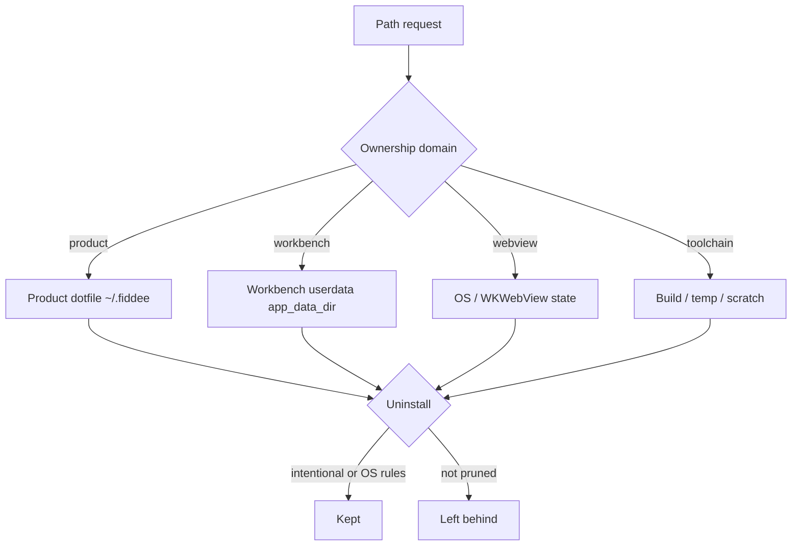
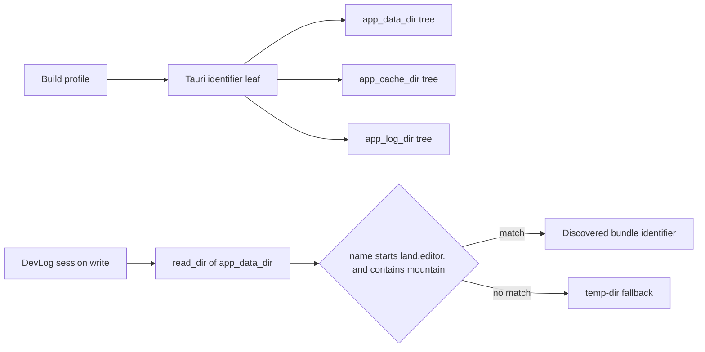

<table>
	<tr>
		<td align="left" valign="middle"><h3 align="left">Filesystem Footprint 📂</h3></td>
		<td align="left" valign="middle"><h3 align="left"> + </h3></td>
		<td align="left" valign="middle">
			<h3 align="left">
				<a href="https://editor.land" target="_blank">
					<picture>
						<source media="(prefers-color-scheme: dark)" srcset="https://editor.land/Dark/Image/GitHub/Land.svg" />
						<source media="(prefers-color-scheme: light)" srcset="https://editor.land/Image/GitHub/Land.svg" />
						
					</picture>
				</a>
			</h3>
		</td>
		<td align="left" valign="middle"><h3 align="left"><a href="https://editor.land" target="_blank">Land 🏞️</a></h3></td>
		<td align="left" valign="middle"><h3 align="left"> + </h3></td>
		<td align="left" valign="middle"><h3 align="left">FIDDEE 🎻</h3></td>
	</tr>
</table>

---

# **Filesystem Footprint** 📂

Every host-filesystem location the editor reads or writes, mapped to its producing code, with cross-platform resolution and cleanup recipes.

<picture>
	<source media="(prefers-color-scheme: dark)" srcset="https://img.shields.io/static/v1?label=macOS&message=supported&color=black">
	<source media="(prefers-color-scheme: light)" srcset="https://img.shields.io/static/v1?label=macOS&message=supported&color=white">
	
</picture> <picture>
	<source media="(prefers-color-scheme: dark)" srcset="https://img.shields.io/static/v1?label=Linux&message=partial&color=black">
	<source media="(prefers-color-scheme: light)" srcset="https://img.shields.io/static/v1?label=Linux&message=partial&color=white">
	
</picture> <picture>
	<source media="(prefers-color-scheme: dark)" srcset="https://img.shields.io/static/v1?label=Windows&message=pending&color=black">
	<source media="(prefers-color-scheme: light)" srcset="https://img.shields.io/static/v1?label=Windows&message=pending&color=white">
	
</picture>

---

## Why This Document Exists 🎯

The reason for this document:

- Both `Land` (`Tauri` shell plus workbench wiring) and the bundled VS Code dependency are ours to modify.
- Today's filesystem layout is incidental rather than required.
- The document enumerates what we touch.
- Future work on **cleanup**, **versioning**, **packaging**, and **encapsulation** has a single source of truth to start from.
- The minimum-effect-over-the-system goal demands knowing exactly where the side effects are.
- Each section below states its own context.
- The document survives being read out of order.

---

## The Four Ownership Domains 🗺️

The domain rule:

- Every path the editor touches belongs to exactly one of four domains.
- The domain decides who may rename the path.
- The domain decides whether an uninstall removes it.

| Status | Domain | Owner | Path family | Survives uninstall? |
| ------ | ------ | ----- | ----------- | ------------------- |
| full | Product dotfile | `Land` code | `~/.fiddee/` | yes (intentional) |
| partial | Workbench userdata | Bundled VS Code | `<app_data_dir>/<bundle>/` | yes (intentional) |
| pending | Webview / OS state | OS / `WKWebView` | `<webview-storage>/`, plist, Saved State | yes (OS rules) |
| build-only | Build / temp / scratch | Toolchain / shell | `<tmp>/land-*`, `Element/*/Target/` | no, but not pruned |

Three observations follow from this split:

- The bundled VS Code expects a per-instance `app_data_dir`-style root for settings, keybindings, and profiles. `Tauri`'s `PathResolver` resolves it per OS, so one tree exists per build profile with an OS-specific leaf.
- `Land`'s own product state lives under `~/.fiddee/` across operating systems. That tree is shared across every build profile of the editor a user runs.
- The webview half writes through the OS-native webview. Its persisted state lands in OS-controlled directories. `Land` cannot rename those locations but can configure what the webview writes into them.



### Dotfile root resolution 🏠

The `~/.fiddee/` root is a single atom, duplicated once on the `TypeScript` side so both halves agree on the dotfile name.

```rust
/// Returns `$HOME/.fiddee` (or `$USERPROFILE\.fiddee` on Windows).
pub fn Fn() -> PathBuf {
```

> [!NOTE]
>
> This is the `Rust` atom in
> [`Element/Mountain/Source/IPC/WindServiceHandlers/Utilities/FiddeeRoot.rs`](https://github.com/CodeEditorLand/Mountain/tree/Current/Source/IPC/WindServiceHandlers/Utilities/FiddeeRoot.rs);
> [`Element/Cocoon/Source/Platform/FiddeeRoot.ts`](https://github.com/CodeEditorLand/Cocoon/tree/Current/Source/Platform/FiddeeRoot.ts)
> mirrors it for the workbench.

### Userdata seeding 🌱

The workbench userdata base is scaffolded once on first access, before the first configuration merge.

```rust
let Dirs = [
	format!("{}/User", Base),
	format!("{}/User/globalStorage", Base),
	format!("{}/logs", Base),
];
```

> [!NOTE]
>
> An excerpt of the directory list created by
> [`Element/Mountain/Source/IPC/WindServiceHandlers/Utilities/UserdataDir/Ensure.rs`](https://github.com/CodeEditorLand/Mountain/tree/Current/Source/IPC/WindServiceHandlers/Utilities/UserdataDir/Ensure.rs);
> the full list also seeds `profiles`, `snippets`, `prompts`, `cacheHome`,
> `workspaceStorage` and `CachedConfigurations`.

---

## The Bundle-Identifier Story 🆔

The `Tauri` `identifier` is the leaf segment of every per-bundle path. Today's identifiers encode each `Maintain` build profile's full configuration matrix into a single string.

| Profile | Identifier |
| ------- | ---------- |
| `debug-electron-bundled` | `land.editor.binary.development.node.environment.microsoft.vscode.dependency.node.22.bundle.clean.debug.electron.profile.esbuild.compiler.mountain` |
| `release` | `land.editor.binary.production.node.environment.microsoft.vscode.dependency.node.22.bundle.clean.compile.electron.profile.esbuild.compiler.mountain` |
| Browser variants | `...browser.debug.mountain`, `...browser.mountain`, and further variants |

Source of truth:

- [`Element/Mountain/tauri.conf.json`](https://github.com/CodeEditorLand/Mountain/tree/Current/tauri.conf.json).
- Per-profile generation happens through [`Element/Maintain`](https://github.com/CodeEditorLand/Maintain/tree/Current) templating.

> [!IMPORTANT]
>
> The checked-in `identifier` in `tauri.conf.json` is the short seed `fiddee.editor.binary`. The long matrix identifiers above are what `Maintain` writes into that field per build profile, restoring the original on completion.

Two consequences:

- A user who runs both `debug` and `release` accumulates two parallel per-bundle trees. One tree of caches and logs exists per profile.
- Mountain's `IPC/DevLog/AppDataPrefix.rs::DetectAppDataPrefix` performs a runtime `read_dir` of the OS `<app_data_dir>`. It looks for the directory whose name starts with `land.editor.` and contains `mountain`. The match returns its own bundle identifier. When DevLog needs to write a session log, it discovers the path rather than hard-coding it. This makes the editor robust against identifier changes from `Maintain` regenerating `tauri.conf.json`.



### Runtime prefix discovery 🔎

```rust
if !Name.starts_with("land.editor.") || !Name.contains("mountain") {
	continue;
}
```

> [!NOTE]
>
> The match test inside `DetectAppDataPrefix` in
> [`Element/Mountain/Source/IPC/DevLog/AppDataPrefix.rs`](https://github.com/CodeEditorLand/Mountain/tree/Current/Source/IPC/DevLog/AppDataPrefix.rs),
> which prefers a strict suffix match on the binary signature and otherwise
> falls back to the first `*.mountain` candidate.

A shorter, stable bundle identifier such as `cloud.fiddee.editor` or `editor.fiddee.binary` would fold all profile-specific differences into a per-profile subdirectory. It would make uninstall a one-line `rm -rf`. This is not done today.

---

## Document Index 📑

The footprint splits across six focused documents. Read in order for a full tour, or jump to whichever matches the task at hand.

| Document | Topic | Lines |
| -------- | ----- | ----- |
| [`FilesystemFootprint/UserDotfile.md`](https://github.com/CodeEditorLand/Land/tree/Current/Documentation/GitHub/FilesystemFootprint/UserDotfile.md) | `~/.fiddee/` tree, `~/.land/` legacy, cross-OS resolution, `Cocoon`-side mirror | 160+ |
| [`FilesystemFootprint/PlatformPaths.md`](https://github.com/CodeEditorLand/Land/tree/Current/Documentation/GitHub/FilesystemFootprint/PlatformPaths.md) | Per-OS Library / XDG / AppData paths, OS-managed state, temp-dir conventions | 280+ |
| [`FilesystemFootprint/PerElement.md`](https://github.com/CodeEditorLand/Land/tree/Current/Documentation/GitHub/FilesystemFootprint/PerElement.md) | Write-site index by Element (`Mountain`, `Cocoon`, `Sky`, `Wind`, `Output`, `Air`, `SideCar`, and others) | 240+ |
| [`FilesystemFootprint/EnvironmentVariables.md`](https://github.com/CodeEditorLand/Land/tree/Current/Documentation/GitHub/FilesystemFootprint/EnvironmentVariables.md) | Path-shaping env vars catalogued by Element and role | 180+ |
| [`FilesystemFootprint/Cleanup.md`](https://github.com/CodeEditorLand/Land/tree/Current/Documentation/GitHub/FilesystemFootprint/Cleanup.md) | Per-OS cleanup recipes, archive pattern, what each `rm -rf` removes | 200+ |
| [`FilesystemFootprint/Encapsulation.md`](https://github.com/CodeEditorLand/Land/tree/Current/Documentation/GitHub/FilesystemFootprint/Encapsulation.md) | Potential directions for compaction, versioning, self-uninstall, foreign-tool gating | 220+ |

---

## Cross-Cutting Observations 🔍

These are the patterns no single sub-document owns, because each one spans at least two ownership domains:

- **Three log destinations.** `Mountain` session logs land in `<app_data_dir>/<bundle>/logs/<ts>/Mountain.dev.log`. Workbench logs live in `<app_data_dir>/<bundle>/logs/window1/output_*`. Per-extension logs live in `~/.fiddee/logs/<extId>/`. No central rotation exists. No max-size enforcement exists. `Trace=all` debug sessions of roughly 200 MB compound quickly.
- **Two userdata bases per profile.** `<app_data_dir>/<bundle>/` comes from `Tauri`, is per-profile, and holds machine-id plus workbench userdata. `~/.fiddee/` is product-wide, shared across profiles, and holds extensions plus per-extension storage. Wiping the app's state requires touching both plus four OS-managed locations.
- **Two extension roots.** `~/.fiddee/extensions/` is the primary root. `~/.land/extensions/` is the legacy root. Both are scanned. Only the former is written.
- **Two FIDDEE roots.** `Mountain` owns `~/.fiddee/` (lowercase dotfile). The `Air` background daemon writes to `<config_dir>/FIDDEE/` (uppercase, under the OS config root). The conventions differ. The product is the same. Reconciliation is a `Branch H` encapsulation candidate.
- **Two install identifiers.** `<app_data_dir>/<bundle>/machine-id.txt` carries the `Mountain` UUID. The PostHog `distinctId` is `Sky`-side and lives in webview localStorage. Analytics see two identities per install.
- **Backup files accumulate.** Memento corruption recovery writes `<state>.json.backup` and `<state>.json.corrupted.<YYYYMMDD_HHMMSS>` siblings. Nothing prunes them.
- **Temp-dir leakage.** `<tmp>/land-zsh-integration-<pid>/` accumulates with one directory per integrated-terminal launch. `<tmp>/vine_fallback.proto` is overwritten but never removed.
- **`Cocoon` writes inside the extension bundle dir** (`~/.fiddee/extensions/<id>/.storage/`). Removing or version-bumping an extension destroys that state. This is subtle because `Land`'s three other storage paths (`extensionStorage`, `globalStorage`, `logs`) live outside the bundle and would survive a reinstall.
- **Bundle identifier explosion.** Each `Maintain` profile produces its own per-bundle tree. A developer running `debug`, `release`, and a browser variant accumulates three full sets.

### Session log destination 🪵

```rust
let Base = match AppDataPrefix::Fn() {
	Some(Prefix) => PathBuf::from(Prefix).join("logs"),
	None => std::env::temp_dir().join("land-editor-logs"),
};
```

> [!NOTE]
>
> `ResolveLogDirectory` in
> [`Element/Mountain/Source/IPC/DevLog/WriteToFile.rs`](https://github.com/CodeEditorLand/Mountain/tree/Current/Source/IPC/DevLog/WriteToFile.rs)
> falls back to `<tmp>/land-editor-logs` whenever prefix discovery has not yet
> succeeded.

### Temp-dir leakage 🧹

```rust
let TmpDir = std::env::temp_dir().join(format!("land-zsh-integration-{}", std::process::id()));
```

> [!NOTE]
>
> One directory per integrated-terminal launch, created by
> [`Element/Mountain/Source/Environment/Terminal/ShellIntegration.rs`](https://github.com/CodeEditorLand/Mountain/tree/Current/Source/Environment/Terminal/ShellIntegration.rs)
> and never removed on exit.

### In-bundle extension storage 📦

```typescript
const StoragePath = `${ExtensionPath}/.storage`;
```

> [!WARNING]
>
> This line in
> [`Element/Cocoon/Source/Services/Extension/Context.ts`](https://github.com/CodeEditorLand/Cocoon/tree/Current/Source/Services/Extension/Context.ts)
> is why uninstalling or version-bumping an extension destroys its `.storage`
> state.

---

## Convention Migration Notes 🔗

This section records the two link conventions this document was migrated away from, so that an edit does not reintroduce them.

### Badge endpoint migration 🏷️

The three platform badges above now use the `/static/v1` endpoint. Before the migration they used the legacy `/badge/` endpoint. The retired forms were:

- Dark variants: `macOS-supported-black`, `Linux-partial-black`, `Windows-pending-black`.
- Light variants: `macOS-supported-white`, `Linux-partial-white`, `Windows-pending-white`.

```md


```

> [!WARNING]
>
> The retired form shown above breaks whenever a badge message contains a
> slash, which is why `/static/v1` replaced it.

### Link form migration 🧭

Every file reference in this document is now a full absolute URL on the `Current` branch, resolving into the repository that owns the file.

```md
[`FilesystemFootprint/UserDotfile.md`](FilesystemFootprint/UserDotfile.md)
[`FilesystemFootprint/PlatformPaths.md`](FilesystemFootprint/PlatformPaths.md)
[`FilesystemFootprint/PerElement.md`](FilesystemFootprint/PerElement.md)
[`FilesystemFootprint/EnvironmentVariables.md`](FilesystemFootprint/EnvironmentVariables.md)
[`FilesystemFootprint/Cleanup.md`](FilesystemFootprint/Cleanup.md)
[`FilesystemFootprint/Encapsulation.md`](FilesystemFootprint/Encapsulation.md)
[`EnvironmentVariables.md`](EnvironmentVariables.md)
[`Building.md`](Building.md)
[`BuildMatrix.md`](BuildMatrix.md)
[`Workflow/ApplicationStartupAndHandshake.md`](Workflow/ApplicationStartupAndHandshake.md)
```

> [!NOTE]
>
> These are the retired relative forms, kept only as a reference for what the
> absolute links above replaced.

---

## Related Documentation 📚

- [`EnvironmentVariables.md`](https://github.com/CodeEditorLand/Land/tree/Current/Documentation/GitHub/EnvironmentVariables.md) - the canonical environment-variable registry. Cross-referenced from [`FilesystemFootprint/EnvironmentVariables.md`](https://github.com/CodeEditorLand/Land/tree/Current/Documentation/GitHub/FilesystemFootprint/EnvironmentVariables.md).
- [`Building.md`](https://github.com/CodeEditorLand/Land/tree/Current/Documentation/GitHub/Building.md) - `Maintain` build profiles and how they produce the bundle identifiers enumerated above.
- [`BuildMatrix.md`](https://github.com/CodeEditorLand/Land/tree/Current/Documentation/GitHub/BuildMatrix.md) - the matrix of (profile, target, level) combinations that map to bundle identifier suffixes.
- [`Workflow/ApplicationStartupAndHandshake.md`](https://github.com/CodeEditorLand/Land/tree/Current/Documentation/GitHub/Workflow/ApplicationStartupAndHandshake.md) - the boot sequence inside which `AppLifecycle::Dirs` runs.

### Key source files 🦴

Each Element is its own repository, so the links below resolve into the Element that owns the file rather than into `Land`.

| Concern | File |
| ------- | ---- |
| Dotfile atom (`Rust`) | [`Element/Mountain/Source/IPC/WindServiceHandlers/Utilities/FiddeeRoot.rs`](https://github.com/CodeEditorLand/Mountain/tree/Current/Source/IPC/WindServiceHandlers/Utilities/FiddeeRoot.rs) |
| Dotfile atom (`Cocoon` `TypeScript` mirror) | [`Element/Cocoon/Source/Platform/FiddeeRoot.ts`](https://github.com/CodeEditorLand/Cocoon/tree/Current/Source/Platform/FiddeeRoot.ts) |
| Userdata seeder | [`Element/Mountain/Source/Binary/Main/AppLifecycle.rs`](https://github.com/CodeEditorLand/Mountain/tree/Current/Source/Binary/Main/AppLifecycle.rs) |
| Userdata base resolver | [`Element/Mountain/Source/IPC/WindServiceHandlers/Utilities/UserdataDir/Ensure.rs`](https://github.com/CodeEditorLand/Mountain/tree/Current/Source/IPC/WindServiceHandlers/Utilities/UserdataDir/Ensure.rs) |
| Bundle-identifier runtime discoverer | [`Element/Mountain/Source/IPC/DevLog/AppDataPrefix.rs`](https://github.com/CodeEditorLand/Mountain/tree/Current/Source/IPC/DevLog/AppDataPrefix.rs) |
| Extension scan-path classifier | [`Element/Mountain/Source/ExtensionManagement/Scanner.rs::IsUserExtensionScanPath`](https://github.com/CodeEditorLand/Mountain/tree/Current/Source/ExtensionManagement/Scanner.rs) |
| Per-extension storage seeder | [`Element/Cocoon/Source/Services/Handler/Extension/Host/ActivateExtension.ts`](https://github.com/CodeEditorLand/Cocoon/tree/Current/Source/Services/Handler/Extension/Host/ActivateExtension.ts) |
| Per-extension in-bundle storage | [`Element/Cocoon/Source/Services/Extension/Context.ts`](https://github.com/CodeEditorLand/Cocoon/tree/Current/Source/Services/Extension/Context.ts) |
| Session log destination | [`Element/Mountain/Source/IPC/DevLog/WriteToFile.rs::ResolveLogDirectory`](https://github.com/CodeEditorLand/Mountain/tree/Current/Source/IPC/DevLog/WriteToFile.rs) |
| `Air` daemon root | [`Element/Air/Source/Updates/UpdateManager.rs`](https://github.com/CodeEditorLand/Air/tree/Current/Source/Updates/UpdateManager.rs) (uses `<config_dir>/FIDDEE/`) |
| Machine-id write site | [`Element/Mountain/Source/ProcessManagement/InitializationData.rs`](https://github.com/CodeEditorLand/Mountain/tree/Current/Source/ProcessManagement/InitializationData.rs) |
| Memento corrupted-state backup | [`Element/Mountain/Source/ApplicationState/Internal/Persistence/MementoLoader/CreateCorruptedBackup.rs`](https://github.com/CodeEditorLand/Mountain/tree/Current/Source/ApplicationState/Internal/Persistence/MementoLoader/CreateCorruptedBackup.rs) |

Update this index and the relevant sub-document when adding any new path, renaming a leaf, or retiring a location.

---

**Project Maintainers:** Source Open
([Source/Open@Editor.Land](mailto:Source/Open@Editor.Land)) |
[GitHub Repository](https://github.com/CodeEditorLand/Land) |
[Report an Issue](https://github.com/CodeEditorLand/Land/issues)
