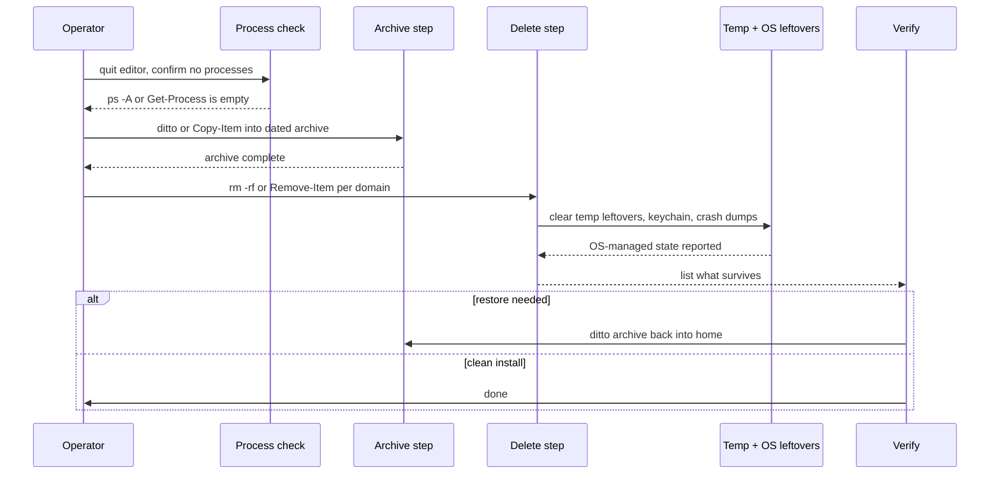

<table>
	<tr>
		<td align="left" valign="middle"><h3 align="left">Cleanup Recipes 🧼</h3></td>
		<td align="left" valign="middle"><h3 align="left"> + </h3></td>
		<td align="left" valign="middle"><h3 align="left"><a href="https://editor.land" target="_blank">Land 🏞️</a></h3></td>
	</tr>
</table>

---

# **Cleanup Recipes** 🧼

Per-OS commands to wipe every piece of `Land` / `FIDDEE` state from a system, plus the archive pattern used in production cleanups.

[Back to Filesystem Footprint index](https://github.com/CodeEditorLand/Land/tree/Current/Documentation/GitHub/FilesystemFootprint.md)

---

## Safety Preamble ⚠️

Read before running anything below:

1. **Quit the editor first.** Active file handles can defeat `rm -rf` on Linux / macOS and outright fail on Windows. Check with `ps -A | grep -iE "Mountain|Cocoon"` (POSIX) or `Get-Process Mountain,Cocoon` (PowerShell).
2. **Archive before deleting.** `~/.fiddee/extensions/` can be several GB of user-installed extensions. Lose it once, lose hours of reinstall time.
3. **Cleanup targets one bundle profile by default.** Each `Maintain` build profile produces its own per-bundle tree. Adapt the glob if you need to keep one profile while wiping another.
4. **Foreign-tool dirs.** `~/.claude/agents/` and `~/.copilot/agents/` are pre-created by `Land` but belong to third-party tools. Delete only if you are also uninstalling those tools, or you can confirm `Land` was the sole creator.

---

## Cleanup Lifecycle 🔄

The recipe order is identical on all three operating systems. Only the path roots differ.



Lifecycle steps:

1. Quit the editor. Confirm no `Mountain` or `Cocoon` process remains.
2. Archive the product dotfile and per-bundle trees. Keep a dated copy off the volume being cleaned.
3. Delete the product dotfile, workbench userdata, workbench caches, webview storage, and OS-managed defaults.
4. Clear temp-dir leftovers and, where needed, OS keychain entries and crash dumps.
5. Verify the survivors listed in [What This Removes vs Preserves](#what-this-removes-vs-preserves).
6. Restore from the archive only when a reinstall needs the old state back.

---

## macOS - Complete Wipe 🍎

Tested against the 2026-05-26 cleanup. Archive-then-delete pattern.

```bash
ARCH=/Volumes/ < external-disk > /Archive/ApplicationSupport/$(date +%Y-%m-%d)-fresh
mkdir -p "$ARCH"/Library/{Application\ Support,Caches,Preferences,Logs,WebKit,Saved\ Application\ State,HTTPStorages} \
	"$ARCH"/Home

# ---------- Archive ----------
for d in "$HOME/Library/Application Support/"land.playform*; do
	[ -d "$d" ] && ditto "$d" "$ARCH/Library/Application Support/$(basename "$d")"
done
for d in "$HOME/Library/Caches/"land.playform*; do
	[ -d "$d" ] && ditto "$d" "$ARCH/Library/Caches/$(basename "$d")"
done
for d in "$HOME/Library/Logs/"land.playform*; do
	[ -d "$d" ] && ditto "$d" "$ARCH/Library/Logs/$(basename "$d")"
done
for d in "$HOME/Library/WebKit/"land.playform* "$HOME/Library/WebKit/vanilla.editor.land"; do
	[ -d "$d" ] && ditto "$d" "$ARCH/Library/WebKit/$(basename "$d")"
done
for d in "$HOME/Library/HTTPStorages/"land.playform*; do
	[ -d "$d" ] && ditto "$d" "$ARCH/Library/HTTPStorages/$(basename "$d")"
done
for d in "$HOME/Library/Saved Application State/"land.playform*; do
	[ -d "$d" ] && ditto "$d" "$ARCH/Library/Saved Application State/$(basename "$d")"
done
for f in "$HOME/Library/Preferences/"land.playform*.plist; do
	[ -f "$f" ] && cp -p "$f" "$ARCH/Library/Preferences/$(basename "$f")"
done
[ -d "$HOME/.fiddee" ] && ditto "$HOME/.fiddee" "$ARCH/Home/.fiddee"
[ -d "$HOME/.land" ] && ditto "$HOME/.land" "$ARCH/Home/.land"

# ---------- Delete ----------
rm -rf "$HOME/Library/Application Support/"land.playform*
rm -rf "$HOME/Library/Caches/"land.playform*
rm -rf "$HOME/Library/Logs/"land.playform*
rm -rf "$HOME/Library/WebKit/"land.playform* "$HOME/Library/WebKit/vanilla.editor.land"
rm -rf "$HOME/Library/HTTPStorages/"land.playform* 2> /dev/null
rm -rf "$HOME/Library/Saved Application State/"land.playform* 2> /dev/null
rm -f "$HOME/Library/Preferences/"land.playform*.plist
rm -rf "$HOME/Library/Application Support/Land" # legacy hard-coded fallback (rarely populated)
rm -rf "$HOME/.fiddee"
rm -rf "$HOME/.land"

# Temp-dir leftovers (best-effort; macOS sweeps weekly anyway)
rm -rf /var/folders/*/T/land-zsh-integration-* 2> /dev/null
rm -rf /var/folders/*/T/land-editor-logs 2> /dev/null
rm -f /var/folders/*/T/vine_fallback.proto 2> /dev/null

# Foreign-tool dirs (DELETE ONLY IF LAND WAS SOLE CREATOR)
# rmdir "$HOME/.claude/agents" "$HOME/.copilot/agents" 2>/dev/null

# In-tree developer artefacts
cd /path/to/Land && find Element -maxdepth 2 -name Target -prune -exec rm -rf {} + 2> /dev/null
```

What survives this recipe, intentionally:

- `Air` daemon state under `~/Library/Application Support/FIDDEE/` (uppercase, a different root from `Mountain`'s). Add `rm -rf "$HOME/Library/Application Support/FIDDEE"` if you want to clear it too.
- `~/Library/Logs/DiagnosticReports/<bundle>*.crash` - system-managed crash reports. macOS prunes after 30 days.
- `~/Library/Application Support/com.apple.AssistiveControl.editor.plist` - an Apple system file matched by `*editor*` globs, not `Land` state.

---

## Linux - Complete Wipe 🐧

XDG-aware. Adapts `$XDG_*` overrides correctly.

```bash
ARCH="/mnt/<external-disk>/Archive/ApplicationSupport/$(date +%Y-%m-%d)-fresh"
mkdir -p "$ARCH"/{Config,Data,Cache,Home}

XDG_CONFIG="${XDG_CONFIG_HOME:-$HOME/.config}"
XDG_DATA="${XDG_DATA_HOME:-$HOME/.local/share}"
XDG_CACHE="${XDG_CACHE_HOME:-$HOME/.cache}"

# ---------- Archive ----------
for d in "$XDG_CONFIG"/land.playform* "$XDG_DATA"/land.playform* "$XDG_CACHE"/land.playform*; do
	[ -d "$d" ] || continue
	target="$ARCH/$(basename "$(dirname "$d")")/$(basename "$d")"
	mkdir -p "$(dirname "$target")"
	cp -a "$d" "$target"
done
[ -d "$HOME/.fiddee" ] && cp -a "$HOME/.fiddee" "$ARCH/Home/.fiddee"
[ -d "$HOME/.land" ] && cp -a "$HOME/.land" "$ARCH/Home/.land"

# ---------- Delete ----------
rm -rf "$XDG_CONFIG"/land.playform*
rm -rf "$XDG_DATA"/land.playform*
rm -rf "$XDG_CACHE"/land.playform*
rm -rf "$HOME/.fiddee"
rm -rf "$HOME/.land"

# Temp-dir leftovers
rm -rf /tmp/land-zsh-integration-* 2> /dev/null
rm -rf /tmp/land-editor-logs 2> /dev/null
rm -f /tmp/vine_fallback.proto 2> /dev/null
# Honour TMPDIR if set
[ -n "$TMPDIR" ] && rm -rf "$TMPDIR/land-zsh-integration-*" "$TMPDIR/land-editor-logs" 2> /dev/null

# Foreign-tool dirs (DELETE ONLY IF LAND WAS SOLE CREATOR)
# rmdir "$HOME/.claude/agents" "$HOME/.copilot/agents" 2>/dev/null

# In-tree developer artefacts
cd /path/to/Land && find Element -maxdepth 2 -name Target -prune -exec rm -rf {} + 2> /dev/null
```

What survives this recipe, intentionally:

- `Air` daemon state under `$XDG_CONFIG_HOME/FIDDEE/` and `$XDG_DATA_HOME/FIDDEE/`. Add explicit removal if needed.
- systemd-coredump entries under `/var/lib/systemd/coredump/`.
- WebKitGTK storage on some distros may live under `$XDG_DATA_HOME/<bundle>/` (already covered). Rare distros split it. Verify with `find $XDG_DATA_HOME -maxdepth 2 -iname "*land*"` if you suspect drift.

---

## Windows - Complete Wipe (PowerShell) 🪟

Status: pending at the time of writing. The layout per `dirs` crate resolution is documented here. Expect minor drift in path leaf names until the Windows target ships.

```powershell
$ArchRoot = "D:\Archive\ApplicationSupport\$(Get-Date -Format 'yyyy-MM-dd')-fresh"
New-Item -ItemType Directory -Force "$ArchRoot\AppData\Roaming","$ArchRoot\AppData\Local","$ArchRoot\Home" | Out-Null

$Roaming = "$env:APPDATA"
$Local   = "$env:LOCALAPPDATA"
$Home    = "$env:USERPROFILE"
$Temp    = "$env:TEMP"

# ---------- Archive ----------
Get-ChildItem -Path "$Roaming" -Filter "land.playform*" -Directory -ErrorAction SilentlyContinue | ForEach-Object {
	Copy-Item -Recurse -Force $_.FullName "$ArchRoot\AppData\Roaming\$($_.Name)"
}
Get-ChildItem -Path "$Local" -Filter "land.playform*" -Directory -ErrorAction SilentlyContinue | ForEach-Object {
	Copy-Item -Recurse -Force $_.FullName "$ArchRoot\AppData\Local\$($_.Name)"
}
if (Test-Path "$Home\.fiddee") { Copy-Item -Recurse -Force "$Home\.fiddee" "$ArchRoot\Home\.fiddee" }
if (Test-Path "$Home\.land")   { Copy-Item -Recurse -Force "$Home\.land"   "$ArchRoot\Home\.land" }

# ---------- Delete ----------
Get-ChildItem -Path "$Roaming" -Filter "land.editor*" -Directory -ErrorAction SilentlyContinue |
	Remove-Item -Recurse -Force
Get-ChildItem -Path "$Local" -Filter "land.editor*" -Directory -ErrorAction SilentlyContinue |
	Remove-Item -Recurse -Force
Remove-Item -Recurse -Force "$Home\.fiddee" -ErrorAction SilentlyContinue
Remove-Item -Recurse -Force "$Home\.land"   -ErrorAction SilentlyContinue

# Temp-dir leftovers
Get-ChildItem -Path "$Temp" -Filter "land-zsh-integration-*" -Directory -ErrorAction SilentlyContinue |
	Remove-Item -Recurse -Force
Remove-Item -Recurse -Force "$Temp\land-editor-logs"   -ErrorAction SilentlyContinue
Remove-Item -Force         "$Temp\vine_fallback.proto" -ErrorAction SilentlyContinue

# Registry traces (if any). HKCU\Software\<bundle> is the Tauri default.
# Remove-Item -Path "HKCU:\Software\land.editor*" -Recurse -Force -ErrorAction SilentlyContinue

# Crash dumps
Remove-Item -Force "$Local\CrashDumps\land.editor*.dmp" -ErrorAction SilentlyContinue
```

What survives this recipe, intentionally:

- `Air` daemon state under `%APPDATA%\FIDDEE\` and `%LOCALAPPDATA%\FIDDEE\`.
- WebView2 cache may have `%LOCALAPPDATA%\<bundle>\EBWebView\` subtrees. Those match the `land.editor*` glob and get removed correctly. Verify the registry key cleanup if the install was via the official MSI.

---

## What This Removes vs Preserves 📊

Cross-OS summary of what a complete cleanup touches.

| Domain | What `rm -rf` clears | What survives intentionally |
| ------ | -------------------- | -------------------------- |
| Product dotfile | `~/.fiddee/` (extensions, storage, recents) | - |
| Workbench userdata | `<app_data_dir>/<bundle>/` (machine-id, settings, profiles) | - |
| Workbench caches | `<app_cache_dir>/<bundle>/` | - |
| Webview storage | `<webview-storage>/<bundle>/` | OS may retain encrypted credential store entries (keychain / Credential Manager / secret-service) |
| OS-managed defaults | `~/Library/Preferences/<bundle>.plist` and equivalents | - |
| Saved app state | `Saved Application State/<bundle>.savedState/` | - |
| Crash reports | `Land` does not write these directly | OS-managed retention applies (macOS: 30 days; Linux: distro-dependent; Windows: per WER policy) |
| `Air` daemon | NOT touched by the recipes above | `<config_dir>/FIDDEE/`, `<data_local_dir>/FIDDEE/` - add explicit removal if needed |
| Foreign-tool dirs | NOT touched by default | `~/.claude/agents/`, `~/.copilot/agents/` - delete only if `Land` was sole creator |
| Legacy `~/.land/extensions/` | yes (recipe targets this) | - |
| In-tree build artefacts | `Element/*/Target/` (developer machines only) | Source tree itself |

---

## OS Keychain / Credential Store 🔐

[`Element/Mountain/Source/Environment/SecretProvider.rs`](https://github.com/CodeEditorLand/Mountain/tree/Current/Source/Environment/SecretProvider.rs) writes through the `keyring` crate. That crate delegates to the OS backends below.

| OS | Backend | Survives `rm -rf`? |
| -- | ------- | ------------------ |
| macOS | Keychain (`security` framework) | yes |
| Linux | Secret Service (`gnome-keyring` / `kwallet`) | yes |
| Windows | Credential Manager | yes |

`Land` does not enumerate the keychain entries it creates. Removal requires one of:

- `security delete-generic-password -s "<service>"` per entry (macOS).
- `secret-tool clear <attributes>` per entry (Linux).
- `cmdkey /delete:<target>` per entry (Windows).

A self-uninstall command (see [section F of `Encapsulation.md`](https://github.com/CodeEditorLand/Land/tree/Current/Documentation/GitHub/FilesystemFootprint/Encapsulation.md)) would enumerate and clear these.

---

## Archive Pattern (Production-Validated) 📦

The 2026-05-26 cleanup ran the macOS recipe above against an active developer workstation.

- Archive total: 4.5 GB.
- Library subtrees: roughly 780 MB.
- `~/.fiddee/`: 1.1 GB.
- `~/.land/`: 2.6 GB.
- Wall-clock time: roughly two minutes across volumes, from internal APFS to external HFS+.

The archive directory structure:

```text
$ARCH/
+-- Library/
|   +-- Application Support/
|   |   +-- land.editor.binary.<profile>.mountain/
|   +-- Caches/
|   |   +-- land.editor.binary.<profile>.mountain/
|   +-- Preferences/
|   |   +-- land.editor.binary.<profile>.mountain.plist
|   +-- Logs/
|   |   +-- land.editor.binary.<profile>.mountain/
|   +-- WebKit/
|       +-- land.editor.binary.<profile>.mountain/
+-- Home/
    +-- .fiddee/
    |   +-- extensions/
    |   +-- extensionStorage/
    |   +-- globalStorage/
    |   +-- logs/
    |   +-- workspaces/
    +-- .land/
        +-- extensions/
```

Restoration, if needed:

```bash
ditto "$ARCH/Library/Application Support/<bundle>" \
	"$HOME/Library/Application Support/<bundle>"
ditto "$ARCH/Home/.fiddee" "$HOME/.fiddee"
ditto "$ARCH/Home/.land" "$HOME/.land"
```

---

## Developer: Clear Pre-Baked Extension Manifest 🗂️

`PreBake.ts` writes `Element/Mountain/Target/<profile>/extensions.manifest.json` at bundle time. It accelerates boot-time extension scanning from roughly 1200 ms to under 50 ms. Clear it to force a live re-scan on next boot:

```sh
# Clear pre-baked extension manifest (forces full extension re-scan on next boot)
find Element/Mountain/Target -name "extensions.manifest.json" -delete 2> /dev/null
```

This is an in-tree developer artefact. It is never written inside the installed `.app` bundle. Normal user cleanup does not require this step.

---

## Related Documentation 📚

- [`UserDotfile.md`](https://github.com/CodeEditorLand/Land/tree/Current/Documentation/GitHub/FilesystemFootprint/UserDotfile.md) - what is inside `~/.fiddee/`.
- [`PlatformPaths.md`](https://github.com/CodeEditorLand/Land/tree/Current/Documentation/GitHub/FilesystemFootprint/PlatformPaths.md) - what is inside each per-OS path.
- [`PerElement.md`](https://github.com/CodeEditorLand/Land/tree/Current/Documentation/GitHub/FilesystemFootprint/PerElement.md) - who wrote it.
- [`Encapsulation.md`](https://github.com/CodeEditorLand/Land/tree/Current/Documentation/GitHub/FilesystemFootprint/Encapsulation.md) - the self-uninstall direction (section F).
- [`FilesystemFootprint.md`](https://github.com/CodeEditorLand/Land/tree/Current/Documentation/GitHub/FilesystemFootprint.md) - the ownership-domain index.

---

**Project Maintainers:** Source Open
([Source/Open@Editor.Land](mailto:Source/Open@Editor.Land)) |
[GitHub Repository](https://github.com/CodeEditorLand/Land) |
[Report an Issue](https://github.com/CodeEditorLand/Land/issues)
