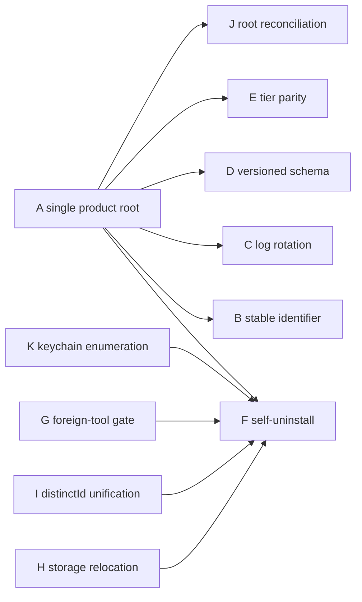

<table>
	<tr>
		<td align="left" valign="middle"><h3 align="left">Encapsulation Directions 🚧</h3></td>
		<td align="left" valign="middle"><h3 align="left"> + </h3></td>
		<td align="left" valign="middle"><h3 align="left"><a href="https://editor.land" target="_blank">Land 🏞️</a></h3></td>
	</tr>
</table>

---

# **Encapsulation Directions** 🚧

Potential refactors that would shrink `Land`'s filesystem footprint, simplify cleanup, or unblock versioning.

- Each option is feasible because both `Land` and the bundled VS Code dependency are ours to modify.
- None are decided plans.
- All should be costed against [`PerElement.md`](https://github.com/CodeEditorLand/Land/tree/Current/Documentation/GitHub/FilesystemFootprint/PerElement.md) and [`PlatformPaths.md`](https://github.com/CodeEditorLand/Land/tree/Current/Documentation/GitHub/FilesystemFootprint/PlatformPaths.md) before implementation.

[Back to Filesystem Footprint index](https://github.com/CodeEditorLand/Land/tree/Current/Documentation/GitHub/FilesystemFootprint.md)

---

## At-a-Glance Roadmap 🗺️

| ID | Direction | Effort | Impact | Risk |
| -- | --------- | ------ | ------ | ---- |
| A | Single product root (`~/.fiddee/<profile>/`) | L | One-line uninstall | `Tauri` / `WKWebView` sandboxing |
| B | Stable short bundle identifier | M | Eliminates per-profile path explosion | Existing-install migration |
| C | Log rotation + retention | S | Bounds disk growth from `Trace=` | Low |
| D | Versioned userdata schema | M | Safe forward / backward migrations | Low |
| E | Tier parity for every location | S | Portable / sandboxed installs | Low |
| F | Self-uninstall command | S | One-step user-facing cleanup | Low |
| G | Foreign-tool probe tier-gate | S | Stops creating `.claude/agents`, `.copilot/agents` | Low |
| H | `Cocoon` `.storage` move out-of-bundle | S | Storage survives extension reinstall | Low (in-host migration needed) |
| I | PostHog distinctId unification | S | One analytics identity per install | Low |
| J | FIDDEE root reconciliation (`Air` vs `Mountain`) | M | One product root across daemon + editor | `Air` daemon migration |
| K | OS keychain enumeration | M | Cleanup recipes can clear secrets too | Per-OS API surface |

Effort legend:

- `S` means at most one day.
- `M` means one to five days.
- `L` means one to two weeks.

---

## A. Single Product Root (`~/.fiddee/<profile>/`) 🏞️

**Move every per-bundle path under `~/.fiddee/<profile>/`.** Replace `Tauri`'s `app_data_dir()`, `app_cache_dir()`, and `app_log_dir()` calls with an internal resolver. That resolver returns:

- `~/.fiddee/<profile>/data/`
- `~/.fiddee/<profile>/cache/`
- `~/.fiddee/<profile>/logs/`

`Cocoon` storage paths fold in naturally as `~/.fiddee/<profile>/extensionStorage/` and similar leaves.

- Webview-managed paths such as `Library/WebKit/<bundle>/` and equivalents stay where the OS puts them. `Land` cannot rename those.
- Everything else is ours.

**Win:** Uninstall becomes `rm -rf ~/.fiddee` plus a documented short list of OS-managed cleanups.

**Risk:** `Tauri`'s webview bridge expects `app_data_dir` to be the OS-blessed location for some sandboxing-related operations. An experiment must confirm that `WKWebView` still gets its keychain-equivalents when the userdata moves.

**Touches:**

- `Element/Mountain/Source/Binary/Main/AppLifecycle.rs` (userdata seeder).
- `Element/Mountain/Source/IPC/WindServiceHandlers/Utilities/UserdataDir/*`.
- `Element/Mountain/Source/IPC/DevLog/AppDataPrefix.rs` (path discoverer).
- `Element/Mountain/Source/ProcessManagement/InitializationData.rs` (machine-id resolver).

---

## B. Stable Short Bundle Identifier 🆔

Stop encoding the build matrix into the `Tauri` `identifier`. Use a single identifier such as `cloud.fiddee.editor`. Represent the profile as a subdirectory or env var. Per-profile separation is preserved via `~/.fiddee/<profile>/` from option A, rather than via separate Library trees.

**Win:**

- Today the bundle identifier is 130 characters.
- Profile churn from rebuilds and variant switches accumulates per-profile Library trees that must be enumerated for cleanup.
- A single identifier collapses that.

**Risk:** Existing-install migration is a one-shot `Maintain` script. It walks all `land.editor.*mountain*` paths and moves contents into the new layout. Workbench userdata needs careful handling so settings do not reset.

**Touches:**

- `Element/Mountain/tauri.conf.json` (per-profile template).
- `Element/Maintain/Source/Build/*` (identifier composer).
- A one-shot migration tool in `Maintain/Migration/`.

---

## C. Log Rotation and Retention 🪵

A single `~/.fiddee/<profile>/logs/<ts>/` tree from option A opens the door to:

- Boot-time pruning of sessions older than `LogRetention=<days>`.
- Size-bounded ring buffers via the existing `IPC/DevLog/AppDataPrefix.rs` infrastructure.
- Per-tag retention overrides, such as keeping `breaker` and `lifecycle` longer than `ipc-verbose`.

Today `Record=1` plus `Trace=all` debug sessions leave behind roughly 200 MB per run forever. The fix is mechanical once the log root is single-source.

**Touches:**

- `Element/Mountain/Source/IPC/DevLog/*`.
- One new boot hook to prune on start.
- New env vars - `LogRetention`, `LogMaxSize`, `LogPruneOnBoot` - with registry entries in [`EnvironmentVariables.md`](https://github.com/CodeEditorLand/Land/tree/Current/Documentation/GitHub/EnvironmentVariables.md).

---

## D. Versioned Userdata Schema 🔢

Stamp `~/.fiddee/<profile>/data/.schema-version`. In the pre-A layout the marker is `<app_data_dir>/<bundle>/User/.schema-version`.

- Boot-time migrations move data forward.
- Backward-incompatible changes write to `User-vN+1/` and leave the older snapshot for rollback.
- Today the userdata directory has no version marker.
- Future format changes such as the `mcp.json` shape or settings categorisation have no recourse but in-place rewrite.

**Per-document version fields** complement this. Every JSON the editor writes should grow a top-level `_v` key. That is cheap to add today, by writing the key and ignoring it on read for now. It is expensive to retrofit later.

**Touches:**

- `Element/Mountain/Source/Binary/Main/AppLifecycle.rs` (boot-time migration step).
- New crate `Element/Mountain/Source/Migration/` for schema migrations.
- Optional `RetainPreviousSchemaVersions=<N>` env var to bound rollback snapshot retention.

---

## E. Tier Parity for Every Location 🎚️

`Lodge` and `Extend` let operators redirect the extension paths. Today `<app_data_dir>`, `<app_log_dir>`, and `<app_cache_dir>` cannot be redirected without `Tauri`-level config changes.

Add equivalent overrides for every location:

| Existing | Proposed | Role |
| -------- | -------- | ---- |
| `Lodge` | already done | Extensions root |
| - | `Lair` | Workbench userdata root |
| - | `Hive` | Logs root |
| - | `Cache` | Cache root |
| - | `Storage` | Per-extension storage root |

Pair each with a registry entry in [`EnvironmentVariables.md`](https://github.com/CodeEditorLand/Land/tree/Current/Documentation/GitHub/EnvironmentVariables.md). This is useful for **portable installs** such as a USB-stick FIDDEE, and for CI runners that should not accumulate state.

---

## F. Self-Uninstall Command 🧼

`fiddee --uninstall`, or a menu item, walks the [`PerElement.md`](https://github.com/CodeEditorLand/Land/tree/Current/Documentation/GitHub/FilesystemFootprint/PerElement.md) tables and removes every path it owns. It optionally archives to `~/.fiddee-archive-<ts>/` first. This matches the procedure in [`Cleanup.md`](https://github.com/CodeEditorLand/Land/tree/Current/Documentation/GitHub/FilesystemFootprint/Cleanup.md) done by hand.

**Bonus:** integrate with option K, so the uninstall also clears OS-keychain entries.

**Touches:**

- New CLI flag handler in `Element/Mountain/Source/Binary/Initialize/CliParse.rs`.
- Path enumeration via the centralised resolvers: FiddeeRoot, UserdataDir, and `PathResolver`.
- Optional UI surface in the workbench (`File`, then `Uninstall...`).

---

## G. Foreign-Tool Probe Tier-Gate 🌐

`TierForeignToolProbe=Off` would stop `AppLifecycle::Dirs` from pre-creating `~/.claude/agents` and `~/.copilot/agents`. Workbench-side, make the missing-dir probe failure-tolerant so the create-on-startup step is no longer needed.

Default tier value: `On`, for backwards-compatible boot behaviour.

**Touches:**

- `Element/Mountain/Source/Binary/Main/AppLifecycle.rs`.
- `Element/Mountain/build.rs` tier registry.
- `Element/Mountain/Source/LandFixTier.rs` runtime banner.
- VS Code Dependency: relax the `stat` probe in `extensions/agent/`, or whichever path triggers the original error.

---

## H. `Cocoon` `.storage` Move Out-of-Bundle 📦

The current `~/.fiddee/extensions/<id>/.storage/` location ties per-extension storage to the extension's own directory. Reinstalls or version bumps destroy it.

**Proposed:** move to `~/.fiddee/extensionData/<id>/.storage/`, parallel to the existing `extensionStorage` sibling. Storage then survives extension lifecycle events.

**Migration:** one-shot scan on boot. For every `~/.fiddee/extensions/<id>/.storage/`, move to the new location if the target does not already exist.

**Touches:**

- `Element/Cocoon/Source/Services/Extension/Context.ts`.
- New boot-time migration in `Cocoon`.

---

## I. PostHog distinctId Unification 🆔

Read `<app_data_dir>/<bundle>/machine-id.txt` and use it as the PostHog distinctId, so analytics see one identity per install. This avoids the divergence that today exists between:

- `Mountain`'s `machineId` - a server-issued UUID, durable on disk.
- `Sky`'s distinctId - `Sky`-issued, living in webview localStorage.

**Touches:**

- `Element/Sky/Source/Workbench/Electron/Post/Hog/Bridge.ts` (currently generates and stores a fresh distinctId in localStorage).
- Add a `MountainIPCInvoke({method: "system:machineId"})` call that returns `machine-id.txt` content. Cache in localStorage so the round-trip happens once.

---

## J. FIDDEE Root Reconciliation (`Air` vs `Mountain`) 🫱

`Mountain` owns `~/.fiddee/` (lowercase dotfile). The `Air` background daemon writes to `<config_dir>/FIDDEE/` (uppercase, under the OS config root, for example `~/Library/Application Support/FIDDEE/` on macOS).

Two products, two roots. Cleanup recipes that target `~/.fiddee/` miss `Air`'s state and vice versa.

**Proposed:**

- `Air` migrates to `~/.fiddee/air/` or `~/.fiddee/daemon/` so both processes share one root.
- Alternatively, if `Air` needs the OS config dir specifically, such as for a system-service installation, `Mountain` also writes a pointer file under `<config_dir>/FIDDEE/` so cleanup tools find both roots from either entry point.

**Touches:**

- `Element/Air/Source/Updates/UpdateManager.rs` (configured paths).
- `Element/Air/Source/Authentication/CredentialsStore.rs` (credentials store path).
- `Element/Air/Source/Downloader/DownloadManager.rs` (cache directory).
- `Air`'s configuration file format - new schema version, which is option D's territory.

---

## K. OS Keychain Enumeration 🔐

[`Element/Mountain/Source/Environment/SecretProvider.rs`](https://github.com/CodeEditorLand/Mountain/tree/Current/Source/Environment/SecretProvider.rs) writes through the `keyring` crate, but `Land` does not enumerate the entries it creates. A complete uninstall requires either user-side commands or per-OS API enumeration:

- `security delete-generic-password` (macOS).
- `secret-tool clear` (Linux).
- `cmdkey /delete` (Windows).

**Proposed:**

- Maintain a per-extension keychain-service-name registry in `~/.fiddee/<profile>/data/secrets-index.json`, subject to option D's versioning.
- `fiddee --uninstall` from option F walks the index and removes each entry via the platform keyring API.

**Touches:**

- `Element/Mountain/Source/Environment/SecretProvider.rs` (record service name on every write).
- Option F, the self-uninstall implementation.

---

## Sequencing Suggestion 📐

If we tackle these, the natural order is:

1. **C** - log rotation, cheap and independent.
2. **G** - foreign-tool probe tier-gate, cheap and independent.
3. **I** - distinctId unification, cheap and independent.
4. **A** - single product root, which unlocks B, C, D, and E.
5. **B** - stable bundle identifier, which depends on A's migration tooling.
6. **D** - versioned userdata schema, which depends on A for the canonical path.
7. **E** - tier parity for every location, which depends on A.
8. **F** - self-uninstall, which depends on A and ideally K.
9. **J** - `Air` / `Mountain` root reconciliation, which depends on A for the target shape.
10. **K** - keychain enumeration, which can ship with F.
11. **H** - `Cocoon` `.storage` move, which can happen any time and is trivially additive.

---

## Versioning Sketch 🔢

Once option A lands, the versioning story becomes straightforward:

1. **`.schema-version` markers** at the root of each owned tree: `~/.fiddee/.schema-version`, `~/.fiddee/<profile>/data/.schema-version`, and `~/.fiddee/<profile>/.machine-id-version`. Version-aware migrations run at boot when the marker is missing or stale.
2. **Per-document version fields** on every JSON file `Land` writes: `settings.json`, `keybindings.json`, `tasks.json`, `mcp.json`, `RecentlyOpened.json`, and every memento file. Add a top-level `_v` key. Cheap to add today, expensive to retrofit later.
3. **Forward-compat shape rules:** anything `Land` adds to a JSON document is optional with a sane default. Anything removed goes through a migration step.
4. **Rollback snapshots** stored under a versioned path such as `User-v3/` or `User-v4/`, so a downgrade is plausible. Bounded by the `RetainPreviousSchemaVersions=<N>` env var.

The combination of A, the single product root, and D, schema versions, makes the versioning story straightforward. Without A, versioning has to be replicated across all four ownership domains.

---

## Related Documentation 📚

- [`UserDotfile.md`](https://github.com/CodeEditorLand/Land/tree/Current/Documentation/GitHub/FilesystemFootprint/UserDotfile.md) - the `~/.fiddee/` tree, which is option A's target shape.
- [`PerElement.md`](https://github.com/CodeEditorLand/Land/tree/Current/Documentation/GitHub/FilesystemFootprint/PerElement.md) - per-Element write-site inventory.
- [`Cleanup.md`](https://github.com/CodeEditorLand/Land/tree/Current/Documentation/GitHub/FilesystemFootprint/Cleanup.md) - the manual recipe option F would automate.
- [`EnvironmentVariables.md`](https://github.com/CodeEditorLand/Land/tree/Current/Documentation/GitHub/EnvironmentVariables.md) - where new env var registries land.
- [`FilesystemFootprint.md`](https://github.com/CodeEditorLand/Land/tree/Current/Documentation/GitHub/FilesystemFootprint.md) - the ownership-domain index.

---

**Project Maintainers:** Source Open
([Source/Open@Editor.Land](mailto:Source/Open@Editor.Land)) |
[GitHub Repository](https://github.com/CodeEditorLand/Land) |
[Report an Issue](https://github.com/CodeEditorLand/Land/issues)
