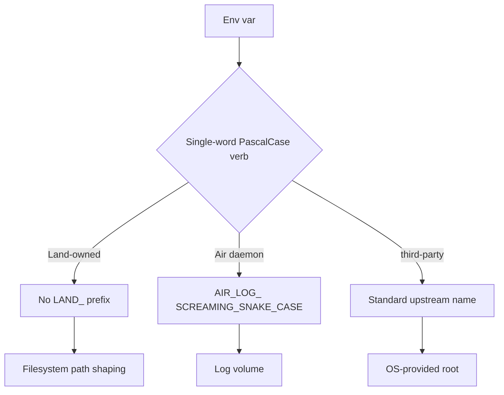

<table>
	<tr>
		<td align="left" valign="middle"><h3 align="left">Environment Variables 🎛️</h3></td>
		<td align="left" valign="middle"><h3 align="left"> + </h3></td>
		<td align="left" valign="middle"><h3 align="left"><a href="https://editor.land" target="_blank">Land 🏞️</a></h3></td>
	</tr>
</table>

---

# **Environment Variables** 🎛️

Every env var that shapes a filesystem path, controls log volume, or affects the bundle identifier, grouped by role. This cross-references the canonical [`EnvironmentVariables.md`](https://github.com/CodeEditorLand/Land/tree/Current/Documentation/GitHub/EnvironmentVariables.md) registry and lives here in filesystem-footprint terms.

[Back to Filesystem Footprint index](https://github.com/CodeEditorLand/Land/tree/Current/Documentation/GitHub/FilesystemFootprint.md)

---

## Naming Convention 📐

Per [`EnvironmentVariables.md`](https://github.com/CodeEditorLand/Land/tree/Current/Documentation/GitHub/EnvironmentVariables.md):

- **Single-word PascalCase verbs**, such as `Lodge`, `Extend`, `Record`, `Trace`, `Browser`, and `Electron`.
- **No `LAND_` prefix.** Names describe what the variable does, not where it comes from.
- **External-daemon vars** from `Air` keep their conventional `AIR_LOG_*` SCREAMING_SNAKE_CASE prefix. The convention permits this because `Air` is an external tool.
- **Third-party / `Tauri` vars** - `NODE_ENV`, `TAURI_ENV_DEBUG`, `USER`, `USERNAME`, `HOME`, `USERPROFILE`, `ZDOTDIR`, and `XDG_*` - keep their standard names.



---

## Path-Shaping Overrides 🏞️

These redirect where `Land` reads or writes on disk.

| Variable | Effect | Reader | Default |
| -------- | ------ | ------ | ------- |
| `Lodge` | Override the user-extensions root, replacing `~/.fiddee/extensions/`. | `Binary/Extension/ScanPathConfigure.rs:200`, `ExtensionManagement/Scanner.rs::IsUserExtensionScanPath` | unset, falls back to `~/.fiddee/extensions/` |
| `Extend` | Append extra extension scan paths. POSIX uses `:` as separator; Windows uses `;`. | `Binary/Extension/ScanPathConfigure.rs:245` | unset |
| `MountainDir` | Override the `Mountain` Element root for nested builds. | `Maintain/*/Build.sh` | `Element/Mountain` |
| `HOME` / `USERPROFILE` | Fallback when `dirs::home_dir()` returns `None`. Last-resort home resolution. | `FiddeeRoot.rs:27`, `Utilities/UserdataDir.rs:25`, `IPC/DevLog/AppDataPrefix.rs:101` | OS-provided |
| `VSCODE_COCOON_GLOBAL_STORAGE` | Override globalStorage root in `Cocoon`-side extension activation. | `Cocoon/Source/Services/Extension/Context.ts:491` | `${FiddeeRoot()}/globalStorage` |
| `ZDOTDIR` | Overridden per integrated-terminal launch with the temp dir from `ShellIntegration.rs`. Original preserved in `LAND_ORIG_ZDOTDIR`. | `Environment/Terminal/ShellIntegration.rs` | user-set |
| `LAND_ORIG_ZDOTDIR` | Preserves the user's original `ZDOTDIR` when `Land` overrides it for shell integration. | `Environment/Terminal/ShellIntegration.rs` | set by `Land` at launch |
| `LAND_SHELL_INTEGRATION_ACTIVE` | Marker that the shell-integration shim is loaded. Read by the in-shell script. | `Environment/Terminal/ShellIntegration.rs` | `1` when active |
| `VSCODE_APP_ROOT` | `Mountain` reads this to surface as `vscode.env.appRoot`. | `Grove/Source/API/VSCode.rs:738` | set by `Mountain` at boot |
| `XDG_*` family | Linux-specific path roots respected by the `dirs` crate: `XDG_CONFIG_HOME`, `XDG_DATA_HOME`, and `XDG_CACHE_HOME`. | `dirs` crate | freedesktop.org defaults |
| `APPDATA` / `LOCALAPPDATA` | Windows roots resolved by the `dirs` crate. | `dirs` crate | OS-provided |
| `TMPDIR` | macOS / Linux temp-dir override. Resolved by `std::env::temp_dir()`. | `Environment/Terminal/ShellIntegration.rs`, `IPC/DevLog/WriteToFile.rs`, `Cocoon` proto fallback | `/tmp/` on Linux, per-user temp on macOS |

---

## Log Control 🪵

| Variable | Effect | Reader | Default |
| -------- | ------ | ------ | ------- |
| `Record` | Gates whether `IPC/DevLog/WriteToFile.rs` writes to disk at all. Values `1`, `true`, `yes`, and `on` mean enabled. | `IPC/DevLog/*` | unset, off |
| `Trace` | Comma-separated tag filter for dev-log emission. Indirectly controls log volume and therefore log file size. | `IPC/DevLog/*` | unset, meaning all |
| `AIR_LOG_FILE` | Daemon log file path. SCREAMING_SNAKE_CASE because `Air` is an external tool. | `Air/Source/Initialize/Configure/Log/ConfigureLog.rs:126` | unset |
| `AIR_LOG_DIR` | Daemon log directory. | `Air/Source/Initialize/Command/HandleCommand.rs:393` | unset |
| `AIR_LOG_JSON` | Switch daemon log format to JSON. | `Air/Source/Initialize/Configure/Log/ConfigureLog.rs:104` | unset, text |

### Recommended `Trace=` for filesystem-relevant traces 📐

```text
Trace=ipc,grpc,extensions,storage,vfs,lifecycle,breaker,tree-view,mountain-client
```

- Drops roughly 97 percent of `*-verbose` volume.
- Keeps the storage, vfs, and lifecycle events needed to diagnose filesystem issues.
- See section `Trace` of [`EnvironmentVariables.md`](https://github.com/CodeEditorLand/Land/tree/Current/Documentation/GitHub/EnvironmentVariables.md) for the full tag list.

---

## Bundle-Identifier-Shaping Build Env 🆔

These change the `Maintain` bundle identifier, the long `land.editor.binary....mountain` string that is the leaf of every per-bundle path. They are read at **build time only**, not at runtime.

| Variable | Affects bundle identifier? | Reader |
| -------- | -------------------------- | ------ |
| `Browser` | yes, adds `.browser.` | `Output/Source/ESBuild.ts`, `Maintain` bundle-identifier composer |
| `Electron` | yes, adds `.electron.` | `Output/Source/ESBuild.ts` |
| `Clean` | yes, adds `.clean.` | `Output/Source/ESBuild.ts`, `Wind/Source/ESBuild.ts` |
| `Dependency` | yes, adds `.dependency.<name>.` | `Output/Source/ESBuild.ts:9` |
| `Level` | yes, adds `.<level>.` | `Output/Source/ESBuild.ts:11` |
| `Compiler` | yes, adds `.<compiler>.` | `Output/Source/ESBuild/Output.js:5` |
| `Meta` | no, build-only flag | `Wind/Source/ESBuild.ts:5`, `Output/Source/ESBuild.ts:13` |
| `NODE_ENV` | no, build-only flag | `Wind/Source/ESBuild.ts:8`, `Output/Source/ESBuild.ts:16` |
| `TAURI_ENV_DEBUG` | no, build-only flag | `Wind/Source/ESBuild.ts:9`, `Output/Source/ESBuild.ts:17` |

Cleanup recipes that target `*land.editor*` cover every profile naturally. There is no need to enumerate per-variable.

---

## Webview localStorage Growth (PostHog Telemetry) 📈

Build-time env baked into the bundle via `Vite`'s `define`. It affects how much data `Sky` writes into the OS-managed webview storage tree:

- `Library/WebKit/<bundle>/` on macOS.
- `~/.local/share/<bundle>/` on Linux.
- `%LOCALAPPDATA%\<bundle>\EBWebView\` on Windows.

| Variable | Effect on storage growth | Reader |
| -------- | ------------------------ | ------ |
| `Authorize` | API key gates PostHog ingest. Off means no events queued. | `Sky/Workbench/Electron/Post/Hog/Bridge.ts:27` |
| `Beam` | PostHog endpoint host. Off means batches sit in the localStorage queue. | `Sky/Workbench/Electron/Post/Hog/Bridge.ts:30` |
| `Capture` | Master enable / disable. `false` means no events captured. | `Sky/Workbench/Electron/Post/Hog/Bridge.ts:38`, `Output/Source/ESBuild/Output.js:71` |
| `Report` | Send-or-store toggle. `false` means events held in localStorage. | `Sky/Workbench/Electron/Post/Hog/Bridge.ts:42`, `Output/Source/ESBuild/Output.js:72` |
| `Throttle` | Per-second throttle, default `5`. Lower means less localStorage churn. | `Sky/Workbench/Electron/Post/Hog/Bridge.ts:49` |
| `Buffer` | Batch window in ms, default `3000`. Larger means fewer and larger localStorage writes. | `Sky/Workbench/Electron/Post/Hog/Bridge.ts:52` |
| `Batch` | Max events per batch, default `20`. | `Sky/Workbench/Electron/Post/Hog/Bridge.ts:54` |
| `Brand` | PostHog project name string baked into events. | `Sky/Workbench/Electron/Post/Hog/Bridge.ts:57` |
| `Cap` | Max queue depth, default `7`. Caps localStorage usage at roughly 7 batches. | `Sky/Workbench/Electron/Post/Hog/Bridge.ts:230` |
| `Replay` | Session-replay capture toggle. `true` means significantly larger payloads. | `Sky/Workbench/Electron/Post/Hog/Bridge.ts:109` |
| `Ask` | User-feedback request toggle. `true` adds queued requests to localStorage. | `Sky/Workbench/Electron/Post/Hog/Bridge.ts:113` |

---

## Sky Workbench Gates (localStorage / build-time) 🌌

Build-time env via `import.meta.env`, baked into the bundle by `Vite`'s `define`.

- A few of these are also persisted as localStorage keys with the same name.
- The env value is the **default**.
- The localStorage value overrides it.

| Variable | Effect | Reader |
| -------- | ------ | ------ |
| `Disable` | UI-fix toggle. Surfaces both as `import.meta.env.Disable` at build time and as a localStorage key at runtime. | `Workbench/Bundled/Electron/Entry.ts`, `Sky/Bridge.ts`, `Sky/Function/SmokeTest/Auto/Diagnose/Input.ts`, `Workbench/Bundled/Electron/Layout.astro` |
| `Smoke` | Sticky smoke-test gate. Surfaces both as env and localStorage key. | `Sky/Function/SmokeTest/Run/Command/Catalog/Smoke/Test.ts` |
| `Render` | `Sky` workbench render gate. `false` means bootstrap exits before rendering. | `Sky/Workbench/Electron/Bootstrap.ts:34` |

---

## Tier-Gating Build Env 🎚️

Subset of the broader tier system that touches paths. See section Tier of [`EnvironmentVariables.md`](https://github.com/CodeEditorLand/Land/tree/Current/Documentation/GitHub/EnvironmentVariables.md) for the full catalog.

| Variable | Path effect | Default |
| -------- | ----------- | ------- |
| `TierIPC` | `Mountain` / `NodeDeferred` / `Node` routes per-extension storage writes via different bridges. | `Mountain` |
| `TierCommandEventBroadcast` | `On` / `Off` controls whether extension-host-originated `executeCommand` calls dual-emit `$acceptCommandExecuted`. Off-default means less log noise and smaller `WKWebView` storage churn. | `Off` |

---

## Environment Snapshot at Boot 📸

`Element/Mountain/Source/LandFixTier.rs` logs the active tier values at boot. For filesystem debugging, run with the recommended profile:

```bash
export DisableUIFixes=true \
	Trace=ipc,grpc,extensions,storage,vfs,lifecycle,breaker,tree-view,mountain-client \
	Record=1 Disable=false Inspect=1 DebugServer=both
./Maintain/Debug/Build.sh --profile debug-electron-bundled
```

- `Record=1` plus `Trace=...` produces roughly 5 to 50 MB of session logs at `<app_data_dir>/<bundle>/logs/<ts>/Mountain.dev.log`.
- `Trace=all` produces roughly 200 MB.

---

## Related Documentation 📚

- [`EnvironmentVariables.md`](https://github.com/CodeEditorLand/Land/tree/Current/Documentation/GitHub/EnvironmentVariables.md) - canonical registry with full descriptions, tier-gating rules, and multi-file `.env` system docs.
- [`UserDotfile.md`](https://github.com/CodeEditorLand/Land/tree/Current/Documentation/GitHub/FilesystemFootprint/UserDotfile.md) - what `Lodge`, `Extend`, and `VSCODE_COCOON_GLOBAL_STORAGE` shape.
- [`PlatformPaths.md`](https://github.com/CodeEditorLand/Land/tree/Current/Documentation/GitHub/FilesystemFootprint/PlatformPaths.md) - what `XDG_*`, `APPDATA`, `LOCALAPPDATA`, and `TMPDIR` shape per OS.
- [`PerElement.md`](https://github.com/CodeEditorLand/Land/tree/Current/Documentation/GitHub/FilesystemFootprint/PerElement.md) - which Element reads each env var.
- [`FilesystemFootprint.md`](https://github.com/CodeEditorLand/Land/tree/Current/Documentation/GitHub/FilesystemFootprint.md) - the ownership-domain index.

---

**Project Maintainers:** Source Open
([Source/Open@Editor.Land](mailto:Source/Open@Editor.Land)) |
[GitHub Repository](https://github.com/CodeEditorLand/Land) |
[Report an Issue](https://github.com/CodeEditorLand/Land/issues)
