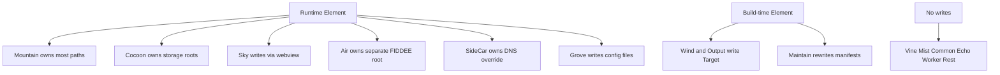

<table>
	<tr>
		<td align="left" valign="middle"><h3 align="left">Per-Element Write Sites ✍🏻</h3></td>
		<td align="left" valign="middle"><h3 align="left"> + </h3></td>
		<td align="left" valign="middle"><h3 align="left"><a href="https://editor.land" target="_blank">Land 🏞️</a></h3></td>
	</tr>
</table>

---

# **Per-Element Write Sites** ✍🏻

Every Element grouped by which filesystem location it touches. This is the reverse map of [`UserDotfile.md`](https://github.com/CodeEditorLand/Land/tree/Current/Documentation/GitHub/FilesystemFootprint/UserDotfile.md) and [`PlatformPaths.md`](https://github.com/CodeEditorLand/Land/tree/Current/Documentation/GitHub/FilesystemFootprint/PlatformPaths.md). Those answer "which Element writes here?". This one answers "where does this Element write?".

[Back to Filesystem Footprint index](https://github.com/CodeEditorLand/Land/tree/Current/Documentation/GitHub/FilesystemFootprint.md)

---

## Per-Element Ownership Matrix 🗺️

| Element | Owns paths? | Writes to disk? | Primary destinations |
| ------- | ----------- | --------------- | -------------------- |
| `Mountain` | yes (most) | yes | `~/.fiddee/*`, `<app_data_dir>/<bundle>/*`, `<temp_dir>/land-*` |
| `Cocoon` | yes, via FiddeeRoot | yes | `~/.fiddee/extensionStorage`, `~/.fiddee/globalStorage`, `~/.fiddee/logs`, `<temp_dir>/vine_fallback.proto` |
| `Sky` | no, writes via webview | no (filesystem) | `WKWebView` localStorage / IndexedDB, managed by OS at `<webview-storage>/<bundle>/` |
| `Wind` | build-time only | no (runtime) | `Target/` output; no runtime writes |
| `Output` | build-time only | no (runtime) | `Target/` output; no runtime writes |
| `Air` | yes, separate root | yes | `<config_dir>/FIDDEE/*`, `<data_local_dir>/FIDDEE/*`, cache / staging / backups, update history JSON |
| `SideCar` | yes, DNS override | yes | `<data_dir>/SideCar/dns_override.txt` (Mist DNS data dir), download cache |
| `Grove` | minimal | yes, configs | `ConfigurationService` writes via `tokio::fs::write`; IPCTransport socket via `temp_dir` |
| `Maintain` | build-time only | no (runtime) | Bash-script edits during build; no runtime writes |
| `Vine` | no | no | Proto files shipped; no runtime writes |
| `Mist` | no | no | DNS / WebSocket; no filesystem writes |
| `Common` | no | no | Abstract crate; no filesystem writes |
| `Echo` | no | no | Scheduler; no filesystem writes |
| `Worker` | no | no | Service Worker; no filesystem writes |
| `Rest` | no | no | OXC bindings; no filesystem writes |

---

## Mountain ⛰️

The largest write-site domain. This `Rust` backend owns:

- The `~/.fiddee/` atom.
- The workbench userdata seeder.
- The session log.
- The memento persistence layer.
- The VSIX extraction pipeline.

| Producer | Writes | Trigger |
| -------- | ------ | ------- |
| `Binary/Main/AppLifecycle.rs::Dirs` | All `<app_data_dir>/<bundle>/User/*` seed dirs, default JSON files, `~/.claude/agents`, `~/.copilot/agents` | First boot plus every subsequent boot, idempotent |
| `IPC/WindServiceHandlers/Utilities/UserdataDir/Ensure.rs` | Same seed set as a fallback, idempotent with `AppLifecycle::Dirs` | First access to `<app_data_dir>` post-boot |
| `ProcessManagement/InitializationData.rs::get_or_generate_machine_id` | `<app_data_dir>/<bundle>/machine-id.txt` as a UUID | First boot only; persisted thereafter |
| `IPC/DevLog/WriteToFile.rs` | `<app_data_dir>/<bundle>/logs/<ts>/Mountain.dev.log`, or `<temp_dir>/land-editor-logs/<ts>/` fallback | Every dev-log emission when `Record=1` |
| `IPC/WindServiceHandlers/Utilities/RecentlyOpened.rs::Mutate` | `~/.fiddee/workspaces/RecentlyOpened.json` | Workspace folder add |
| `ApplicationState/State/WorkspaceState/WorkspaceDelta.rs::PersistRecentlyOpened` | Same `RecentlyOpened.json` | Workspace delta event |
| `ApplicationState/Internal/Persistence/MementoSaver.rs` | `<app_data_dir>/<bundle>/...memento.json`, the global memento | Memento update via `storage:set` IPC |
| `MementoLoader/AttemptMementoRecovery.rs` | `<memento>.json.backup` corruption-recovery sibling | JSON deserialise failure |
| `MementoLoader/CreateCorruptedBackup.rs` | `<memento>.json.corrupted.<YYYYMMDD_HHMMSS>` timestamped corruption snapshot | JSON deserialise failure, parallel side-channel |
| `RunTime/Shutdown/SaveApplicationState.rs` | Final global memento JSON flush | App shutdown |
| `Environment/StorageProvider.rs` | `<app_data_dir>/<bundle>/User/globalStorage/<extId>/state.json` per extension | Extension `Memento.update()` |
| `Environment/ConfigurationProvider/UpdateValue.rs` plus `Loading.rs` | `<app_config_dir>/User/settings.json` | User settings write |
| `Environment/KeybindingProvider.rs` | `<app_config_dir>/User/keybindings.json` | Keybinding edit |
| `Environment/Terminal/ShellIntegration.rs` | `<temp_dir>/land-zsh-integration-<pid>/.zshrc` | Integrated-terminal launch |
| `Environment/WorkspaceProvider.rs` | `<workspace>/<tempfile>` using atomic write-rename | Workspace file save |
| `Environment/FileSystemProvider/WriteOperations.rs` | Arbitrary user-workspace paths, the `Cocoon`-to-`Mountain` `write_file` IPC target | Extension file write |
| `ExtensionManagement/VsixInstaller.rs` | `~/.fiddee/extensions/<id>/...` from VSIX extraction plus `HealExecutableBits` | VSIX install |
| `RPC/CocoonService/FileSystem/*` | Arbitrary user-workspace paths, the gRPC file-system service surface | `Cocoon` gRPC `write_file`, `create_directory`, `rename_file`, or `copy_file` |
| `Maintain/Build/Manifest/PreBake.ts`, build-time not runtime | `Element/Mountain/Target/<profile>/extensions.manifest.json`, the pre-baked extension list | `beforeBundleCommand` in `tauri.conf.json`; accelerates boot-time scan to under 50 ms |

---

## Cocoon 🦋

The `Node.js` extension host. It writes per-extension storage roots under `~/.fiddee/` and a temp proto when the bundled proto resource is missing.

| Producer | Writes | Trigger |
| -------- | ------ | ------- |
| `Services/Handler/Extension/Host/ActivateExtension.ts:51-53` | `~/.fiddee/extensionStorage/<extId>/`, `~/.fiddee/globalStorage/<extId>/`, `~/.fiddee/logs/<extId>/` | Extension activation |
| `Services/Extension/Context.ts:495-496` | `~/.fiddee/extensions/<id>/.storage/` in-bundle, `~/.fiddee/globalStorage/<extId>/` | First call to `context.globalState` or `context.workspaceState` |
| `Services/Mountain/Client/Service.ts:558` | `<temp_dir>/vine_fallback.proto` | gRPC client init when the bundled proto resource is missing |
| `Services/gRPC/Server/Service.ts:1664` | Same `<temp_dir>/vine_fallback.proto`, parallel fallback | gRPC server init when the bundled proto resource is missing |
| `Platform/FiddeeRoot.ts` | Resolver only, no write | `TypeScript` mirror of Rust `FiddeeRoot.rs` |

`Cocoon` never writes to `<app_data_dir>/<bundle>/` directly. All per-bundle writes are proxied through `Mountain` via IPC: `storage:set`, `secrets:set`, and file-system gRPC.

---

## Sky 🌌

`Sky` writes via the OS-native webview storage APIs. The actual filesystem destination is the webview's per-bundle storage tree:

- `~/Library/WebKit/<bundle>/` on macOS.
- `~/.local/share/<bundle>/` on Linux.
- `%LOCALAPPDATA%\<bundle>\EBWebView\` on Windows.

| Producer | localStorage key | Purpose |
| -------- | ---------------- | ------- |
| `Workbench/Bundled/Electron/Entry.ts`, `Sky/Bridge.ts` | `Disable` | UI-fix toggle. Survives reload. |
| `Sky/Function/SmokeTest/Auto/Diagnose/Input.ts` | `Disable` | Smoke-test side reads the same key. |
| `Sky/Function/SmokeTest/Run/Command/Catalog/Smoke/Test.ts` | `Smoke` | Sticky smoke-test gate. |
| `Workbench/Electron/Post/Hog/Bridge.ts` | PostHog distinctId | Per-install PostHog telemetry identifier. Separate from `Mountain`'s `machine-id.txt`. |
| Workbench-internal VS Code `LocalStorageService` | many | Editor state, layout, opened editors, and more. Not enumerable from source without runtime inspection. |

`Sky` does **not** make direct filesystem writes. Every write goes through the webview's storage layer or via `MountainIPCInvoke` IPC to `Mountain`, which then writes the file.

---

## Wind 🍃

Build-time only. Reads `process.env` and `import.meta.env` to compose the `ESBuild` config and PostHog telemetry constants. No runtime filesystem writes.

| Producer | Reads, build-time | Purpose |
| -------- | ----------------- | ------- |
| `Source/ESBuild.ts` | `Clean`, `Meta`, `NODE_ENV`, `TAURI_ENV_DEBUG` | Bundle build configuration. |
| `Source/Telemetry/PostHog/Configuration.ts` | `import.meta.env` plus `process.env` fallback for PostHog config | Telemetry constants baked into the bundle. |
| `Source/Configuration/ESBuild/Config/TargetConfig.ts` | `Authorize`, `Beam`, `Capture`, `Report`, `Brand`, `Buffer`, `Batch`, `Throttle`, `Cap` | `esbuild` `define` keys; substitute literals at build time. |

---

## Output ⚫

Build-time only. Same shape as `Wind`: reads env, no runtime writes.

| Producer | Reads, build-time | Purpose |
| -------- | ----------------- | ------- |
| `Source/ESBuild.ts` | `Browser`, `Electron`, `Clean`, `Dependency`, `Level`, `Meta`, `NODE_ENV`, `TAURI_ENV_DEBUG` | Output bundle build configuration. |
| `Source/ESBuild/Output.js` | `Compiler`, plus the full PostHog set | Compiler dispatch plus PostHog `define` block. |
| `Source/ESBuild/Rest/Plugin.ts` | imports `tmpdir` from `node:os` | Compiler-temp directory at build time, not runtime. |

---

## Air 🪁

Background daemon. **Uses a different filesystem root from `Mountain`:**

- `<config_dir>/FIDDEE/` with uppercase letters.
- `<data_local_dir>/FIDDEE/` with uppercase letters.
- Not `~/.fiddee/` with lowercase letters.

Reconciliation candidate: see [section H of `Encapsulation.md`](https://github.com/CodeEditorLand/Land/tree/Current/Documentation/GitHub/FilesystemFootprint/Encapsulation.md).

| Producer | Writes | Notes |
| -------- | ------ | ----- |
| `Source/Updates/UpdateManager.rs` | `<config_dir>/FIDDEE/`, `~/.config/land/`, `<data_local_dir>/FIDDEE/`, `~/.local/share/land/` | Update backup destinations; multiple candidates probed. |
| `Source/Updates/UpdateManager.rs` | `<cache>/staging/`, `<cache>/backups/` | Staging and rollback directories under the configured cache. |
| `Source/Updates/UpdateManager.rs` | `<updates>/rollback_history.json` | Update history JSON. |
| `Source/Downloader/DownloadManager.rs` | `<cache>/` plus `<destination>.chunks/chunk_NNNN` | Download cache plus per-chunk temp files. |
| `Source/Authentication/CredentialsStore.rs` | `<credentials-store-path>`, resolved at config time | Credentials store, separate from the OS keychain. |
| `Source/Binary/Binary.rs` | Arbitrary `path` argument from caller | Binary copy / install. |
| `Source/Initialize/Configure/Log/ConfigureLog.rs` | `AIR_LOG_FILE` env-controlled destination | Daemon log file. |
| `Source/Initialize/Command/HandleCommand.rs` | `AIR_LOG_DIR` env-controlled destination | Daemon log directory. |

`<config_dir>` and `<data_local_dir>` resolve per OS via `dirs::config_dir()` and `dirs::data_local_dir()`. See [`PlatformPaths.md`](https://github.com/CodeEditorLand/Land/tree/Current/Documentation/GitHub/FilesystemFootprint/PlatformPaths.md) for the resolution table.

`Air` is the only Element today that uses SCREAMING_SNAKE_CASE env vars, such as `AIR_LOG_*`. The project convention permits this for the daemon because `Air` ships as an external tool with its own naming convention.

---

## SideCar 🚃

| Producer | Writes | Trigger |
| -------- | ------ | ------- |
| `Source/Spawn.rs:56-61` | `<data_dir>/<override_path>` from `DNS_OVERRIDE` | First `Mist` DNS configure |
| `Source/Source/SideCar/Spawn.rs:48-53` | Same, mirrored handler | Same trigger |
| `Source/Download.rs:165, 555, 628` | `<CachePath>`, `<Parent>`, `<TempDownloadsDirectory>/` | SideCar package download |

SideCar paths are resolved via the parent SideCar process's CLI arguments, not under FiddeeRoot.

---

## Grove 🌳

| Producer | Writes | Trigger |
| -------- | ------ | ------- |
| `Source/Services/ConfigurationService.rs:194` | `<path>` from the argument | `ConfigurationService.write()` API |
| `Source/Transport/IPCTransport.rs:96` | `<temp_dir>/<socket>` as a Unix socket path | IPC transport bind |
| `Source/DevLog.rs:54` | Env read, no write | Dev-log home resolution |
| `Source/API/VSCode.rs:723, 738` | Env read, no write | `vscode.env.machineId` / `VSCODE_APP_ROOT` proxy |

---

## Maintain 💪🏻

Build-time only. Reads env through `get_env`, `env`, and `vars`, and runs Rhai scripts. No runtime writes.

- Build-time writes go to `Target/` and to temporarily rewritten manifest files.
- `Cargo.toml.Backup` residue is the known leakage. See section In-Tree Build Artefacts of [`PlatformPaths.md`](https://github.com/CodeEditorLand/Land/tree/Current/Documentation/GitHub/FilesystemFootprint/PlatformPaths.md).

---

## Elements With No Filesystem Writes ⚫

For completeness:

| Element | Role | Notes |
| ------- | ---- | ----- |
| `Common` | Abstract crate with traits, DTOs, and `ActionEffect` | Foundational; no concrete I/O. |
| `Echo` | Scheduler runtime | No filesystem; manages `tokio` tasks. |
| `Mist` | DNS plus WebSocket transport | Network-only. |
| `Rest` | OXC / Rust language bindings | Build-time dependency surface. |
| `Vine` | gRPC proto plus transport, planned crate split | Proto resource lookup only. |
| `Worker` | Service Worker bundle | Webview-only; no `Node.js` filesystem access. |

---

## Related Documentation 📚

- [`UserDotfile.md`](https://github.com/CodeEditorLand/Land/tree/Current/Documentation/GitHub/FilesystemFootprint/UserDotfile.md) - target table for `~/.fiddee/` writes.
- [`PlatformPaths.md`](https://github.com/CodeEditorLand/Land/tree/Current/Documentation/GitHub/FilesystemFootprint/PlatformPaths.md) - target tables for per-OS paths.
- [`EnvironmentVariables.md`](https://github.com/CodeEditorLand/Land/tree/Current/Documentation/GitHub/FilesystemFootprint/EnvironmentVariables.md) - per-Element env-var registry.
- [`Cleanup.md`](https://github.com/CodeEditorLand/Land/tree/Current/Documentation/GitHub/FilesystemFootprint/Cleanup.md) - per-OS cleanup recipes that pick up every destination in this document.
- [`FilesystemFootprint.md`](https://github.com/CodeEditorLand/Land/tree/Current/Documentation/GitHub/FilesystemFootprint.md) - the ownership-domain index.

---

**Project Maintainers:** Source Open
([Source/Open@Editor.Land](mailto:Source/Open@Editor.Land)) |
[GitHub Repository](https://github.com/CodeEditorLand/Land) |
[Report an Issue](https://github.com/CodeEditorLand/Land/issues)
