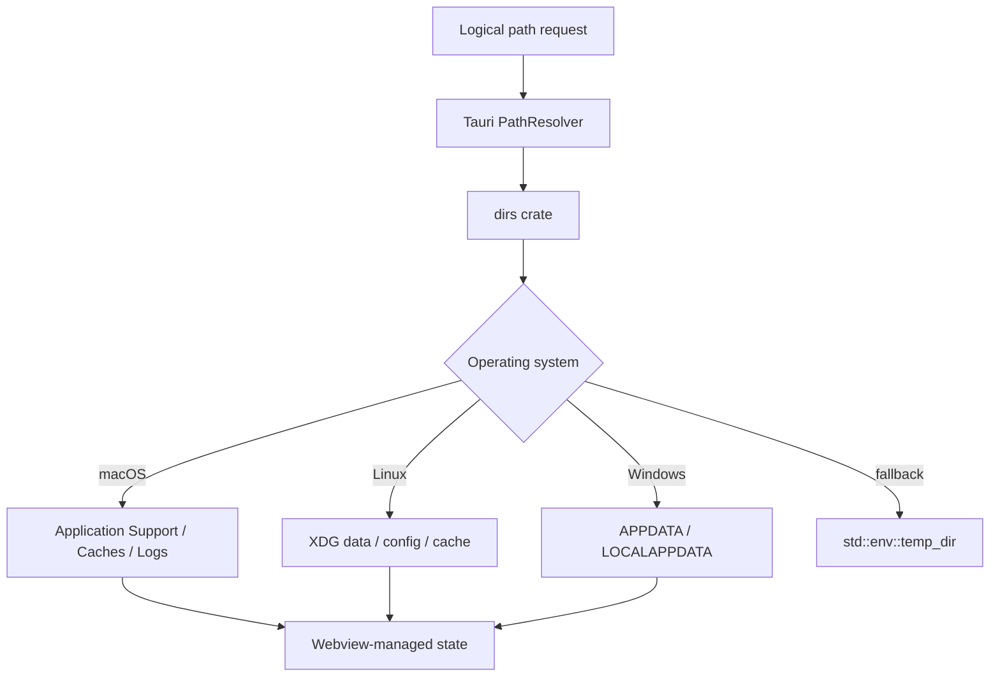

<table>
	<tr>
		<td align="left" valign="middle"><h3 align="left">Platform Paths 🖥️</h3></td>
		<td align="left" valign="middle"><h3 align="left"> + </h3></td>
		<td align="left" valign="middle"><h3 align="left"><a href="https://editor.land" target="_blank">Land 🏞️</a></h3></td>
	</tr>
</table>

---

# **Platform Paths** 🖥️

OS-specific resolution for every per-bundle, OS-managed, and temp-directory path `Land` touches.

[Back to Filesystem Footprint index](https://github.com/CodeEditorLand/Land/tree/Current/Documentation/GitHub/FilesystemFootprint.md)

---

## Resolution Rule 📐

What the resolution rule does:

- It maps a single logical path request onto the correct OS-native directory.
- No call site in `Land` ever hard-codes `~/Library`, `~/.local/share`, or `%APPDATA%`.

All per-bundle paths flow through `Tauri`'s `PathResolver`, which delegates to the `dirs` crate. Three helpers do almost all the work.

| Helper | macOS | Linux | Windows |
| ------ | ----- | ----- | ------- |
| `app_data_dir()` | `$HOME/Library/Application Support/<id>/` | `$XDG_DATA_HOME/<id>/` or `$HOME/.local/share/<id>/` | `%APPDATA%\<id>\` (`C:\Users\<user>\AppData\Roaming\<id>\`) |
| `app_config_dir()` | `$HOME/Library/Application Support/<id>/` | `$XDG_CONFIG_HOME/<id>/` or `$HOME/.config/<id>/` | `%APPDATA%\<id>\` |
| `app_cache_dir()` | `$HOME/Library/Caches/<id>/` | `$XDG_CACHE_HOME/<id>/` or `$HOME/.cache/<id>/` | `%LOCALAPPDATA%\<id>\` (`C:\Users\<user>\AppData\Local\<id>\`) |
| `app_log_dir()` | `$HOME/Library/Logs/<id>/` | `$XDG_DATA_HOME/<id>/logs/` | `%LOCALAPPDATA%\<id>\logs\` |
| `temp_dir()` via `std::env` | `$TMPDIR` (`/var/folders/<XX>/T/`) | `/tmp/` | `%TEMP%` (`C:\Users\<user>\AppData\Local\Temp\`) |

`<id>` is whichever per-profile `Tauri` bundle identifier the build emits. See section Bundle-Identifier Story of the master [`FilesystemFootprint.md`](https://github.com/CodeEditorLand/Land/tree/Current/Documentation/GitHub/FilesystemFootprint.md) for examples.

macOS folds `app_data_dir` and `app_config_dir` into the same location. Linux and Windows split them.

### Per-Platform Summary 🗺️

One row per platform, with the root used for each path family.

| Platform | Data root | Config root | Cache root | Log root | Temp root | Webview storage | Status |
| -------- | --------- | ----------- | ---------- | -------- | --------- | --------------- | ------ |
| macOS | `$HOME/Library/Application Support/<id>/` | same as data | `$HOME/Library/Caches/<id>/` | `$HOME/Library/Logs/<id>/` | `$TMPDIR` | `~/Library/WebKit/<bundle>/` | fully supported, primary development target |
| Linux | `$XDG_DATA_HOME/<id>/` or `$HOME/.local/share/<id>/` | `$XDG_CONFIG_HOME/<id>/` or `$HOME/.config/<id>/` | `$XDG_CACHE_HOME/<id>/` or `$HOME/.cache/<id>/` | `$XDG_DATA_HOME/<id>/logs/` | `/tmp/` | `~/.local/share/<bundle>/` | partial; webview-storage paths differ from WKWebView |
| Windows | `%APPDATA%\<id>\` | `%APPDATA%\<id>\` | `%LOCALAPPDATA%\<id>\` | `%LOCALAPPDATA%\<id>\logs\` | `%TEMP%` | `%LOCALAPPDATA%\<bundle>\EBWebView\` | pending; not smoke-tested |



`Element/Mountain/Source/IPC/DevLog/WriteToFile.rs`:

```rust
let Base = match AppDataPrefix::Fn() {
	Some(Prefix) => PathBuf::from(Prefix).join("logs"),
	None => std::env::temp_dir().join("land-editor-logs"),
};
```

> [!NOTE]
>
> This is the one branch that decides between the per-bundle tree and the
> temp-dir fallback on every OS.

---

## macOS Layout 🍎

What the macOS layout does:

- It places `Land` state under the three Cocoa library roots.
- `Application Support` holds data and config.
- `Caches` holds disposable bytes.
- `Logs` is the `Tauri` default sink.

> [!NOTE]
>
> Status: fully supported, primary development target.

### Per-bundle paths (Tauri-resolved) 📦

| Path | Helper | Producer | Purpose |
| ---- | ------ | -------- | ------- |
| `~/Library/Application Support/<bundle>/machine-id.txt` | `app_data_dir` | `ProcessManagement/InitializationData.rs::get_or_generate_machine_id` | Stable per-install UUID surfaced as `vscode.env.machineId`. Created once with `Uuid::new_v4()` and persisted. |
| `~/Library/Application Support/<bundle>/User/settings.json` | `app_data_dir` | `AppLifecycle.rs:457`, seeds `{}` | User settings. |
| `~/Library/Application Support/<bundle>/User/keybindings.json` | `app_data_dir` | `AppLifecycle.rs:458`, seeds `[]` | Keybinding overrides. |
| `~/Library/Application Support/<bundle>/User/tasks.json` | `app_data_dir` | `AppLifecycle.rs:459`, seeds `{}` | Tasks definitions. |
| `~/Library/Application Support/<bundle>/User/extensions.json` | `app_data_dir` | `AppLifecycle.rs:460`, seeds `[]` | Extension recommendations. |
| `~/Library/Application Support/<bundle>/User/mcp.json` | `app_data_dir` | `AppLifecycle.rs:461`, seeds `{}` | MCP server registry. |
| `~/Library/Application Support/<bundle>/User/globalStorage/` | `app_data_dir` | Workbench plus `Environment/StorageProvider.rs` | Per-extension `Memento`-backed globalState, JSON per extension. |
| `~/Library/Application Support/<bundle>/User/workspaceStorage/` | `app_data_dir` | Workbench | Per-workspace state. |
| `~/Library/Application Support/<bundle>/User/profiles/...` | `app_data_dir` | Workbench profile system | Profile-scoped settings overlay. |
| `~/Library/Application Support/<bundle>/User/snippets/` | `app_data_dir` | Workbench | User-defined snippets. |
| `~/Library/Application Support/<bundle>/User/prompts/` | `app_data_dir` | Chat surfaces | Saved chat requests. |
| `~/Library/Application Support/<bundle>/CachedConfigurations/...` | `app_data_dir` | Workbench configuration system | Computed defaults overlay cache. |
| `~/Library/Application Support/<bundle>/logs/<ts>/Mountain.dev.log` | `app_data_dir` | `IPC/DevLog/WriteToFile.rs::ResolveLogDirectory` | Per-session timestamped `Rust`-side log. Not pruned today. |
| `~/Library/Application Support/<bundle>/logs/window1/output_*` | `app_data_dir` | Workbench `LogService` | Per-window workbench-side log files. Seeded directory is `logs/window1/`. |
| `~/Library/Caches/<bundle>/` | `app_cache_dir` | `Tauri` runtime plus webview asset caches | 200+ MB after a few sessions. Not pruned by the app. |
| `~/Library/Logs/<bundle>/` | `app_log_dir` | `Tauri` default, rarely used | Empty in normal operation; main logs land under `app_data_dir`. |

Producers above resolve to the following files in the `Mountain` Element:

- [`Source/ProcessManagement/InitializationData.rs`](https://github.com/CodeEditorLand/Mountain/tree/Current/Source/ProcessManagement/InitializationData.rs)
- [`Source/Binary/Main/AppLifecycle.rs`](https://github.com/CodeEditorLand/Mountain/tree/Current/Source/Binary/Main/AppLifecycle.rs)
- [`Source/Environment/StorageProvider.rs`](https://github.com/CodeEditorLand/Mountain/tree/Current/Source/Environment/StorageProvider.rs)
- [`Source/IPC/DevLog/WriteToFile.rs`](https://github.com/CodeEditorLand/Mountain/tree/Current/Source/IPC/DevLog/WriteToFile.rs)

`Element/Mountain/Source/ProcessManagement/InitializationData.rs`:

```rust
async fn get_or_generate_machine_id(app_data_dir:&PathBuf) -> String {
	let machine_id_path = app_data_dir.join("machine-id.txt");
	let new_machine_id = Uuid::new_v4().to_string();
```

> [!NOTE]
>
> The identifier is written once into `app_data_dir` and re-read on every
> later boot, which is why deleting that one file re-identifies the install.

### OS-managed paths (created by macOS / WKWebView, not by Land code) 🔒

What these paths do:

- They hold state the operating system writes on `Land`'s behalf.
- That state covers window restoration, webview storage, and crash reports.
- `Land` creates or prunes none of it itself.

| Path | Owner | Purpose |
| ---- | ----- | ------- |
| `~/Library/Preferences/<bundle>.plist` | macOS NSUserDefaults | Window position, recent docs, `Tauri`-set defaults. Cocoa-managed binary plist. |
| `~/Library/WebKit/<bundle>/` | `WKWebView` | Webview localStorage, IndexedDB, ServiceWorker caches. 50 to 400 MB typical. |
| `~/Library/HTTPStorages/<bundle>/` | URLSession | HTTP cookies and credentials when URLSession is used. Empty if the webview handles all networking. |
| `~/Library/Saved Application State/<bundle>.savedState/` | AppKit | Window restoration data when `NSQuitAlwaysKeepsWindows` is enabled. |
| `~/Library/Logs/DiagnosticReports/<bundle>*.crash` | macOS diagnostic engine | Crash reports, system-managed, written on crash only. |

### Temp-dir writes (macOS) 🧹

What the temp-dir writes do:

- They stage short-lived scratch files outside the per-bundle tree.
- Those files are a short-lived `.zshrc`, a fallback proto, and a fallback log root.

`std::env::temp_dir()` resolves to `$TMPDIR`, a per-user `/var/folders/<XX>/T/` directory.

| Path | Producer | Lifetime |
| ---- | -------- | -------- |
| `$TMPDIR/land-zsh-integration-<pid>/.zshrc` | `Environment/Terminal/ShellIntegration.rs:106` | Per integrated-terminal launch. Process-scoped name, but the file lingers after the shell exits. macOS sweeps `$TMPDIR` infrequently; the user accumulates one per launch. |
| `$TMPDIR/vine_fallback.proto` | `Cocoon/Services/Mountain/Client/Service.ts:647`, `gRPC/Server/Service.ts:2096` | Per gRPC client init when the bundled proto resource is missing. Overwritten on each init, not deleted. |
| `$TMPDIR/land-editor-logs/<ts>/` | `IPC/DevLog/WriteToFile.rs:95` | Fallback only. Used when `AppDataPrefix::Fn()` cannot resolve a bundle identifier. Normally empty. |

The two `TypeScript` producers live in the `Cocoon` Element:

- [`Source/Services/Mountain/Client/Service.ts`](https://github.com/CodeEditorLand/Cocoon/tree/Current/Source/Services/Mountain/Client/Service.ts)
- [`Source/Services/gRPC/Server/Service.ts`](https://github.com/CodeEditorLand/Cocoon/tree/Current/Source/Services/gRPC/Server/Service.ts)

`Element/Mountain/Source/Environment/Terminal/ShellIntegration.rs`:

```rust
let TmpDir = std::env::temp_dir().join(format!("land-zsh-integration-{}", std::process::id()));
let ZshRcPath = TmpDir.join(".zshrc");
```

> [!NOTE]
>
> The directory name carries the PID, so each terminal launch leaves its own
> copy behind rather than reusing one.

---

## Linux Layout 🐧

What the Linux layout does:

- It splits `Land` state across the XDG base directories.
- Data, config, and cache land in three separate trees instead of macOS's single `Application Support` root.

> [!NOTE]
>
> Status: partial. `Tauri`'s path resolver works; webview-storage paths differ
> from the WKWebView equivalents.

### Per-bundle paths (Tauri-resolved) 📦

`<XDG_*>` defaults are respected. Otherwise the `dirs` crate falls back to the freedesktop.org base-directory spec.

| Path | Helper | Producer | Purpose |
| ---- | ------ | -------- | ------- |
| `~/.local/share/<bundle>/machine-id.txt` | `app_data_dir` | `InitializationData.rs` | Same content as macOS, different location. |
| `~/.local/share/<bundle>/User/{settings,keybindings,tasks,extensions,mcp}.json` | `app_data_dir` | `AppLifecycle.rs` | Workbench userdata defaults. |
| `~/.local/share/<bundle>/User/globalStorage/` | `app_data_dir` | Workbench plus `StorageProvider.rs` | Per-extension `Memento` storage. |
| `~/.local/share/<bundle>/logs/<ts>/Mountain.dev.log` | `app_data_dir` | `IPC/DevLog/WriteToFile.rs` | Per-session `Rust`-side log. Same naming as macOS. |
| `~/.config/<bundle>/` | `app_config_dir` | `Environment/ConfigurationProvider/*` | Settings and keybindings flow through this resolver. May coexist with `app_data_dir` content depending on caller. |
| `~/.cache/<bundle>/` | `app_cache_dir` | `Tauri` runtime plus webview asset caches | Webview cache equivalent. |

The config resolver is [`Source/Environment/ConfigurationProvider/`](https://github.com/CodeEditorLand/Mountain/tree/Current/Source/Environment/ConfigurationProvider) in the `Mountain` Element.

```sh
XDG_DATA_HOME=~/.local/share ls ~/.local/share/<bundle>/logs/
```

> [!NOTE]
>
> Overriding `XDG_DATA_HOME` relocates the whole data tree, logs included,
> without any change to `Land`.

### OS-managed paths (Linux) 🔒

What these paths do:

- They carry desktop-environment and distro state.
- That state covers WebKitGTK storage, dconf window state, and coredumps.
- `Land` reads about them but never manages them.

| Path | Owner | Purpose |
| ---- | ----- | ------- |
| `~/.local/share/<bundle>/` | WebKitGTK, `Tauri` default | Webview localStorage / IndexedDB. Layout matches `app_data_dir` and lives inside the same per-bundle tree. |
| `~/.config/<bundle>/dconf` if used | GNOME settings backend | `Tauri` does not write here today, but some Linux desktops persist window state via dconf. |
| Crash reports | systemd-coredump / apport | Vary by distro, such as `~/.cache/abrt/` or `/var/lib/systemd/coredump/`. Not `Land`-controlled. |

### Temp-dir writes (Linux) 🧹

What the temp-dir writes do:

- They use the same three scratch producers as macOS.
- They live under a system-swept `/tmp`.

`std::env::temp_dir()` resolves to `/tmp/`, unless `$TMPDIR` overrides it.

| Path | Producer | Note |
| ---- | -------- | ---- |
| `/tmp/land-zsh-integration-<pid>/.zshrc` | `Environment/Terminal/ShellIntegration.rs` | systemd-tmpfiles sweeps `/tmp` on boot, so leakage is less severe than macOS. |
| `/tmp/vine_fallback.proto` | `Cocoon/Services/Mountain/Client/Service.ts` | Same fallback semantics as macOS. |
| `/tmp/land-editor-logs/<ts>/` | `IPC/DevLog/WriteToFile.rs` | Same fallback semantics as macOS. |

---

## Windows Layout 🪟

What the Windows layout does:

- It routes roaming state to `%APPDATA%`.
- It routes machine-local caches to `%LOCALAPPDATA%`.
- It follows the two `FOLDERID_*` roots the `dirs` crate queries.

> [!WARNING]
>
> Status: pending. The `dirs` crate paths and `Tauri` `PathResolver` are documented
> here for completeness, but the editor has not been smoke-tested on Windows.
> Treat the table as a forward-looking reference; expect minor drift when the
> platform target lands.

### Per-bundle paths (Tauri-resolved) 📦

| Path | Helper | Notes |
| ---- | ------ | ----- |
| `%APPDATA%\<bundle>\machine-id.txt` | `app_data_dir` | `dirs` resolves to `FOLDERID_RoamingAppData`, that is `C:\Users\<user>\AppData\Roaming\<bundle>\`. |
| `%APPDATA%\<bundle>\User\{settings,keybindings,tasks,extensions,mcp}.json` | `app_data_dir` | Same JSON shape as macOS / Linux. |
| `%APPDATA%\<bundle>\User\globalStorage\` | `app_data_dir` | Per-extension `Memento` storage. |
| `%APPDATA%\<bundle>\logs\<ts>\Mountain.dev.log` | `app_data_dir` | Per-session `Rust`-side log. |
| `%LOCALAPPDATA%\<bundle>\` | `app_cache_dir` | `FOLDERID_LocalAppData`, that is `C:\Users\<user>\AppData\Local\<bundle>\`. `Tauri` / webview caches. |
| `%LOCALAPPDATA%\<bundle>\logs\` | `app_log_dir` | `Tauri` default, rarely used. |

### OS-managed paths (Windows) 🔒

What these paths do:

- They hold WebView2 browser storage.
- They hold registry-backed window state.
- They hold Windows Error Reporting minidumps.

| Path | Owner | Purpose |
| ---- | ----- | ------- |
| `%LOCALAPPDATA%\<bundle>\EBWebView\` | WebView2 | Edge WebView2 storage: cookies, IndexedDB, localStorage, ServiceWorker caches. Equivalent of `Library/WebKit`. |
| `HKCU\Software\<bundle>\` | Windows Registry | `Tauri` / Cocoa-equivalent default storage. The app may write window state here. |
| `%LOCALAPPDATA%\CrashDumps\<bundle>*.dmp` | Windows Error Reporting | Minidump destination on crash. |

### Temp-dir writes (Windows) 🧹

What the temp-dir writes do:

- They mirror the macOS scratch set under `%TEMP%`.
- The zsh producer is effectively dormant.

`std::env::temp_dir()` resolves to `%TEMP%`, that is `C:\Users\<user>\AppData\Local\Temp\`.

| Path | Producer | Note |
| ---- | -------- | ---- |
| `%TEMP%\land-zsh-integration-<pid>\.zshrc` | `Environment/Terminal/ShellIntegration.rs` | No-op on Windows in practice; the zsh-integration path only triggers when the user opens a zsh shell. |
| `%TEMP%\vine_fallback.proto` | `Cocoon/Services/Mountain/Client/Service.ts` | Same fallback semantics as macOS. |
| `%TEMP%\land-editor-logs\<ts>\` | `IPC/DevLog/WriteToFile.rs` | Same fallback semantics as macOS. |

---

## User-Dotfile Resolution (cross-OS) 🏞️

What dotfile resolution does:

- It expands `~/.fiddee/` to the caller's home directory identically on all three platforms.
- No OS-specific branch is needed.

The `~/.fiddee/` tree resolves the same way on every OS. See [`UserDotfile.md`](https://github.com/CodeEditorLand/Land/tree/Current/Documentation/GitHub/FilesystemFootprint/UserDotfile.md) for the table.

| OS | Resolves to |
| -- | ----------- |
| macOS | `/Users/<user>/.fiddee/` |
| Linux | `/home/<user>/.fiddee/` |
| Windows | `C:\Users\<user>\.fiddee\` |

`~/.land/extensions/`, the legacy fan-out, follows the same convention.

---

## Foreign-Tool Directories Land Creates 🌐

What this startup step does:

- It pre-creates two directories owned by other tools.
- VS Code's startup `stat` probes then find them and stop logging errors.

[`Binary/Main/AppLifecycle.rs:440`](https://github.com/CodeEditorLand/Mountain/tree/Current/Source/Binary/Main/AppLifecycle.rs) pre-creates two directories that belong to other tools. Cross-OS:

| Path | macOS | Linux | Windows |
| ---- | ----- | ----- | ------- |
| `~/.claude/agents/` | `/Users/<user>/.claude/agents/` | `/home/<user>/.claude/agents/` | `C:\Users\<user>\.claude\agents\` |
| `~/.copilot/agents/` | `/Users/<user>/.copilot/agents/` | `/home/<user>/.copilot/agents/` | `C:\Users\<user>\.copilot\agents\` |

`Land` does not write to either path; it only runs `mkdir -p`. If the user does not have those tools installed, these dirs nonetheless persist after `Land`'s first boot. Candidate for tier-gating: see [section G of `Encapsulation.md`](https://github.com/CodeEditorLand/Land/tree/Current/Documentation/GitHub/FilesystemFootprint/Encapsulation.md).

`Element/Mountain/Source/Binary/Main/AppLifecycle.rs`:

```rust
HomeDir.join(".claude/agents"),
HomeDir.join(".copilot/agents"),
```

> [!NOTE]
>
> Both entries are members of the same `Dirs` array that a single
> `create_dir_all` loop walks at boot. The source comment records that they are
> created to avoid `stat` errors.

---

## In-Tree Build Artefacts 🛠️

What the build artefacts do:

- They hold compiler and bundler output inside the checkout.
- None of these paths belong to a user install.

Cross-OS, not part of the user-install footprint:

| Path | Purpose |
| ---- | ------- |
| `Element/Mountain/Target/` | `Rust` build output. Hundreds of MB to several GB per profile. |
| `Element/Mountain/Target/debug/extensions.manifest.json` | PreBake cache of built-in extension manifests. |
| `Element/Mountain/Target/Resources/extensions/` | Bundled built-in extensions copied into the `.app` Resources tree. Read-only. |
| `Element/Mountain/Target/<profile>/.../*.app` | Built bundle. `Maintain/Script/SignBundle.sh` re-signs in place. |
| `Element/Sky/Target/` | Astro / `Vite` build output, workbench and webview assets. |
| `Element/<Other>/Target/` | Per-Element `TypeScript` compile output. |
| `Element/Mountain/Cargo.toml.Backup` | Build-script residue; `Maintain` wrappers rewrite and restore, sometimes leaving a diff. |

The re-signing script is [`Maintain/Script/SignBundle.sh`](https://github.com/CodeEditorLand/Land/tree/Current/Maintain/Script/SignBundle.sh) in this repository. The `Target/` trees belong to [`Mountain`](https://github.com/CodeEditorLand/Mountain/tree/Current) and [`Sky`](https://github.com/CodeEditorLand/Sky/tree/Current).

```sh
du -sh Element/Mountain/Target Element/Sky/Target
```

> [!TIP]
>
> Run this before reporting a disk-usage problem; the checkout is usually
> larger than the installed footprint.

---

## Related Documentation 📚

- [`UserDotfile.md`](https://github.com/CodeEditorLand/Land/tree/Current/Documentation/GitHub/FilesystemFootprint/UserDotfile.md) - the `~/.fiddee/` tree, cross-OS.
- [`PerElement.md`](https://github.com/CodeEditorLand/Land/tree/Current/Documentation/GitHub/FilesystemFootprint/PerElement.md) - which Element writes which path.
- [`Cleanup.md`](https://github.com/CodeEditorLand/Land/tree/Current/Documentation/GitHub/FilesystemFootprint/Cleanup.md) - per-OS cleanup recipes.
- [`EnvironmentVariables.md`](https://github.com/CodeEditorLand/Land/tree/Current/Documentation/GitHub/FilesystemFootprint/EnvironmentVariables.md) - path-shaping env vars.
- [`FilesystemFootprint.md`](https://github.com/CodeEditorLand/Land/tree/Current/Documentation/GitHub/FilesystemFootprint.md) - the ownership-domain index.

---

**Project Maintainers:** Source Open
([Source/Open@Editor.Land](mailto:Source/Open@Editor.Land)) |
[GitHub Repository](https://github.com/CodeEditorLand/Land) |
[Report an Issue](https://github.com/CodeEditorLand/Land/issues)
