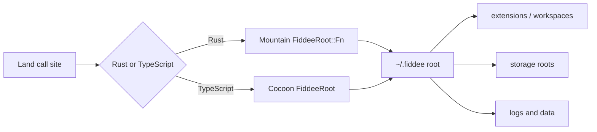

<table>
	<tr>
		<td align="left" valign="middle"><h3 align="left">User Dotfile 🏞️</h3></td>
		<td align="left" valign="middle"><h3 align="left"> + </h3></td>
		<td align="left" valign="middle">
			<h3 align="left">
				<a href="https://editor.land" target="_blank">
					<picture>
						<source media="(prefers-color-scheme: dark)" srcset="https://editor.land/Dark/Image/GitHub/Land.svg" />
						<source media="(prefers-color-scheme: light)" srcset="https://editor.land/Image/GitHub/Land.svg" />
						
					</picture>
				</a>
			</h3>
		</td>
		<td align="left" valign="middle"><h3 align="left"><a href="https://editor.land" target="_blank">Land 🏞️</a></h3></td>
	</tr>
</table>

---

# **User Dotfile** 🏞️

The `~/.fiddee/` tree, `Land`'s primary product-owned filesystem domain.

[Back to Filesystem Footprint index](https://github.com/CodeEditorLand/Land/tree/Current/Documentation/GitHub/FilesystemFootprint.md)

---

## At a Glance 🗺️

`~/.fiddee/` is centralised by **one atom**, duplicated across two languages:

- `FiddeeRoot::Fn` in `Rust`.
- `FiddeeRoot()` in `TypeScript`.

Every `Land` call site resolves sub-paths through this atom. Future renames touch a single file per Element.

| Source of truth | File |
| --------------- | ---- |
| `Rust`, `Mountain` | `Element/Mountain/Source/IPC/WindServiceHandlers/Utilities/FiddeeRoot.rs` |
| `TypeScript`, `Cocoon` | `Element/Cocoon/Source/Platform/FiddeeRoot.ts` |
| Constant | `DOTFILE_NAME = ".fiddee"` |



---

## Cross-OS Resolution 🌐

The dotfile root resolves to the user's home directory with `.fiddee` appended.

| OS | Resolves to |
| -- | ----------- |
| macOS | `$HOME/.fiddee/`, that is `/Users/<user>/.fiddee/` |
| Linux | `$HOME/.fiddee/`, that is `/home/<user>/.fiddee/` |
| Windows | `%USERPROFILE%\.fiddee\`, that is `C:\Users\<user>\.fiddee\` |

Fallback order:

1. `dirs::home_dir()` is the primary resolver.
2. If it returns `None`, the code falls back to `$HOME`.
3. The next fallback is `$USERPROFILE`; Windows uses the latter.
4. A final fallback to a relative `.fiddee` keeps callers receiving a valid `PathBuf`.

---

## Sub-Directory Map 🗂️

| Path | Producer | Purpose |
| ---- | -------- | ------- |
| `.fiddee/extensions/<publisher>.<name>-<ver>/` | `ExtensionManagement/VsixInstaller.rs::InstallVsix` | Primary user-extension root. VSIX archive extraction target. Sets `chmod 755` on platform binaries through `HealExecutableBits`. |
| `.fiddee/extensions/<id>/.storage/` | `Cocoon/Source/Services/Extension/Context.ts:495` | Per-extension persistent state written **inside** the extension's own directory. Lost on reinstall or version bump. |
| `.fiddee/extensionStorage/<extId>/` | `Cocoon/Source/Services/Handler/Extension/Host/ActivateExtension.ts:51` | Per-extension workspace-scoped storage path passed to `context.storageUri`. Created with `mkdir` at activation. |
| `.fiddee/globalStorage/<extId>/` | `Cocoon/.../ActivateExtension.ts:52` plus `Extension/Context.ts:495`, with the env override below | Per-extension global storage path passed to `context.globalStorageUri`. Created with `mkdir` at activation. |
| `.fiddee/logs/<extId>/` | `Cocoon/.../ActivateExtension.ts:53` | Per-extension log directory passed to `context.logUri`. Created with `mkdir` at activation. |
| `.fiddee/workspaces/RecentlyOpened.json` | `Mountain/.../Utilities/RecentlyOpened.rs` plus `State/WorkspaceState/WorkspaceDelta.rs` | Up to 50 most-recent workspace folder URIs with labels. Pretty-printed JSON. |
| `.fiddee/data/` | planned | Reserved for the background daemon's persistent data. Not yet wired. |

Typical footprint after a few months of use:

- Dominated by extensions.
- Roughly 1 to 5 GB, depending on which language servers are installed.

---

## Storage-Path Override 🎛️

`Cocoon` respects one env var that re-roots part of the tree.

| Variable | Effect | Default |
| -------- | ------ | ------- |
| `VSCODE_COCOON_GLOBAL_STORAGE` | Replaces the globalStorage root resolution in `Extension/Context.ts` | `${FiddeeRoot()}/globalStorage` |

- `Lodge`, the user-extensions override, and `Extend`, additional scan paths, do **not** apply to the storage sub-trees.
- They apply only to the extensions root.
- See [`EnvironmentVariables.md`](https://github.com/CodeEditorLand/Land/tree/Current/Documentation/GitHub/FilesystemFootprint/EnvironmentVariables.md) for the full registry.

---

## Cocoon-Side Mirror 🪞

`Element/Cocoon/Source/Platform/FiddeeRoot.ts` exists so `Node.js`-side code does not call back into `Rust` to resolve the path. The `TypeScript` implementation mirrors the `Rust` resolution exactly:

```typescript
// Cocoon/Source/Platform/FiddeeRoot.ts
export default function FiddeeRoot(): string {
	const Home = process.env.HOME ?? process.env.USERPROFILE;
	if (Home) return `${Home}/.fiddee`;
	return ".fiddee";
}
```

Drift between the two implementations would manifest as `Cocoon` writing per-extension storage to a different location than `Mountain` expects when scanning. Keep them in lockstep. The docstring on each file references the other.

---

## Legacy Fan-Out 🦴

| Path | Status | Producer |
| ---- | ------ | -------- |
| `~/.land/extensions/` | read-only scan, never written, additive legacy | Scanned by `Binary/Extension/ScanPathConfigure.rs:227` from the T3 2026-05-26 fix |

- Added to the scan-path registry on 2026-05-26.
- Recognised by `Scanner::IsUserExtensionScanPath`.
- **Read-only:** new VSIX installs land under `~/.fiddee/extensions/`, never here.
- Existing installs in `~/.land/extensions/` are still scanned and activated until the user, or a future migration step, moves them.

The legacy path is documented because:

1. Many pre-rename installs still live there. Removing the scan would break them.
2. Cleanup recipes targeting only `~/.fiddee/` will miss legacy installs.

Retirement plan, deferred: a one-shot migration that moves `~/.land/extensions/*` to `~/.fiddee/extensions/`, then removes the scan path.

---

## Lifecycle 📅

- **First boot:** `FiddeeRoot::Fn()` is resolved lazily. Sub-paths are created on first use, for example the first extension activation creates the per-extension storage triple.
- **Extension install:** `VsixInstaller::InstallVsix` extracts archives to `.fiddee/extensions/<id>/`. It then runs `HealExecutableBits` on `bin/`, `server/`, `tools/`, and other directories to promote `0o644` to `0o755` on ELF, Mach-O, and shebang files. One-shot per boot per path.
- **Extension activation:** `Cocoon` `ActivateExtension.ts` creates the three sibling storage roots: `extensionStorage/<extId>`, `globalStorage/<extId>`, and `logs/<extId>`. Then `Extension/Context.ts` creates the in-bundle `.storage/` inside the extension's own directory.
- **Recently-opened update:** `WorkspaceDelta::PersistRecentlyOpened` updates `.fiddee/workspaces/RecentlyOpened.json` whenever a workspace folder is added. Truncated to 50 entries and pretty-printed.

---

## Open Questions ❓

- The `.fiddee/extensions/<id>/.storage/` location ties per-extension storage to the extension's own directory. Reinstalls or version bumps destroy that state. This is subtle because the three sibling roots, `extensionStorage`, `globalStorage`, and `logs`, live outside the bundle and survive lifecycle events. Encapsulation candidate: move to `.fiddee/extensionData/<id>/.storage/`, parallel to the existing siblings. See [section H of `Encapsulation.md`](https://github.com/CodeEditorLand/Land/tree/Current/Documentation/GitHub/FilesystemFootprint/Encapsulation.md).
- `.fiddee/data/` is reserved but not yet wired. The background-daemon flow may bypass it entirely. `Air` uses `<config_dir>/FIDDEE/` instead; see section Air of [`PerElement.md`](https://github.com/CodeEditorLand/Land/tree/Current/Documentation/GitHub/FilesystemFootprint/PerElement.md) for the divergence.

---

## Related Documentation 📚

- [`PlatformPaths.md`](https://github.com/CodeEditorLand/Land/tree/Current/Documentation/GitHub/FilesystemFootprint/PlatformPaths.md) - per-OS Library / XDG / AppData paths that coexist with `~/.fiddee/`.
- [`PerElement.md`](https://github.com/CodeEditorLand/Land/tree/Current/Documentation/GitHub/FilesystemFootprint/PerElement.md) - which Element writes which sub-path.
- [`EnvironmentVariables.md`](https://github.com/CodeEditorLand/Land/tree/Current/Documentation/GitHub/FilesystemFootprint/EnvironmentVariables.md) - `Lodge`, `Extend`, and `VSCODE_COCOON_GLOBAL_STORAGE` references.
- [`Cleanup.md`](https://github.com/CodeEditorLand/Land/tree/Current/Documentation/GitHub/FilesystemFootprint/Cleanup.md) - per-OS recipes that include `~/.fiddee/`.
- [`FilesystemFootprint.md`](https://github.com/CodeEditorLand/Land/tree/Current/Documentation/GitHub/FilesystemFootprint.md) - the ownership-domain index.

---

**Project Maintainers:** Source Open
([Source/Open@Editor.Land](mailto:Source/Open@Editor.Land)) |
[GitHub Repository](https://github.com/CodeEditorLand/Land) |
[Report an Issue](https://github.com/CodeEditorLand/Land/issues)
