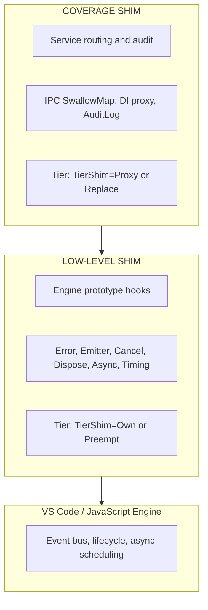
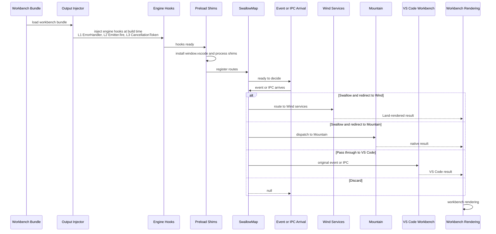
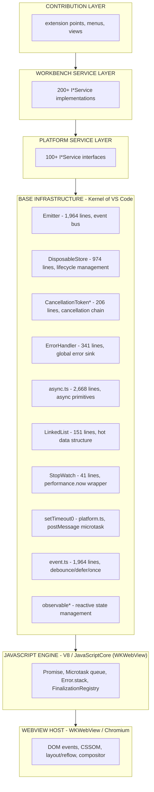
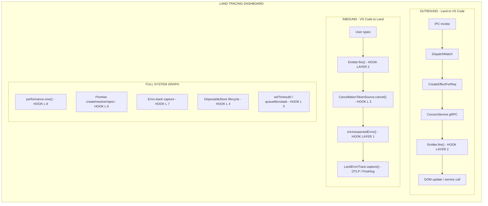
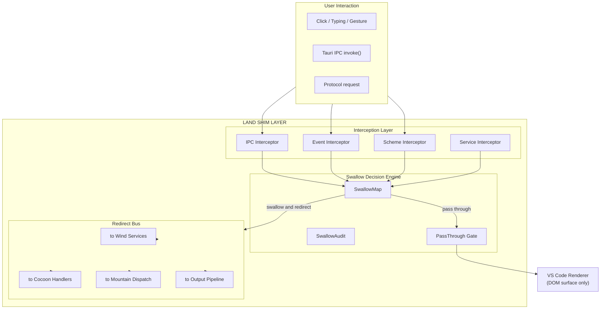
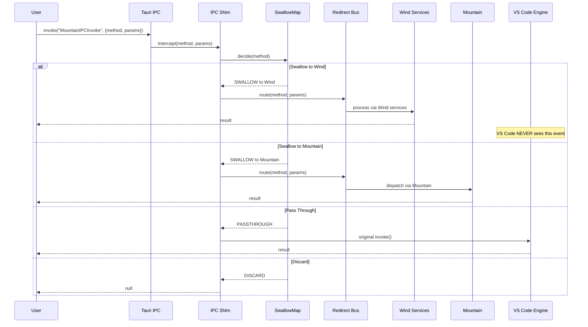

# Shim: Deep-Shim Interception System

`Land` intercepts `VS Code` events at both the `JavaScript` engine level and the
application service level, enabling complete bidirectional visibility, event
swallowing, and service redirection to `Land` native ecosystem.

---

## Table of Contents 📋

1. [Architecture Overview](#architecture-overview)
2. [Shim Boot Sequence](#shim-boot-sequence)
3. [Low-Level Shim (Engine Hooks)](#low-level-shim-engine-hooks)
4. [Coverage Shim (Service Interception)](#coverage-shim-service-interception)
5. [SwallowMap: Decision Engine](#swallowmap-decision-engine)
6. [Performance Impact](#performance-impact)
7. [Feature Gate System](#feature-gate-system)
8. [Per-Element Architecture](#per-element-architecture)
9. [Related Documentation](#related-documentation)

---

## Architecture Overview 🏗️

The `shim` layer sits between the `VS Code` `JavaScript` engine and the `Land`
service tree, intercepting events at two levels:



The two tiers build on each other:

- `Low-Level Shim` hooks into `JavaScript` engine primitives: `ErrorHandler`,
  `Emitter.prototype.fire`, `CancellationTokenSource`, `DisposableStore`,
  `setTimeout0`, `Promise`, `Error.stack`, `performance.now()`. These provide
  maximum coverage with minimal code.
- `Coverage Shim` intercepts at the `service` / `DI` boundary. `SwallowMap`
  routes events to `Wind` / `Cocoon` / `Mountain` / `Output` instead of `VS Code`
  workbench services.

---

## Shim Boot Sequence 🚀

The boot sequence wires the `shim` into the `workbench` before any user event is
processed. `Output` injects the engine hooks at build time, `Preload` installs
the `window.vscode` and `process` shims, and `SwallowMap` registers its routes.



---

## Low-Level Shim (Engine Hooks) 🔬

Eight prototype-level monkey-patches give `Land` complete bidirectional
visibility into `VS Code` event, error, async, and lifecycle infrastructure.

### VS Code Internal Stack 🔬



### Hook Layers 🧩

| Layer | Hook Point | Covers |
| -------- | -------- | -------- |
| `L1` | `ErrorHandler` | 100% of unhandled errors, one-line patch |
| `L2` | `Emitter.prototype.fire` | 474 services in one patch (sampled at 1%) |
| `L3` | `CancellationToken` | Complete cancellation chain visibility |
| `L4` | `DisposableStore` | Resource leak detection, lifecycle mapping |
| `L5` | `setTimeout0` | Async scheduling, boot performance |
| `L6` | `Promise` / microtask | Full async graph tracing (dev-only) |
| `L7` | `Error.stack` | Error creation to propagation to handling map |
| `L8` | `performance.now()` | Microsecond timing for every operation |

### Bidirectional Tracing 📊



### Implementation Strategy 📋

| Priority | Layer | Rationale |
| -------- | -------- | -------- |
| `P0` | `L1` | Zero overhead, catches ALL errors |
| `P0` | `L2` | Covers 474 services in one patch |
| `P1` | `L3` | Completes error/cancel story end-to-end |
| `P2` | `L4` | Resource leak detection |
| `P2` | `L5` | Boot performance improvement |
| `P3` | `L8` | Timing infrastructure |
| `Dev` | `L6` | Development-only profiling |
| `Dev` | `L7` | Development-only stack tracing |

---

## Coverage Shim (Service Interception) 🔌

Instead of piping data through `VS Code` and patching the output, the
`Coverage Shim` intercepts at the `DI` boundary, swallows the event entirely, and
routes it to the `Land` service tree. `VS Code` never sees the event:

- No waterfall
- No double-processing
- No internal cascade

### Architecture 🏗️



### Interceptor Types 🔌

| Interceptor | Location | Purpose |
| -------- | -------- | -------- |
| `IPC Interceptor` | `Wind/Source/Shim/IPCInterceptor.ts` | Intercepts every `invoke("MountainIPCInvoke")` |
| `Event Interceptor` | `Output/Source/Service/CEL/Land/EventInterceptor.ts` | Patches workbench event emitters |
| `Service Interceptor` | `Output/Source/Service/CEL/Land/ServiceInterceptor.ts` | Intercepts `ServiceCollection.get/set` |
| `Scheme Interceptor` | `Mountain` `LandSchemeHandler.rs` | Intercepts protocol requests (`vscode-file://`, `land://`) |

---

## SwallowMap: Decision Engine 🗺️

Every event, `IPC` call, and service resolution passes through the `SwallowMap`,
which decides between three outcomes:

- Swallow: route to `Land`
- Pass through: let `VS Code` handle
- Mix: both, with `Land` gatekeeping the response

### Decision Matrix 🗺️

| Event / Domain | Swallow? | Redirect To | VS Code See? |
| -------------- | -------- | ----------- | ------------ |
| Status bar updates | SWALLOW | `Wind` | No |
| SCM / git operations | SWALLOW | `Cocoon` | No |
| Search queries | SWALLOW | `Air` / `Wind` | No |
| Terminal I/O | SWALLOW | `Mountain PTY` | No |
| Output panel | SWALLOW | `Output` | No |
| File system ops | SWALLOW | `Mountain FS` | No |
| Notifications | SWALLOW | `Wind UI` | No |
| Quick input / picker | SWALLOW | `Wind UI` | No |
| Dialogs | SWALLOW | `Mountain` | No |
| Keybindings | SWALLOW | `Wind` | No |
| Theme changes | SWALLOW | `Wind` | No |
| Config changes | SWALLOW | `Wind` | No |
| Ext. activation | MIXED | `Cocoon` + `VS Code` | Partial |
| Editor text input | PASSTHROUGH | `Monaco` | Yes |
| Editor decorations | MIXED | `Cocoon` + `VS Code` | Partial |
| Webview lifecycle | PASSTHROUGH | `VS Code` | Yes |
| Workbench layout | MIXED | `Wind` + `VS Code` | Partial |
| Workspace trust | PASSTHROUGH | `VS Code` | Yes |
| Extension gallery | SWALLOW | `Wind` (ours) | No |
| Telemetry | SWALLOW | `PostHog` / `OTLP` | No |
| Product identity | SWALLOW | `Land config` | No |

### Decision Flow 🌐



---

## Performance Impact ⚡

### Current (Pipe Flow) 📊

| Step | Operation | Time |
| -------- | -------- | -------- |
| 1 | `Tauri` `IPC` invoke | 1ms |
| 2 | `Mountain` `DispatchMatch` string match | 0.5ms |
| 3 | `forward_to_cocoon!` `gRPC` round-trip | 5ms |
| 4 | `Cocoon` `RequestRoutingHandler` regex match | 1ms |
| 5 | `VS Code` `ITextFileService.save()` | 2ms |
| 6 | `VS Code` `IStatusbarService.update()` | 1ms |
| 7 | `VS Code` `IEditorService.updateOptions()` | 0.5ms |
| 8 | `VS Code` `IModelService.update()` | 0.5ms |
| 9 | `DOM` reflow | 5ms |
| 10 | `Land` patches `DOM` post-reflow | 2ms |
| Total |  | ~17.5ms |

### With Shim (Swallow Flow) 📊

| Step | Operation | Time |
| -------- | -------- | -------- |
| 1 | `IPC` Shim intercept | 0.1ms |
| 2 | `SwallowMap` decide | 0.05ms |
| 3 | Redirect to `Wind` `FileService` | 0.5ms |
| 4 | `Wind` dispatches to `Mountain` | 1ms |
| 5 | `Mountain` writes to disk | 2ms |
| 6 | `Wind` updates `Land` status bar | 0.5ms |
| 7 | `Wind` updates `Land` editor state | 0.5ms |
| Total |  | ~4.65ms (73% reduction) |

### Hook Performance Overhead ⚡

| Hook Layer | Per-Call Overhead | Frequency | Production Impact |
| -------- | -------- | -------- | -------- |
| `L1: ErrorHandler` | ~0.01ms | Rare (errors only) | Negligible |
| `L2: Emitter.fire()` | ~0.005ms | Very high (1000s/sec) | <1% (sampled) |
| `L3: CancellationToken` | ~0.001ms | Medium (100s/sec) | Negligible |
| `L4: DisposableStore` | ~0.001ms | Medium | Negligible |
| `L5: setTimeout0` | ~0.002ms | High | 1-2% |
| `L6: Promise` | ~0.01ms | Very high | Dev-only |
| `L7: Error.stack` | ~0.02ms | High | Dev-only |
| `L8: performance.now()` | ~0.001ms | Very high | 2-3% |

- `Production`: activate `L1` + `L2` (sampled) + `L3` + `L4` + `L5` for ~2% overhead and full error and event tracing.
- `Development`: all layers for ~20% overhead and complete system visibility.

---

## Feature Gate System ⚙️

All `shim` functionality is gated behind `compile-time` and `runtime` flags:

### Compile-Time Flags ⚙️

```typescript
const SHIM_ENABLED = __LAND_SHIM__ === true; // Master gate
const SHIM_LEVEL = __LAND_SHIM_LEVEL__; // 'proxy' | 'replace' | 'own' | 'preempt'
const SHIM_SERVICES = __LAND_SHIM_SERVICES__; // comma-separated list
```

### Runtime Environment Variables ⚙️

| Variable | Default | Description |
| -------- | -------- | -------- |
| `TierShim` | `None` | Master switch (`None` = zero overhead) |
| `__LAND_SHIM__` | `false` | Master compile-time gate, not an environment variable |
| `__LAND_SHIM_LEVEL__` | `proxy` | Compile-time tier level, not an environment variable |

`__LAND_SHIM__`, `__LAND_SHIM_LEVEL__`, and `__LAND_SHIM_SERVICES__` are build-time defines injected by the `Output` transform. They are not environment variables found in `.env.Land.Shim`.

### Tier Values ⚙️

The `TierShim` values are `None`, `Proxy`, `Replace`, `Own`, and `Preempt`.

- `None`: `shim` is compiled out, zero runtime overhead.
- `Proxy`: audit only. Observe all events, log to `dev-log`, no redirection.
- `Replace`: active swallow. Services listed in `__LAND_SHIM_SERVICES__` are intercepted and redirected.
- `Own`: full redirection. `Land` `InstantiationService` subclass becomes the canonical `DI` container.
- `Preempt`: `Land` controls `BrowserMain.open()` entirely, `VS Code` is rendering-only.

### Gradual Adoption 🚀

1. `Audit` (`TierShim=Proxy`): observe all events, zero behavioral change.
2. `Selective Swallow` (`TierShim=Replace`): redirect one service at a time, starting with `ITelemetryService`, then `IStatusbarService`, etc.
3. `Full Redirect` (`TierShim=Own`): after 80% of services are swallowed, `Land` becomes the canonical container.
4. `Preempt` (`TierShim=Preempt`): `Land` is the engine, `VS Code` only renders.

---

## Per-Element Architecture 🧩

Each `Element` implements a different part of the `shim` system:

| Element | Role | Key Files |
| -------- | -------- | -------- |
| `Wind` | Coverage hub | `Source/Shim/` (11 files): `SwallowMap`, `RedirectBus`, `IPCInterceptor`, `AuditLog`, `EventInterceptor`, `NetworkProxy`, `AsyncProxy` |
| `Output` | Engine hook runtime | `Source/Plugin/Transform/Inject/Shim/Hook.ts` (injects shim at build time), `Source/Service/CEL/Land/Shim/` (7 files) |
| `Cocoon` | Layer D interception | `Source/Shim/NodeModuleInterceptor.ts`, intercepts `Node.js` `Module._load` for `fs` / `child_process` |
| `Mountain` | Rust-side `SwallowMap` | `Source/Shim/`, `IPC`-level routing and native dispatch |
| `Sky` | `UI` integration | No shim-specific modules, receives events from `Wind` via bridge |
| `Worker` | Service worker | No shim-specific modules, not affected by engine hooks |

Elements not listed above (`Common`, `Maintain`, `Rest`, `Mist`, `SideCar`, `Echo`, `Grove`, `Vine`, `Air`) support the `shim` system but have no shim-specific modules. Events are routed through `Wind` / `Mountain` / `Cocoon`.

---

## Related Documentation 📖

- [Polyfills](Polyfills.md): `Preload` shim, `SkyBridge`, `Cocoon` prelude
- [EditorCore](EditorCore.md): workbench adaptation and service layer
- [BuildPipeline](BuildPipeline.md): build-time transforms and injections
- [Architecture](Architecture.md): system architecture
- [InterComponentProtocol](InterComponentProtocol.md): `gRPC` protocol specification

---

**Project Maintainers:** Source Open
([Source/Open@Editor.Land](mailto:Source/Open@Editor.Land)) |
[GitHub Repository](https://github.com/CodeEditorLand/Land) |
[Report an Issue](https://github.com/CodeEditorLand/Land/issues)
