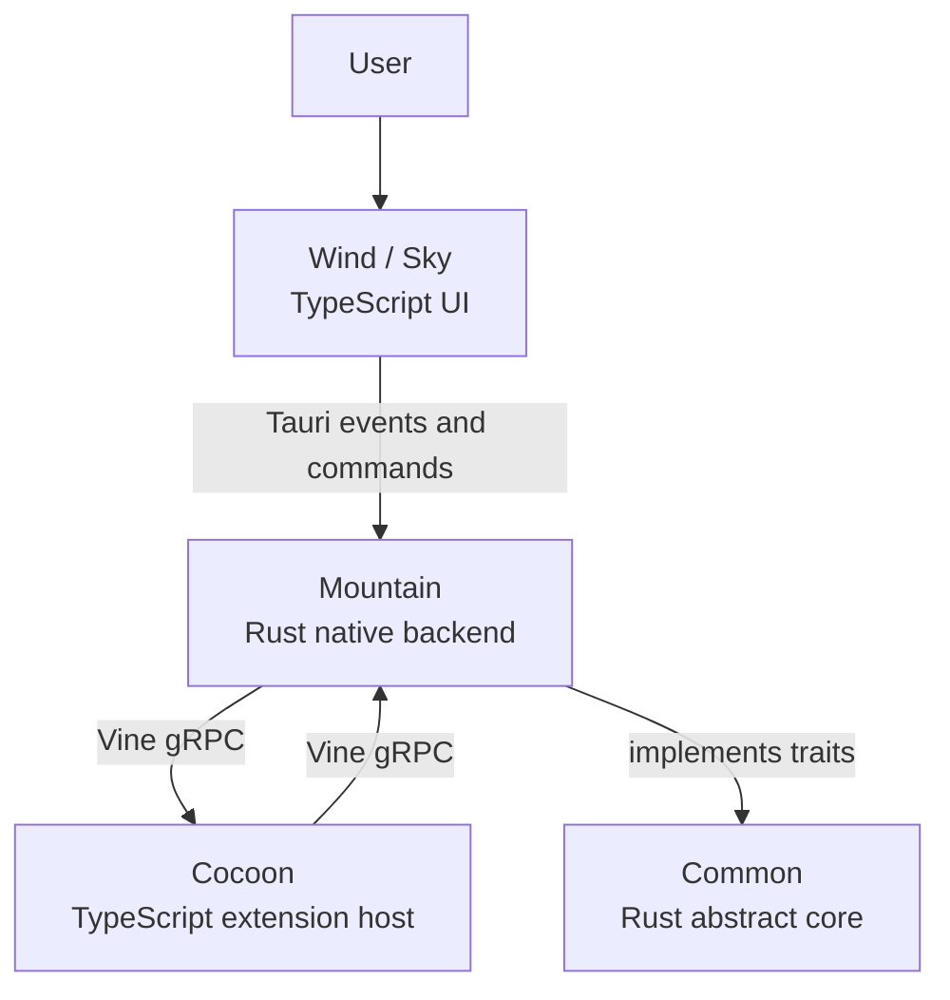

# Land Project Architecture

A high-level overview of the architecture and the core workflows that drive the application.

The system is composed of four primary components:

- **`Common`** (Rust crate):
  - The abstract core library.
  - Defines the architectural language of the application.
  - Defines traits, data structures, and DTOs.
  - Defines a declarative Effect system.
  - Has no knowledge of the final implementation.
- **`Mountain`** (Rust application):
  - The native backend.
  - A Tauri application.
  - Implements the abstract traits from `Common`.
  - Manages the native OS interactions.
  - Runs a gRPC server.
  - Orchestrates the `Cocoon` sidecar process.
- **`Wind`** and **`Sky`** (TypeScript UI):
  - `Wind` is a re-implementation of the VS Code workbench services using `Effect-TS`.
  - `Wind` provides the application logic for the UI.
  - `Sky` is the Astro-based UI layer.
  - `Sky` renders the editor interface.
  - `Sky` bridges Tauri events to the workbench through `SkyBridge`.
- **`Cocoon`** (TypeScript application):
  - A Node.js sidecar process managed by `Mountain`.
  - Runs extensions in a sandboxed environment.
  - Provides a high-fidelity `vscode` API to extensions.

Communication between components:

- `Mountain` and `Cocoon` communicate through gRPC.
- `Mountain` and `Wind`/`Sky` communicate through Tauri Events and Commands.

---

## Table of Contents 📑

1. [Process Model](#process-model)
2. [Core Workflows](#core-workflows)
3. [System Documentation](#system-documentation)
4. [Per-Element Architecture](#per-element-architecture)
5. [Related Documentation](#related-documentation)

---

## Process Model 🗺️

---

## Core Workflows 🔄

Each workflow below is a step-by-step guide.

| #  | Workflow | Elements | Description |
| -- | -------- | -------- | ----------- |
| 1  | [Application Startup and Handshake](Workflow/ApplicationStartupAndHandshake.md) | `Mountain`, `Cocoon`, `Wind`, `Sky` | Describes the complete end-to-end process of launching `Mountain`, spawning `Cocoon`, and establishing a stable, initialized state for both the UI and the extension host. |
| 2  | [Opening a File from the UI](Workflow/OpeningAFileFromTheUI.md) | `Wind`, `Sky`, `Mountain` | Details the flow from a user clicking a file in the explorer to the content being read from disk by `Mountain` and rendered in an editor by `Wind`. |
| 3  | [Invoking a Language Feature (Hover Provider)](Workflow/InvokingALanguageFeatureHoverProvider.md) | `Cocoon`, `Mountain`, `Wind`, `Sky` | A key example of bi-directional communication. An extension in `Cocoon` registers a feature, `Mountain` orchestrates the request, and the result is displayed in the `Wind` UI. |
| 4  | [Saving a File with Save Participants](Workflow/SavingAFileWithSaveParticipants.md) | `Wind`, `Cocoon`, `Mountain` | Explains the advanced process of intercepting a save event. An extension in `Cocoon` may modify a file, for example for formatting, before `Mountain` writes it to disk. |
| 5  | [Executing a Command from the Command Palette](Workflow/ExecutingACommandFromTheCommandPalette.md) | `Wind`, `Sky`, `Mountain`, `Cocoon` | Illustrates the unified command system. `Mountain`'s command registry dispatches execution to either a native Rust handler or a proxied command in `Cocoon`. |
| 6  | [Creating and Interacting with a Webview Panel](Workflow/CreatingAndInteractingWithAWebviewPanel.md) | `Cocoon`, `Mountain`, `Wind`, `Sky` | Details the full lifecycle of extension-contributed UI. `Cocoon` requests a panel, `Mountain` manages the native webview window, and messages are proxied back and forth. |
| 7  | [Creating and Interacting with an Integrated Terminal](Workflow/CreatingAndInteractingWithAnIntegratedTerminal.md) | `Mountain`, `Wind`, `Sky`, `Cocoon` | A deep dive into native process management. `Mountain` spawns a PTY process and streams its I/O to both the `Wind` frontend and the `Cocoon` extension host. |
| 8  | [Source Control Management (SCM)](Workflow/SourceControlManagementSCM.md) | `Cocoon`, `Mountain`, `Wind`, `Sky` | Outlines how the built-in Git extension in `Cocoon` uses `Mountain` as a service to run native `git` commands and then populates the SCM view in the UI with the results. |
| 9  | [User Data Synchronization](Workflow/UserDataSynchronization.md) | `Wind`, `Sky`, `Cocoon`, `Mountain` | Describes the end-to-end process of syncing user settings. It covers user authentication, fetching data from a remote store, performing a three-way merge, applying changes locally, and notifying all parts of the application. |
| 10 | [Running Extension Tests](Workflow/RunningExtensionTests.md) | `Mountain`, `Cocoon` | Explains the Extension Development Host model. A second, isolated instance of the application is launched to run tests, with the test `Cocoon` instance remote-controlling the main UI. |
| 11 | [Tier-Gated Implementation Selection](Workflow/TierGatedImplementationSelection.md) | `Maintain`, `Mountain`, `Cocoon`, `Wind`, `Sky` | Describes how `.env.Land` propagates through the build script into `Mountain`'s `build.rs`, `Cocoon`'s esbuild define map, and `Sky`'s Vite define map. Each capability with more than one viable implementation, such as gRPC versus native or JavaScript glob versus `globset`, lives in the codebase simultaneously and is selected at build time without duplicating call sites. |

### Work in Progress (Documentation) 🚧

The following workflows are implemented in the codebase but are pending detailed documentation.

- **Tree View Data Flow.**
  - Describes how the UI requests children for a tree view node.
  - Describes how `Mountain` proxies this request to the correct `TreeDataProvider` in `Cocoon`.
- **Custom Editor Lifecycle.**
  - Details the process of opening a file in a custom editor.
  - Details handling edits and saving custom document data.
  - Details managing backups and reverts.
- **Debugging Session Lifecycle.**
  - Outlines the flow from launching a debug configuration to `Mountain` starting a debug adapter.
  - Describes how debug events, such as breakpoints, step, and pause, are communicated between the UI, `Mountain`, and `Cocoon`.
- **Task Execution.**
  - Explains how tasks defined in `tasks.json` or by extensions are discovered and executed.
  - Explains how task output is piped to a terminal view.

---

## System Documentation 📖

The following documents provide in-depth system-level documentation complementing these workflows.
A comprehensive master index is available at [`README.md`](README.md).

| Document | Topics Covered |
| -------- | -------------- |
| [Architecture](Architecture.md) | System architecture, process model, IPC architecture, service layer design |
| [BuildPipeline](BuildPipeline.md) | Build stages, env propagation, profile system, artifact layout |
| [EditorCore](EditorCore.md) | Workbench adaptation, `Wind` service layer, command dispatch, workbench variants |
| [Polyfills](Polyfills.md) | Preload shim, `SkyBridge`, `Cocoon` prelude, `Output` transforms, `Worker` service worker |
| [RustInfrastructure](RustInfrastructure.md) | `Common` traits, `Echo` scheduler, `Mountain`, `Mist` DNS, `Air` daemon, `Rest` OXC, `Vine` gRPC protocol |
| [InterComponentProtocol](InterComponentProtocol.md) | Tauri IPC, `Vine` gRPC, `Spine` protocol, connection lifecycle, health monitoring |

---

## Per-Element Architecture 🏗️

Each Element has an `Architecture.md` in its `Documentation/GitHub/` directory.
The companion document covers internal module structure, data flow, and component-specific implementation details.

- Fifteen Elements have an `Architecture.md` on disk.
- `Cache` has no `Architecture.md` on disk and is omitted from this table.

| Element | Language | Role | Doc |
| ------- | -------- | ---- | --- |
| `Air` | Rust | Background daemon | [Architecture](https://github.com/CodeEditorLand/Air/tree/Current/Documentation/GitHub/Architecture.md) |
| `Cocoon` | TypeScript | Node.js extension host | [Architecture](https://github.com/CodeEditorLand/Cocoon/tree/Current/Documentation/GitHub/Architecture.md) |
| `Common` | Rust | Abstract core library | [Architecture](https://github.com/CodeEditorLand/Common/tree/Current/Documentation/GitHub/Architecture.md) |
| `Echo` | Rust | Work-stealing scheduler | [Architecture](https://github.com/CodeEditorLand/Echo/tree/Current/Documentation/GitHub/Architecture.md) |
| `Grove` | Rust | WASM extension host | [Architecture](https://github.com/CodeEditorLand/Grove/tree/Current/Documentation/GitHub/Architecture.md) |
| `Maintain` | Rust | Build system and CI/CD toolkit | [Architecture](https://github.com/CodeEditorLand/Maintain/tree/Current/Documentation/GitHub/Architecture.md) |
| `Mist` | Rust | DNS isolation server | [Architecture](https://github.com/CodeEditorLand/Mist/tree/Current/Documentation/GitHub/Architecture.md) |
| `Mountain` | Rust | Native backend (Tauri) | [Architecture](https://github.com/CodeEditorLand/Mountain/tree/Current/Documentation/GitHub/Architecture.md) |
| `Output` | TypeScript | Build artifact management | [Architecture](https://github.com/CodeEditorLand/Output/tree/Current/Documentation/GitHub/Architecture.md) |
| `Rest` | Rust | OXC TypeScript compiler | [Architecture](https://github.com/CodeEditorLand/Rest/tree/Current/Documentation/GitHub/Architecture.md) |
| `SideCar` | Rust | Vendored runtime manager | [Architecture](https://github.com/CodeEditorLand/SideCar/tree/Current/Documentation/GitHub/Architecture.md) |
| `Sky` | TypeScript | UI component layer | [Architecture](https://github.com/CodeEditorLand/Sky/tree/Current/Documentation/GitHub/Architecture.md) |
| `Vine` | Protocol | gRPC protocol definitions | [Architecture](https://github.com/CodeEditorLand/Vine/tree/Current/Documentation/GitHub/Architecture.md) |
| `Wind` | TypeScript | Frontend service layer | [Architecture](https://github.com/CodeEditorLand/Wind/tree/Current/Documentation/GitHub/Architecture.md) |
| `Worker` | TypeScript | Service worker | [Architecture](https://github.com/CodeEditorLand/Worker/tree/Current/Documentation/GitHub/Architecture.md) |

---

## Related Documentation 📖

- [Architecture](Architecture.md) - system architecture and process model
- [InterComponentProtocol](InterComponentProtocol.md) - Tauri IPC, gRPC, and connection lifecycle
- [README](README.md) - master index for the system documentation set

---

**Project Maintainers:** Source Open
([Source/Open@Editor.Land](mailto:Source/Open@Editor.Land)) |
[GitHub Repository](https://github.com/CodeEditorLand/Land) |
[Report an Issue](https://github.com/CodeEditorLand/Land/issues)
