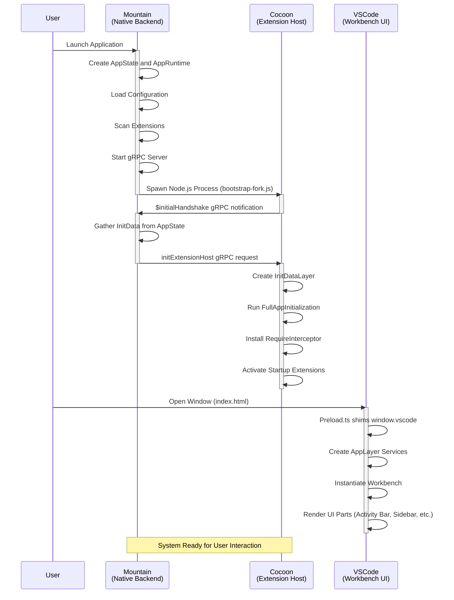

# Workflow Example #1: Application Startup and Handshake

**Goal:**

- Launch the entire `Land` application.
- Cover the `Mountain` native backend.
- Cover the `Wind` UI.
- Cover the `Cocoon` extension host.
- Detail the critical startup sequence.
- Detail the IPC handshake.
- Detail the initialization of all core services.
- Set the stage for all other user interactions.

This is the foundational workflow that enables all others.

---

## Table of Contents 📑

1. [Workflow Map](#workflow-map)
2. [Phase 1: Native Application Startup](#phase-1-native-application-startup)
3. [Phase 2: Sidecar Handshake and UI Launch](#phase-2-sidecar-handshake-and-ui-launch)
4. [Phase 3: Launching the Workbench](#phase-3-launching-the-workbench)
5. [Related Documentation](#related-documentation)

---

## Workflow Map 🗺️

---

## Phase 1: Native Application Startup 🚀

`Mountain` owns this phase.

1. **Application Launch**
   ([`Mountain/Source/Binary/Main/Entry.rs`](https://github.com/CodeEditorLand/Mountain/blob/Current/Source/Binary/Main/Entry.rs#L1)).
   - **Action:** The user launches the `Land` application.
   - The `main` function in `Mountain`'s `main.rs` is executed.
   - Tauri's `Builder` is created.
   - The `.setup()` hook is configured.
   - Inside the `.setup()` hook:
     - The central `AppState` is created and managed by Tauri.
     - The `MountainEnvironment` is created.
       It implements all the `Common` traits.
     - The `AppRuntime` is created.
       It is the engine for running effects and wraps the environment.
     - A `tokio` background task is spawned.
       It handles post-setup initializations.

2. **Post-Setup Initialization** (`Mountain` background task).
   - **Action:** The background task begins its work.
   - It calls
     [`ConfigurationInitialize::Fn`](https://github.com/CodeEditorLand/Mountain/tree/Current/Source/Binary/Service/ConfigurationInitialize.rs)
     to load all `settings.json` files from disk into `AppState`.
   - It calls
     [`ExtensionManagement`](https://github.com/CodeEditorLand/Mountain/tree/Current/Source/ExtensionManagement)
     to find all extensions and load their manifests into `AppState`.
   - If a pre-baked `extensions.manifest.json` exists in the bundle:
     - It was written by `Maintain/Build/Manifest/PreBake.ts` during `beforeBundleCommand`.
     - `Mountain` reads it in under 50 ms.
   - On first boot, or when the cache is absent:
     - `Mountain` falls back to a parallel `join_all` live scan.
     - The scan takes about 1200 ms.
     - `Mountain` caches the result for subsequent launches.
   - It calls
     [`vine::server::Initialize`](https://github.com/CodeEditorLand/Mountain/tree/Current/Source/Vine).
     This starts the gRPC server to listen for connections from `Cocoon`.
   - It then calls
     [`handlers::process_management::InitializeCocoon`](https://github.com/CodeEditorLand/Mountain/tree/Current/Source/ProcessManagement).

3. **Spawning the Sidecar**
   ([`ProcessManagement/CocoonManagement.rs`](https://github.com/CodeEditorLand/Mountain/blob/Current/Source/ProcessManagement/CocoonManagement.rs#L1)).
   - **Action:**
     [`LaunchAndManageCocoonSidecar`](https://github.com/CodeEditorLand/Mountain/blob/Current/Source/ProcessManagement/CocoonManagement.rs#L1)
     is executed.
   - It constructs a detailed environment for the sidecar.
   - It includes `VSCODE_PARENT_PID` to enable automatic shutdown.
   - It spawns the Node.js process:
     [`node ./Element/Cocoon/Scripts/cocoon/bootstrap-fork.js`](https://github.com/CodeEditorLand/Cocoon/blob/Current/Scripts/cocoon/bootstrap-fork.js#L1).
   - `Cocoon` is now running.

---

## Phase 2: Sidecar Handshake and UI Launch 🤝

`Cocoon` and `Wind` own this phase.

4. **`Cocoon` Initialization**
   ([`Cocoon/Source/Service/Effect/Bootstrap.ts`](https://github.com/CodeEditorLand/Cocoon/tree/Current/Source/Service/Effect/Bootstrap.ts)).
   - **Action:** The `Cocoon` process runs its bootstrap stages in order.
     1. **Environment:** Records Node.js version, platform, and arch.
     2. **Configuration:** Resolves `MOUNTAIN_GRPC_PORT` (50051) and `COCOON_GRPC_PORT` (50052).
        It populates `globalThis.__cocoonBootstrapConfig` and `globalThis.__LandTiers`.
     3. **RPCServer:** Binds `Cocoon`'s own gRPC server on port 50052.
        This must complete before `Mountain`'s 30-second gRPC connection budget expires.
     4. **ModuleInterceptor:** Installs the `require()` interceptor.
        It remaps `electron` to Tauri stubs and patches VS Code bundle loading.
     5. **MountainConnection:** TCP-probes `Mountain` on port 50051.
        It opens the gRPC channel and sends the `$initialHandshake` notification to signal readiness.
     6. **Extensions:** Activates enabled extensions concurrently, up to 8 in parallel.
        See step 6 for activation ordering details.
     7. **HealthCheck:** Optional final service health sweep.

5. **`Mountain` Responds to Handshake**
   ([`ProcessManagement`](https://github.com/CodeEditorLand/Mountain/tree/Current/Source/ProcessManagement)).
   - **Action:** `Mountain`'s gRPC server receives the `$initialHandshake`.
   - This signals `Mountain` to proceed.
   - It calls
     [`InitializationData`](https://github.com/CodeEditorLand/Mountain/tree/Current/Source/ProcessManagement/InitializationData.rs).
     This gathers all necessary data from `AppState`: workspace info, extension lists, configuration, and more.
   - It sends the `initExtensionHost` gRPC request back to `Cocoon`.
     The request contains this initialization payload.

6. **`Cocoon` Final Initialization**
   ([`Cocoon`](https://github.com/CodeEditorLand/Cocoon)).
   - **Action:** The
     [`initExtensionHost`](https://github.com/CodeEditorLand/Cocoon/blob/Current#L1)
     handler in `Cocoon` fires.
   - It uses the received payload to create and provide the
     [`InitDataLayer`](https://github.com/CodeEditorLand/Cocoon/blob/Current#L1).
   - It runs `FullAppInitialization`.
     This resolves the
     [`ExtensionHostProvider`](https://github.com/CodeEditorLand/Cocoon/blob/Current#L1)
     and activates startup extensions through the `*` activation event.
   - Extension activation uses topological ordering.
     If extension A declares `extensionDependencies: ["B"]`, extension B is activated first.
   - An `InProgress` Set prevents circular dependency deadlocks.
   - At this point, Workflow #3 (Language Features) and Workflow #6 (Webviews) can begin.
     Extensions register their providers.

7. **The UI Loads Simultaneously**
   ([`Wind/Source/Preload.ts`](https://github.com/CodeEditorLand/Wind/blob/Current/Source/Preload.ts#L1)).
   - **Action:** The main Tauri window opens.
   - It loads the `index.html` built by
     [`Sky/Source/pages/Mountain.astro`](https://github.com/CodeEditorLand/Sky/tree/Current/Source/pages/Mountain.astro).
   - The
     [`Preload.ts`](https://github.com/CodeEditorLand/Wind/blob/Current/Source/Preload.ts#L1)
     script executes first.
   - It shims the `window.vscode` global with Tauri-backed implementations.
     These cover `ipcRenderer` and `process`.
   - This is the critical bridge.
     It allows the VS Code workbench code to run.

---

## Phase 3: Launching the Workbench 🚀

`Wind` owns this phase.

8. **UI Application Entry Point**
   ([`Wind`](https://github.com/CodeEditorLand/Wind)).
   - **Action:** The main UI script runs.
   - It waits for the DOM to be ready.
   - It creates the master
     [`AppLayer`](https://github.com/CodeEditorLand/Wind).
     This composes all `Wind` services.
   - The composed services include:
     - [`LiveClipboardService`](https://github.com/CodeEditorLand/Wind/tree/Current/Source/Effect/Clipboard/Live.ts)
     - [`LiveDialogService`](https://github.com/CodeEditorLand/Wind)
     - [`LiveEditorService`](https://github.com/CodeEditorLand/Wind)
   - It converts this `Layer` into a `Runtime`.
   - It resolves the core services.
   - It instantiates the VS Code
     [`Workbench`](https://github.com/CodeEditorLand/Output/tree/Current/Source)
     class with `new Workbench(...)`.

9. **VS Code Workbench Startup**
   ([`Workbench`](https://github.com/CodeEditorLand/Output/tree/Current/Source)).
   - **Action:** The `Workbench.startup()` method is called.
   - This kicks off the entire UI rendering lifecycle.
   - It creates all the core UI parts: the Activity Bar, the Status Bar, the Side Bar, and the Editor Part.
   - As these parts are created, they begin to interact with the `Wind` services.
   - The File Explorer uses the `IFileService` to list directory contents.
     This triggers Workflow #2 (Opening a File).
   - The Command Palette uses the `ICommandService`.
     This triggers Workflow #5 (Executing a Command).
   - The application is now fully initialized and ready for user interaction.

---

## Related Documentation 📖

- [Workflow](../Workflow.md) - workflow index and per-Element architecture table
- [Opening a File from the UI](OpeningAFileFromTheUI.md) - Workflow #2
- [Invoking a Language Feature (Hover Provider)](InvokingALanguageFeatureHoverProvider.md) - Workflow #3
- [Saving a File with Save Participants](SavingAFileWithSaveParticipants.md) - Workflow #4
- [Executing a Command from the Command Palette](ExecutingACommandFromTheCommandPalette.md) - Workflow #5
- [Creating and Interacting with a Webview Panel](CreatingAndInteractingWithAWebviewPanel.md) - Workflow #6
- [Creating and Interacting with an Integrated Terminal](CreatingAndInteractingWithAnIntegratedTerminal.md) - Workflow #7
- [Source Control Management (SCM)](SourceControlManagementSCM.md) - Workflow #8
- [User Data Synchronization](UserDataSynchronization.md) - Workflow #9
- [Running Extension Tests](RunningExtensionTests.md) - Workflow #10
- [Tier-Gated Implementation Selection](TierGatedImplementationSelection.md) - Workflow #11
- [InterComponentProtocol](../InterComponentProtocol.md) - Tauri IPC, gRPC, and connection lifecycle

---

**Project Maintainers:** Source Open
([Source/Open@Editor.Land](mailto:Source/Open@Editor.Land)) |
[GitHub Repository](https://github.com/CodeEditorLand/Land) |
[Report an Issue](https://github.com/CodeEditorLand/Land/issues)
