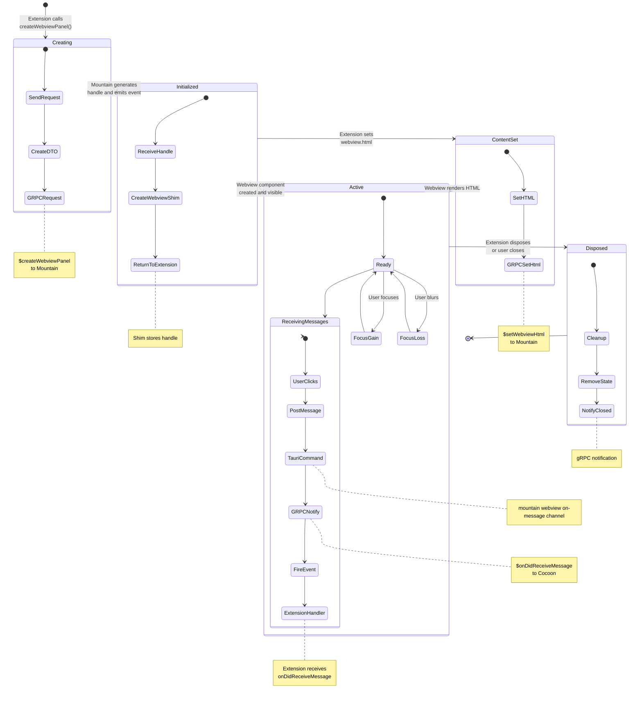
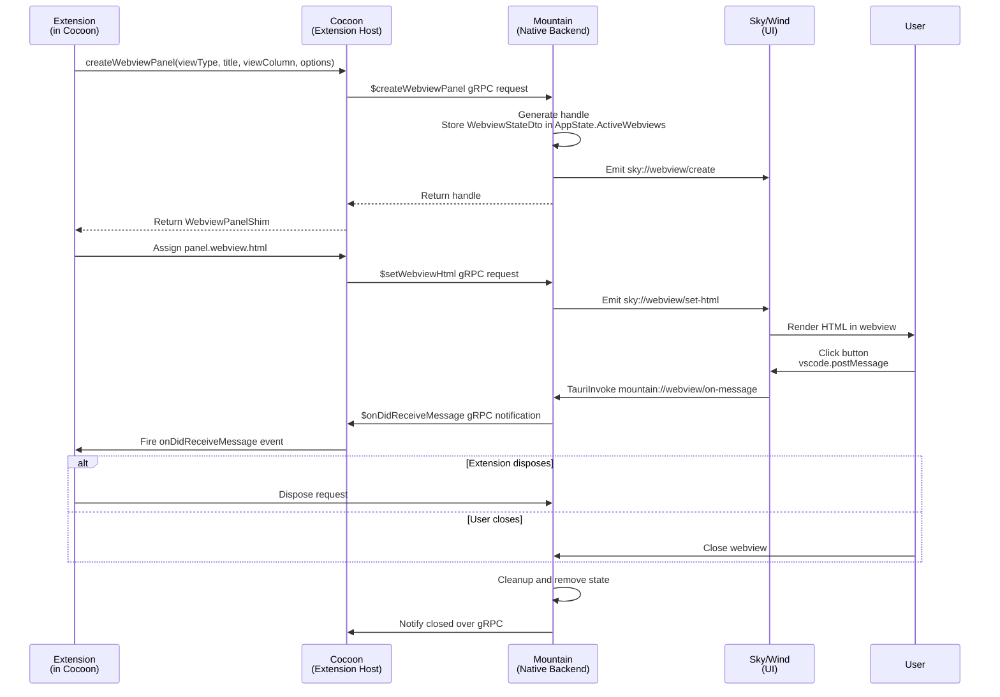

# Workflow Example #6: Creating and Interacting with a Webview Panel

**Goal:**

- An extension wants to show a custom user interface, such as a welcome page or a complex data visualization.
- The extension uses the `createWebviewPanel` API.
- The user interacts with the panel.
- The user sends messages back to the extension.

---

## Table of Contents 📑

1. [Lifecycle Map](#lifecycle-map)
2. [Message Flow](#message-flow)
3. [Phase 1: Extension Creates the Webview](#phase-1-extension-creates-the-webview)
4. [Phase 2: Host Creates the Native Webview](#phase-2-host-creates-the-native-webview)
5. [Phase 3: UI Renders the Webview](#phase-3-ui-renders-the-webview)
6. [Phase 4: Extension Sets Content and Interacts](#phase-4-extension-sets-content-and-interacts)
7. [Related Documentation](#related-documentation)

---

## Lifecycle Map 🗺️

---

## Message Flow 🔄

---

## Phase 1: Extension Creates the Webview 🧩

`Cocoon` owns this phase.

1. **Extension Activation (`Cocoon`).**
   - **Action:** An extension is activated.
   - Its `activate()` function runs.

2. **`vscode.window.createWebviewPanel()`**
   (`Cocoon/src/Service/WebviewPanel.ts`).
   - **Action:** The extension calls `window.createWebviewPanel(...)`.
   - It provides a `viewType`, a `title`, a `viewColumn`, and `options`.
   - The `options` include enabling scripts.
   - The `WebviewPanelProvider` service in `Cocoon` receives the call.
   - The provider's `CreateWebviewPanel` effect is executed.

3. **`IpcProvider` (`Cocoon/src/Service/Ipc.ts`).**
   - **Action:** The `CreateWebviewPanel` effect constructs a detailed DTO.
   - The DTO contains all the panel options.
   - It contains the extension's ID.
   - It contains the extension's location on disk, for resolving `localResourceRoots`.
   - It sends a `$createWebviewPanel` gRPC request to `Mountain` with this DTO.
   - It awaits a response.
   - The response is the unique `handle` (ID) for this new webview panel.

---

## Phase 2: Host Creates the Native Webview 🏔️

`Mountain` owns this phase.

4. **gRPC Server and Dispatcher**
   (`Mountain/Source/Vine/` and `src/track/`).
   - **Action:** The `$createWebviewPanel` request is received.
   - It is dispatched to the `WebviewProvider` trait implementation on the `MountainEnvironment`.

5. [`WebviewProvider.CreateWebviewPanel()`](https://github.com/CodeEditorLand/Mountain/blob/Current/Source/Environment/WebviewProvider.rs#L206)
   (`Mountain`).
   - **Action:** The `CreateWebviewPanel` method is executed on the `MountainEnvironment`.
   - It generates a unique handle for the new panel, such as a UUID.
   - It creates a `WebviewStateDto` containing all the options received from `Cocoon`.
   - It stores the DTO in `AppState.ActiveWebviews`, using the handle as the key.
   - Crucially, it emits a Tauri event to the `Sky` frontend:
     `AppHandle.emit("sky://webview/create", { Handle, Title, ... })`.
   - This command tells the UI layer to physically create a new webview component.
   - It sends the unique `handle` back to `Cocoon`.
   - This is the successful response to the gRPC request.

---

## Phase 3: UI Renders the Webview 🖼️

`Wind` and `Sky` own this phase.

6. **Webview Manager (`Wind`).**
   - **Action:** A listener in `Wind`, such as one in a `WebviewManagementService`, receives the `sky://webview/create` event from `Mountain`.
   - It dynamically creates a new `TauriWebviewWindow` or a webview `<iframe>`.
   - The new component is created within the main window's DOM.
   - It associates the component with the received `handle`.
   - This new webview is initially empty.

---

## Phase 4: Extension Sets Content and Interacts 🔄

`Cocoon`, `Mountain`, and `Wind` own this phase.

7. **`WebviewPanelProvider` (`Cocoon`, continued).**
   - **Action:** The `$createWebviewPanel` gRPC call resolves.
   - It returns the unique `handle`.
   - The service creates a `WebviewPanelShim` and a `WebviewShim` instance.
   - It stores the `handle` in those instances.
   - It returns the `WebviewPanelShim` to the extension.

8. **Extension Code (`Cocoon`).**
   - **Action:** The extension now has a `panel` object.
   - It sets the content by assigning a string of HTML:
     `panel.webview.html = "<h1>Hello World</h1>";`.
   - The `set html` accessor in the `WebviewShim` (`Service/Webview.ts`) is triggered.
   - It sends a `$setWebviewHtml` gRPC request to `Mountain`.
   - The request includes the `handle` and the HTML string.

9. [`WebviewProvider`](https://github.com/CodeEditorLand/Mountain/tree/Current/Source/Environment/WebviewProvider.rs)
   (`Mountain`).
   - **Action:** The `$setWebviewHtml` request is received.
   - It is dispatched to the WebviewProvider.
   - The provider looks up the webview in `AppState` using the `handle`.
   - It emits another Tauri event:
     `AppHandle.emit("sky://webview/set-html", { Handle, Html })`.

10. **Webview Manager (`Wind`).**
    - **Action:** The listener in `Wind` receives the `sky://webview/set-html` event.
    - It finds the webview component corresponding to the `handle`.
    - It sets the inner HTML of the webview element or window.
    - "Hello World" now appears in the UI.

11. **User Interaction (`Wind`, `Mountain`, and `Cocoon`).**
    - **Action:** The user clicks a button inside the webview's HTML.
    - The button has an `onclick` handler that calls
      `vscode.postMessage({ command: 'doSomething' })`.
    - The webview's content script has access to this `vscode` object.
    - A preload script for that webview provides the object.
    - This sends a message from the webview to its host, `Wind`.
    - The `Wind` webview component host sends a Tauri command to the backend:
      `TauriInvoke("mountain://webview/on-message", { Handle, Message })`.
    - `Mountain` receives this command.
    - The handler looks up the webview's owner sidecar, `cocoon-main`, in `AppState`.
    - `Mountain` sends a `$onDidReceiveMessage` gRPC notification to `Cocoon`.
    - The notification includes the `handle` and the message payload.
    - `Cocoon` receives the notification.
    - The `WebviewPanelProvider` finds the `WebviewShim` for that `handle`.
    - It fires its `onDidReceiveMessage` event.

12. **Extension Receives Message (`Cocoon`).**
    - **Action:** The extension's `panel.webview.onDidReceiveMessage` listener is executed.
    - It receives the `{ command: 'doSomething' }` payload.
    - The communication loop is complete.
    - The extension can now react to the user's action in the UI.

---

## Related Documentation 📖

- [Workflow](Workflow.md) - workflow index and per-Element architecture table
- [Application Startup and Handshake](ApplicationStartupAndHandshake.md) - Workflow #1
- [Opening a File from the UI](OpeningAFileFromTheUI.md) - Workflow #2
- [Invoking a Language Feature (Hover Provider)](InvokingALanguageFeatureHoverProvider.md) - Workflow #3
- [Saving a File with Save Participants](SavingAFileWithSaveParticipants.md) - Workflow #4
- [Executing a Command from the Command Palette](ExecutingACommandFromTheCommandPalette.md) - Workflow #5
- [Creating and Interacting with an Integrated Terminal](CreatingAndInteractingWithAnIntegratedTerminal.md) - Workflow #7
- [Source Control Management (SCM)](SourceControlManagementSCM.md) - Workflow #8
- [User Data Synchronization](UserDataSynchronization.md) - Workflow #9
- [Running Extension Tests](RunningExtensionTests.md) - Workflow #10
- [Tier-Gated Implementation Selection](TierGatedImplementationSelection.md) - Workflow #11
- [InterComponentProtocol](../InterComponentProtocol.md) - Tauri IPC, gRPC, and connection lifecycle

---

**Project Maintainers:** Source Open
([Source/Open@Editor.Land](mailto:Source/Open@Editor.Land)) |
[GitHub Repository](https://github.com/CodeEditorLand/Land) |
[Report an Issue](https://github.com/CodeEditorLand/Land/issues)
