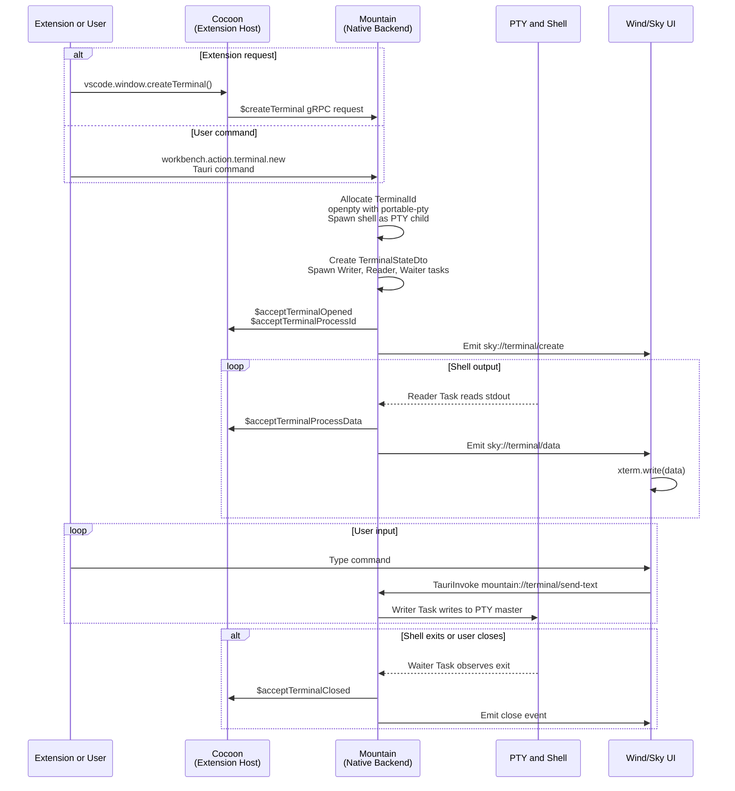

# Workflow Example #7: Creating and Interacting with an Integrated Terminal

**Goal:**

- An extension, or the user through a command, requests a new integrated terminal.
- A native shell process is spawned, such as `bash` or `powershell`.
- The shell's input and output are fully connected to a terminal UI component.
- The terminal UI component is in the frontend, for example Xterm.js.

---

## Table of Contents 📑

1. [Flow Map](#flow-map)
2. [Phase 1: Terminal Creation Request](#phase-1-terminal-creation-request)
3. [Phase 2: Native PTY Spawning](#phase-2-native-pty-spawning)
4. [Phase 3: UI Rendering and State Sync](#phase-3-ui-rendering-and-state-sync)
5. [Phase 4: User Input](#phase-4-user-input)
6. [Phase 5: Terminal Lifecycle Events](#phase-5-terminal-lifecycle-events)
7. [Phase 6: OSC 633 Shell Integration](#phase-6-osc-633-shell-integration)
8. [Related Documentation](#related-documentation)

---

## Flow Map 🗺️



---

## Phase 1: Terminal Creation Request 📥

`Cocoon` or `Wind` owns this phase.

1. **Request Origin.**
   - **Scenario A (Extension):**
     - An extension in `Cocoon` calls `vscode.window.createTerminal(...)`.
   - **Scenario B (User):**
     - The user executes the `workbench.action.terminal.new` command.
     - The command is run from the Command Palette in `Wind`.
   - **Result:**
     - In both scenarios, the request is routed to `Mountain`'s `TerminalProvider`.
     - It arrives as an `ActionEffect`, `Common::terminal::CreateTerminal`.
     - For the extension, this happens through a `$createTerminal` gRPC call.
     - For the user, it is a Tauri command.

---

## Phase 2: Native PTY Spawning ⚙️

`Mountain` owns this phase.

2. [`TerminalProvider.CreateTerminal()`](https://github.com/CodeEditorLand/Mountain/blob/Current/Source/Environment/TerminalProvider.rs#L122)
   (`Mountain`).
   - **Action:** The `CreateTerminal` method is executed on the `MountainEnvironment`.
   - It gets a new unique `TerminalId` from `AppState`.
   - It determines the shell to launch.
     The shell comes from the request options or the system default.
   - **Crucial Step:** It uses the `portable-pty` crate to spawn a native pseudo-terminal.
     The call is `PtySystem.openpty`.
     This creates a master and slave PTY pair.
   - It creates a `CommandBuilder` for the shell process, such as `bash`.
   - **It spawns the shell process as a child of the PTY slave.**
     The shell now believes it is talking to a real terminal.
   - It creates a `TerminalStateDto` to hold all the information.
     The DTO holds the `TerminalId`.
     It holds the OS process ID (`pid`) of the shell.
     It holds clones of the PTY master's reader and writer handles.

3. **I/O Task Spawning (`Mountain`).**
   - **Action:** The handler spawns several `tokio` tasks to manage the terminal's lifecycle.
     - **Writer Task:**
       - Creates a `tokio::mpsc` channel.
       - The sender end of this channel is stored in the `TerminalStateDto`.
       - The task runs in a loop, waiting for messages on the receiver end.
       - When it receives a string, it writes those bytes to the PTY master's writer handle.
       - This sends input to the shell.
     - **Reader Task:**
       - Runs in a loop, constantly reading from the PTY master's reader handle.
       - Whenever it receives data, the shell's output, it sends a `$acceptTerminalProcessData` gRPC notification to `Cocoon`.
       - The notification contains the `TerminalId` and the data string.
     - **Waiter Task:**
       - Awaits the termination of the child shell process.
       - When the process exits, it sends a `$acceptTerminalClosed` gRPC notification to `Cocoon`.
       - It also cleans up the terminal's entry from `AppState`.
   - The `TerminalStateDto` now contains the `mpsc` sender and the task handles.
   - It is stored in `AppState.ActiveTerminals`.

4. **Initial Notifications (`Mountain` to `Cocoon` and `Sky`).**
   - **Action:** The handler sends a `$acceptTerminalOpened` gRPC notification to `Cocoon`.
   - The notification includes the `TerminalId` and its name.
   - Cocoon's notification handler adds the terminal to the `__terminals` cache.
   - It fires the `onDidOpenTerminal` event to any listening extensions.
   - It also emits the same event to `Sky` through `AppHandle.emit`.
   - The workbench UI can then register the new terminal entry.
   - It also sends a `$acceptTerminalProcessId` notification.
   - That notification provides the OS-level `pid`.
   - Finally, it returns the creation details as the successful result of the original request.
     The details are the ID, the name, and the PID.

---

## Phase 3: UI Rendering and State Sync 🖥️

`Cocoon`, `Mountain`, `Wind`, and `Sky` own this phase.

5. **Cocoon Terminal Service**
   ([`Element/Cocoon/Source/Services/`](https://github.com/CodeEditorLand/Cocoon/tree/Current/Source/Services/)).
   - **Action:** The terminal service in `Cocoon` receives notifications from `Mountain`.
   - The notifications are `Opened`, `ProcessId`, and `Data`.
   - It creates a local `Terminal` proxy object.
   - The proxy represents the terminal to extensions.
   - When it receives data, it fires the `onDidWriteData` event for that specific terminal instance.
   - This allows extensions to listen to a terminal's output.

6. **`Mountain` to `Wind/Sky` Bridge.**
   - **Action:** In addition to notifying `Cocoon`, `Mountain`'s Reader Task from step 3 also needs to notify the frontend UI.
   - It emits a Tauri event directly to `Sky`:
     `AppHandle.emit("sky://terminal/data", { Id: TerminalId, Data: ... })`.

7. **Terminal UI Component (`Wind/Sky`).**
   - **Action:** A `Terminal` component in the UI listens for Tauri events.
   - The component likely wraps Xterm.js.
   - When it receives the `sky://terminal/create` event, it creates a new Xterm.js instance.
   - That event is triggered by the initial user action.
   - When it receives a `sky://terminal/data` event, it finds the correct Xterm.js instance by its `TerminalId`.
   - It calls `xterm.write(data)`.
   - The shell's output now appears in the UI.

---

## Phase 4: User Input ⌨️

`Wind`, `Sky`, `Mountain`, and the shell own this phase.

8. **Terminal UI Component (`Wind/Sky`).**
   - **Action:** The user types `ls -la` into the terminal UI.
   - The Xterm.js instance captures these keystrokes.
   - It uses its `onData` event handler to send the input string to the native backend.
   - It does this through a Tauri command:
     `TauriInvoke("mountain://terminal/send-text", { Id: TerminalId, Text: "ls -la\r" })`.

9. **`track.rs` and `handlers/terminal/TerminalLogic.rs` (`Mountain`).**
   - **Action:** The `mountain://terminal/send-text` command is dispatched to `track`.
   - `track` creates and runs the `Common::terminal::SendTextToTerminal` effect.
   - The `SendTextToTerminalLogic` handler is executed.
   - It looks up the `TerminalStateDto` for the given `TerminalId` in `AppState`.
   - It sends the input string, `ls -la\r`, to the `mpsc` sender channel.
   - That channel was stored in the `TerminalStateDto`.

10. **Writer Task (`Mountain`).**
    - **Action:** The Writer Task from step 3 was waiting on its receiver.
    - It immediately receives the string.
    - It writes the bytes of the string to the PTY master's writer handle.
    - The OS delivers this input to the waiting shell process.

11. **Shell Execution and Output Loop.**
    - **Action:** The `bash` or `powershell` process receives the input.
    - It executes the `ls -la` command.
    - It writes the resulting directory listing to its `stdout`.
    - This output is captured by the PTY slave and sent to the PTY master.
    - The Reader Task from step 3 reads this output.
    - The loop begins again from steps 6 and 7.
    - The output data is sent to both `Cocoon` and the `Wind/Sky` UI.
    - The user sees the command's output printed in their terminal.

---

## Phase 5: Terminal Lifecycle Events 🔔

When a terminal closes, the shell exits or the user explicitly closes it.

- The Waiter Task fires `$acceptTerminalClosed` to `Cocoon`.
- `Cocoon` removes the terminal from the `__terminals` cache.
- `Cocoon` fires the `onDidCloseTerminal` event.
- `Mountain` also emits the closure to `Sky` through a Tauri event.
- The workbench removes the terminal tab.

The full lifecycle event set available to extensions is:

| Event                       | Trigger                                    |
| --------------------------- | ------------------------------------------ |
| `onDidOpenTerminal`         | `$acceptTerminalOpened` gRPC from `Mountain` |
| `onDidCloseTerminal`        | `$acceptTerminalClosed` gRPC from `Mountain` |
| `onDidChangeActiveTerminal` | Focus change notification from `Wind/Sky`  |

---

## Phase 6: OSC 633 Shell Integration 🔌

Modern shells emit OSC 633 escape sequences to signal command lifecycle boundaries.
Land processes these sequences through the PTY Reader Task.
Land routes them as IPC calls:

```text
OSC 633 ; A          shell input line start (decoration marker)
OSC 633 ; B          shell input line end (decoration marker)
OSC 633 ; C          command start
                         -> localPty:shellExecutionStart IPC
                         -> Mountain stores in InflightExecution Map
                         -> $acceptTerminalShellExecutionStart gRPC to Cocoon
OSC 633 ; D[;<exit>] command end
                         -> localPty:shellExecutionEnd IPC
                         -> $acceptTerminalShellExecutionEnd gRPC to Cocoon
                         -> $acceptExecutedTerminalCommand gRPC to Cocoon
OSC 633 ; E;<line>   command line capture
                         -> stored per-terminal in InflightExecution Map
                           (associated with the next OSC 633 ; D flush)
```

Extension subscribers receive these events through:

- `window.onDidStartTerminalShellExecution` - fires on OSC 633 ; C.
- `window.onDidEndTerminalShellExecution` - fires on OSC 633 ; D.
- `window.onDidExecuteTerminalCommand` - fires after OSC 633 ; D with the captured command line and exit code.

---

## Related Documentation 📖

- [Workflow](../Workflow.md) - workflow index and per-Element architecture table
- [Application Startup and Handshake](ApplicationStartupAndHandshake.md) - Workflow #1
- [Opening a File from the UI](OpeningAFileFromTheUI.md) - Workflow #2
- [Invoking a Language Feature (Hover Provider)](InvokingALanguageFeatureHoverProvider.md) - Workflow #3
- [Saving a File with Save Participants](SavingAFileWithSaveParticipants.md) - Workflow #4
- [Executing a Command from the Command Palette](ExecutingACommandFromTheCommandPalette.md) - Workflow #5
- [Creating and Interacting with a Webview Panel](CreatingAndInteractingWithAWebviewPanel.md) - Workflow #6
- [Source Control Management (SCM)](SourceControlManagementSCM.md) - Workflow #8
- [User Data Synchronization](UserDataSynchronization.md) - Workflow #9
- [Running Extension Tests](RunningExtensionTests.md) - Workflow #10
- [Tier-Gated Implementation Selection](TierGatedImplementationSelection.md) - Workflow #11
- [InterComponentProtocol](../InterComponentProtocol.md) - Tauri IPC, gRPC, and connection lifecycle

---

**Project Maintainers:** Source Open
([Source/Open@Editor.Land](mailto:Source/Open@Editor.Land)) |
[GitHub Repository](https://github.com/CodeEditorLand/Land) |
[Report an Issue](https://github.com/CodeEditorLand/Land/issues)
