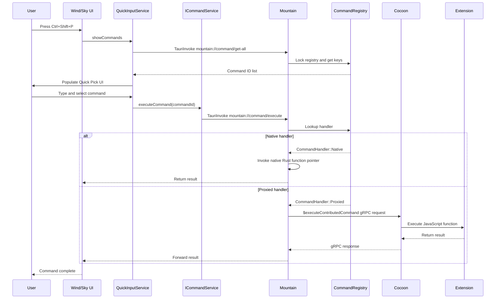

# Workflow Example #5: Executing a Command from the Command Palette

**Goal:**

- The user opens the Command Palette with `Ctrl+Shift+P`.
- The user types the name of a command, such as "Format Document".
- The user selects the command.
- The corresponding action is executed.
- This workflow covers a native command.
- This workflow covers an extension-provided command.

---

## Table of Contents 📑

1. [Flow Map](#flow-map)
2. [Phase 1: Opening the Command Palette](#phase-1-opening-the-command-palette)
3. [Phase 2: Fetching the Command List](#phase-2-fetching-the-command-list)
4. [Phase 3: Displaying and Selecting a Command](#phase-3-displaying-and-selecting-a-command)
5. [Phase 4A: Executing a Native Command](#phase-4a-executing-a-native-command)
6. [Phase 4B: Executing an Extension Command](#phase-4b-executing-an-extension-command)
7. [registerTextEditorCommand](#registertexteditorcommand)
8. [onDidExecuteCommand](#ondidexecutecommand)
9. [Related Documentation](#related-documentation)

---

## Flow Map 🗺️

---

## Phase 1: Opening the Command Palette ⌨️

`Wind` and `Sky` own this phase.

1. **User Input.**
   - **Action:** The user presses `Ctrl+Shift+P`.
   - The keybinding system dispatches the `workbench.action.showCommands` command.

2. **`QuickInputService` (`Wind/Source/Application/QuickInput/Definition.ts`).**
   - **Action:** The handler for `showCommands` invokes `quickInputService.quickAccess.show()`.
   - This opens the Quick Pick UI.
   - The UI is configured for showing commands.

3. **`CommandsQuickAccessProvider`**
   (`vs/workbench/contrib/quickaccess/browser/commandsQuickAccess.ts`).
   - **Action:** This provider populates the Quick Pick list.
   - To get the list of all available commands, it needs to call `ICommandService.getCommands()`.
   - This code is in `Wind`, but the registry is in `Mountain`.
   - It therefore makes an `Integration` layer call.
   - It executes an Effect that wraps `TauriInvoke('mountain://command/get-all')`.

---

## Phase 2: Fetching the Command List 📋

`Mountain` owns this phase.

4. [`track.rs`](https://github.com/CodeEditorLand/Mountain/tree/Current/Source/Track/mod.rs)
   and
   [`CommandProvider.rs`](https://github.com/CodeEditorLand/Mountain/tree/Current/Source/Environment/CommandProvider.rs)
   (`Mountain`).
   - **Action:** The Tauri command is dispatched to `track`.
   - `track` creates the `Common::command::GetAllCommands` effect.
   - The `AppRuntime` executes the effect.
   - The `MountainEnvironment` implementation of `CommandExecutor::GetAllCommands` is called.
   - It delegates to the handler.

5. [`CommandProvider.GetAllCommands()`](https://github.com/CodeEditorLand/Mountain/blob/Current/Source/Environment/CommandProvider.rs#L322).
   - **Action:** The `GetAllCommands` method is executed.
   - It acquires a lock on `AppState.CommandRegistry`.
   - It retrieves the `keys()` of the `HashMap`.
   - The keys contain the IDs of all registered native commands.
   - They also contain all proxied commands from `Cocoon`.
   - It returns this list of command ID strings.

---

## Phase 3: Displaying and Selecting a Command 🖱️

`Wind` and `Sky` own this phase.

6. **`CommandsQuickAccessProvider` (continued).**
   - **Action:** The `TauriInvoke` promise resolves with the list of command IDs.
   - The provider populates the Quick Pick UI with the command list.
   - The list becomes visible to the user.

7. **User Selection.**
   - **Action:** The user types "Format Document" and presses Enter.
   - The Quick Pick widget registers that the command `editor.action.formatDocument` has been selected.
   - It then calls `ICommandService.executeCommand('editor.action.formatDocument')`.

---

## Phase 4A: Executing a Native Command 🛠️

`Wind` calls into `Mountain` in this phase.

8. **`CommandService` (`Wind`).**
   - **Action:** The `executeCommand` call is made.
   - The `CommandService` in `Wind` is a thin client.
   - It immediately forwards the request to the backend.
   - It creates and runs an Effect that wraps
     `TauriInvoke('mountain://command/execute', { commandId: 'editor.action.formatDocument', args: [...] })`.

9. **`track.rs` and `environment/CommandsProvider.rs` (`Mountain`).**
   - **Action:** The request is dispatched to `track`.
   - `track` creates the `Common::command::ExecuteCommand` effect.
   - The `AppRuntime` executes it.
   - The `MountainEnvironment` `CommandExecutor::ExecuteCommand` is called.

10. [`CommandProvider.ExecuteCommand()`](https://github.com/CodeEditorLand/Mountain/blob/Current/Source/Environment/CommandProvider.rs#L231)
    (`Mountain`).
    - **Action:** The `ExecuteCommand` method is executed.
    - It acquires a lock on `AppState.CommandRegistry`.
    - It looks up `'editor.action.formatDocument'`.
    - It finds that the handler is of the type `CommandHandler::Native`.
    - It invokes the corresponding native Rust function pointer.
    - It passes it the `AppHandle`, the `Window`, the `AppRuntime`, and the arguments.

11. **Native Formatting Handler.**
    - **Action:** The native Rust code for formatting a document runs.
    - This might involve:
      - Getting the active document's content from `AppState`.
      - Finding a registered formatting provider in `AppState`.
        That provider may itself be proxied to `Cocoon`.
      - Requesting edits from the provider.
      - Applying the edits through the `WorkspaceEditApplier`.
    - The command completes.
    - Its result, if any, is returned up the call chain.

---

## Phase 4B: Executing an Extension Command 🧩

`Wind`, `Mountain`, and `Cocoon` own this phase.

The `CommandService` call and the `track.rs` dispatch from steps 8 and 9 are the same here.

12. **`handlers/commands/CommandsLogic.rs` (`Mountain`).**
    - **Action:** `ExecuteCommandLogic` looks up `'my-extension.doSomething'`.
    - It finds that the handler is of the type
      `CommandHandler::Proxied { SidecarIdentifier: "cocoon-main", CommandIdentifier: "my-extension.doSomething" }`.

13. **`IpcProvider` (`Mountain`).**
    - **Action:** The handler knows it must proxy the request.
    - It uses the `IpcProvider` capability from the `MountainEnvironment`.
    - It makes a `$executeContributedCommand` gRPC request to `Cocoon`.
    - The request carries the command ID and its arguments.

14. **`IpcProvider` and Command Handler (`Cocoon`).**
    - **Action:** `Cocoon`'s gRPC server receives the request.
    - It dispatches the request to the `CommandsProvider`.
    - The `CommandsProvider` looks up `'my-extension.doSomething'` in its own local registry.
    - It finds the JavaScript function provided by the extension.
    - It executes that function.

15. **Result Propagation.**
    - **Action:** The extension's command finishes and returns a result, such as a string or number.
    - This result is serialized.
    - It is sent back to `Mountain` as the response to the gRPC request.
    - `Mountain` receives the gRPC response.
    - It forwards the response back to `Wind` as the result of the `TauriInvoke` promise.
    - The command execution is complete.

---

## registerTextEditorCommand 🔧

`vscode.commands.registerTextEditorCommand(id, callback)` wraps the callback so it always receives `(textEditor, editBuilder, ...args)` with live objects:

- **`textEditor`:** The active `TextEditor` proxy.
  It includes `.edit()`, `.setDecorations()`, and `.revealRange()`.
- **`editBuilder`:** The real `TextEditorEdit` buffer.
  It is tied to the active Monaco model.
  - Edits collected through `builder.replace()`, `builder.insert()`, and `builder.delete()` are applied atomically when the callback returns.
  - If the callback is async and returns a `Promise`, the builder waits for it to resolve before flushing.

When no editor is active, a no-op builder is passed.
The extension's pre-edit setup still runs.

---

## onDidExecuteCommand 📢

- Mountain emits `sky://commands/executed` to the Sky renderer after every command dispatch.
- At the same time, it sends `$acceptCommandExecuted` over the Vine gRPC channel to Cocoon.
- `Notification/Handler.ts` in Cocoon catches the Vine notification.
- It re-emits the notification on the shared `Emitter` channel `commands.executed`.
- The `onDidExecuteCommand` subscription in `Commands/Namespace.ts` listens on that channel.
- Extensions receive the event for both native and extension-contributed commands.
- Local Cocoon-to-Cocoon `executeCommand` calls also emit on `commands.executed` directly.
- This ensures extension-to-extension calls are visible to listeners without a Mountain round-trip.

---

## Related Documentation 📖

- [Workflow](../Workflow.md) - workflow index and per-Element architecture table
- [Application Startup and Handshake](ApplicationStartupAndHandshake.md) - Workflow #1
- [Opening a File from the UI](OpeningAFileFromTheUI.md) - Workflow #2
- [Invoking a Language Feature (Hover Provider)](InvokingALanguageFeatureHoverProvider.md) - Workflow #3
- [Saving a File with Save Participants](SavingAFileWithSaveParticipants.md) - Workflow #4
- [Creating and Interacting with a Webview Panel](CreatingAndInteractingWithAWebviewPanel.md) - Workflow #6
- [Creating and Interacting with an Integrated Terminal](CreatingAndInteractingWithAnIntegratedTerminal.md) - Workflow #7
- [Source Control Management (SCM)](SourceControlManagementSCM.md) - Workflow #8
- [User Data Synchronization](UserDataSynchronization.md) - Workflow #9
- [Running Extension Tests](RunningExtensionTests.md) - Workflow #10
- [Tier-Gated Implementation Selection](TierGatedImplementationSelection.md) - Workflow #11
- [InterComponentProtocol](../InterComponentProtocol.md) - Tauri IPC, gRPC, and connection lifecycle

---

**Project Maintainers:** Source Open
([Source/Open@Editor.Land](mailto:Source/Open@Editor.Land)) |
[GitHub Repository](https://github.com/CodeEditorLand/Land) |
[Report an Issue](https://github.com/CodeEditorLand/Land/issues)
