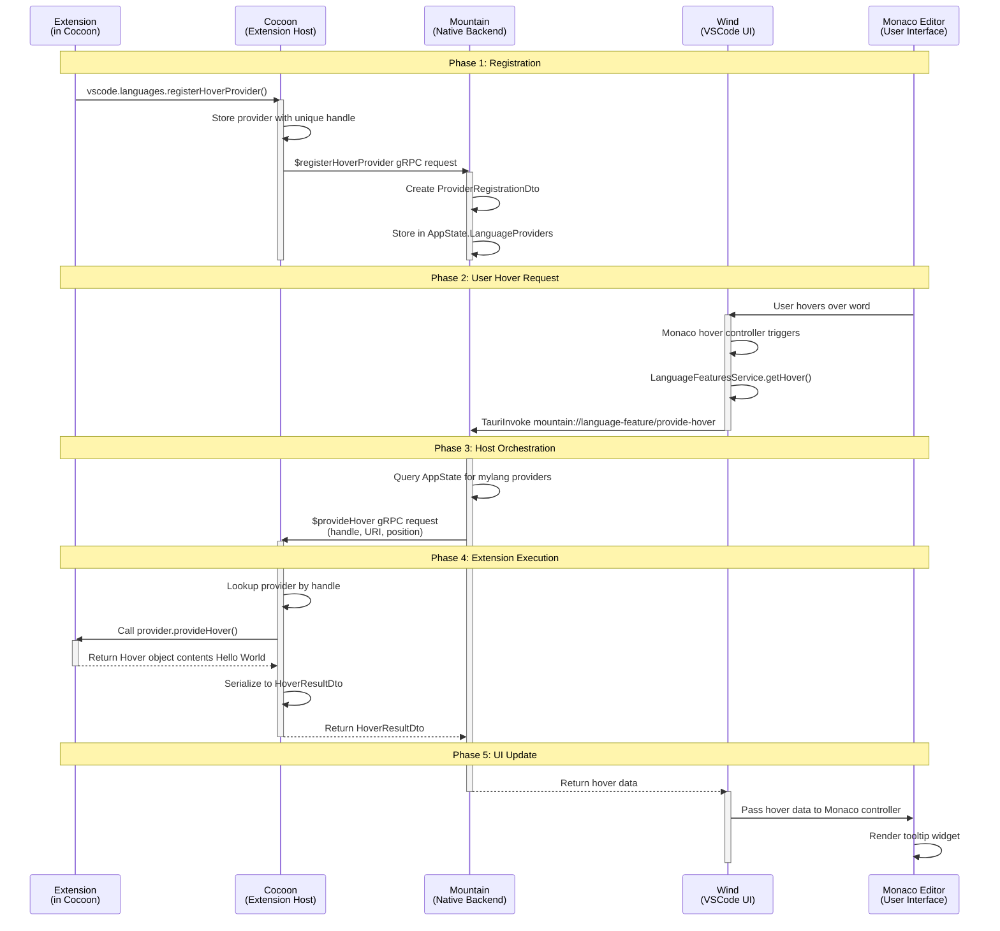

# Workflow Example #3: Invoking a Language Feature (Hover Provider)

**Goal:**

- An extension has registered a Hover Provider.
- The user hovers the mouse over a word in the editor.
- The extension's logic is executed.
- The resulting tooltip is displayed in the UI.

---

## Table of Contents 📑

1. [Flow Map](#flow-map)
2. [Phase 1: Extension Registration](#phase-1-extension-registration)
3. [Phase 2: Host-Side Provider Registration](#phase-2-host-side-provider-registration)
4. [Phase 3: User Interaction and UI Request](#phase-3-user-interaction-and-ui-request)
5. [Phase 4: Host-Side Orchestration](#phase-4-host-side-orchestration)
6. [Phase 5: Extension Execution and Response](#phase-5-extension-execution-and-response)
7. [Phase 6: Final UI Update](#phase-6-final-ui-update)
8. [Resolve Methods](#resolve-methods)
9. [Inline Completions](#inline-completions)
10. [Related Documentation](#related-documentation)

---

## Flow Map 🗺️

---

## Phase 1: Extension Registration 📝

`Cocoon` owns this phase.

1. **Extension Activation** (`Cocoon/src/Core/ExtensionHost.ts`).
   - **Action:** An extension, such as `my-lang-extension`, is activated by `Cocoon`.
   - Its `activate()` function is called.

2. **`vscode.languages.registerHoverProvider()`**
   (`Cocoon/src/Service/LanguageFeatures.ts`).
   - **Action:** The extension's code calls
     `vscode.languages.registerHoverProvider('mylang', provider)`.
   - The `LanguageFeaturesProvider` in `Cocoon` receives this call.
   - It stores the `provider` object in a local map.
     That object contains the `provideHover` method.
   - It associates the object with a new unique handle, such as `handle: 123`.
   - It serializes the provider metadata into a DTO.
     The metadata includes the language selector `'mylang'` and the extension ID.
   - It sends a `$registerHoverProvider` gRPC request to `Mountain`.
     The request includes the handle `123` and the metadata.

---

## Phase 2: Host-Side Provider Registration 🏔️

`Mountain` owns this phase.

3. **gRPC Server**
   (`Mountain/Source/Vine/server/MountainVineGrpcService.rs`).
   - **Action:** The gRPC server receives the `$registerHoverProvider` request.
   - It passes the request to the `track` dispatcher.

4. **Dispatcher**
   ([`Mountain/Source/Track/mod.rs`](https://github.com/CodeEditorLand/Mountain/tree/Current/Source/Track/mod.rs)).
   - **Action:** `DispatchSidecarRequest` is called.
   - It maps the method name `$registerHoverProvider` to an `ActionEffect` via `EffectCreation`.
   - The effect is `LanguageFeature::RegisterProvider`.

5. [`LanguageFeatureProvider.RegisterProvider()`](https://github.com/CodeEditorLand/Mountain/tree/Current/Source/Environment/LanguageFeatureProvider/mod.rs#L49)
   (`Mountain`).
   - **Action:** The `AppRuntime` executes the `RegisterProvider` effect.
   - The `MountainEnvironment` implementation of the `LanguageFeatureProviderRegistry` trait is called.
   - It delegates to the
     [`Registration`](https://github.com/CodeEditorLand/Mountain/tree/Current/Source/Environment/LanguageFeatureProvider/Registration.rs)
     helper module.

6. [`Registration.register_provider()`](https://github.com/CodeEditorLand/Mountain/tree/Current/Source/Environment/LanguageFeatureProvider/Registration.rs)
   (`Mountain`).
   - **Action:** The `register_provider` helper function creates a `ProviderRegistrationDTO`.
   - It stores the DTO in `AppState.LanguageProviders`.
   - The DTO contains:
     - The handle `123`.
     - The provider type `Hover`.
     - The language selector.
     - The ID of the sidecar that owns it, `cocoon-main`.
   - `Mountain` now knows that for the language "mylang", `cocoon-main` has a hover provider with handle `123`.

---

## Phase 3: User Interaction and UI Request 🖱️

`Wind` and `Sky` own this phase.

7. **Monaco Editor UI.**
   - **Action:** The user moves the mouse over a word in an editor showing a "mylang" file.
   - Monaco's internal hover controller is triggered.
   - It needs to fetch hover information for the current position.
   - This logic ultimately calls the `ILanguageFeaturesService` `getHover` method.

8. **`LanguageFeaturesService.getHover()` (`Wind`).**
   - **Action:** This UI-side service orchestrates the hover request.
   - It creates an `Effect` that describes the operation.
   - The effect calls the `IEditorService` to get the current editor model and position.
   - It then makes an `Integration` layer call to `TauriInvoke`.
   - The command is `mountain://language-feature/provide-hover`.

---

## Phase 4: Host-Side Orchestration 🔄

`Mountain` calls into `Cocoon` and back in this phase.

9. **`Mountain/Source/handlers/protocol/ProtocolLogic.rs`.**
   - **Action:** The `HandleCustomUriSchemeRequest` function receives the
     `mountain://language-feature/provide-hover` request.
   - It dispatches the request to the `track` module.
   - The `track` module creates the `LanguageFeature::ProvideHover` effect.

10. [`LanguageFeatureProvider.ProvideHover()`](https://github.com/CodeEditorLand/Mountain/tree/Current/Source/Environment/LanguageFeatureProvider/FeatureMethods.rs)
    (`Mountain`).
    - **Action:** The `AppRuntime` executes the `ProvideHover` effect.
    - The environment's implementation delegates to the `FeatureMethods` helper module.
    - Inside this method:
      - It queries `AppState.LanguageProviders` for all registered hover providers for the "mylang" language.
      - It finds the registration with handle `123` belonging to `cocoon-main`.
      - It now knows it needs to ask `cocoon-main` to do the work.
      - It makes a `$provideHover` gRPC request to `Cocoon`.
        The request carries the document URI, the position, and the original provider handle `123`.

---

## Phase 5: Extension Execution and Response ⚙️

`Cocoon` owns this phase.

11. **gRPC Server (`Cocoon/src/Service/Ipc/Server.ts`).**
    - **Action:** `Cocoon`'s gRPC server receives the `$provideHover` request.
    - It passes the request to its `RpcDispatcher`.

12. **`TreeViewProvider` in `Cocoon`, or a more general Features RPC handler.**
    - **Action:** The dispatcher finds the handler for `$provideHover`.
    - This handler looks up the provider object associated with handle `123` in its local map.
    - It finds the `provider` object that the extension originally registered.
    - It calls `provider.provideHover(document, position, token)`.
      The extension's code is now executing.
    - The extension's code returns a `Hover` object, such as
      `{ contents: ['Hello World'] }`.
    - The handler receives this `Hover` object.
    - It uses the `TypeConverter` to serialize it into a `HoverResultDto`.
    - It sends the `HoverResultDto` back to `Mountain` as the response to the gRPC request.

---

## Phase 6: Final UI Update 🖥️

`Mountain` and `Wind` own this phase.

13. **`LanguageFeaturesProvider` (`Mountain` continued).**
    - **Action:** The gRPC call to `Cocoon` resolves with the `HoverResultDto`.
    - The `ProvideHover` `ActionEffect` in `Mountain` succeeds, yielding this DTO.
    - The result is serialized.
    - It is sent back as the response to the original Tauri `invoke` from step 8.

14. **`LanguageFeaturesService` (`Wind` continued).**
    - **Action:** The `TauriInvoke` promise resolves with the hover data.
    - The `getHover` effect succeeds.
    - The service passes the `Hover` data to Monaco's hover controller.

15. **Monaco Editor UI.**
    - **Action:** The hover controller receives the content.
    - It renders the tooltip widget on the screen.
    - The user now sees the "Hello World" tooltip.

---

## Resolve Methods 🔬

The same `InvokeLanguageProvider` dispatch path used for `$provideHover` also handles the resolve phase of two-phase providers.

The following methods are fully routed through `FeatureMethods.rs` and return results to the caller rather than being dropped:

- `$resolveCodeAction`
- `$resolveCompletionItem`
- `$resolveHover`
- `$resolveInlayHint`
- `$resolveDocumentLink`
- `$resolveWorkspaceSymbol`

---

## Inline Completions ✍️

The same gRPC dispatch path handles inline completion providers.
These providers are used by code completion tools such as Copilot.

- When an extension calls `vscode.languages.registerInlineCompletionItemProvider()`:
  - The handle is stored in `AppState.LanguageProviders` under the `InlineCompletion` type.
- `Sky` registers the provider with `ILanguageFeaturesService.inlineCompletionsProvider`.
  - Registration uses the `sky://language/register-inline-completions` bridge channel.
- When the editor requests completions:
  - `Mountain` routes `language:provideInlineCompletions` through the same `LanguageFeatureProviderRegistry` trait and gRPC path as hover.
  - It returns `InlineCompletionItem[]` to the editor.

---

## Related Documentation 📖

- [Workflow](Workflow.md) - workflow index and per-Element architecture table
- [Application Startup and Handshake](ApplicationStartupAndHandshake.md) - Workflow #1
- [Opening a File from the UI](OpeningAFileFromTheUI.md) - Workflow #2
- [Saving a File with Save Participants](SavingAFileWithSaveParticipants.md) - Workflow #4
- [Executing a Command from the Command Palette](ExecutingACommandFromTheCommandPalette.md) - Workflow #5
- [Creating and Interacting with a Webview Panel](CreatingAndInteractingWithAWebviewPanel.md) - Workflow #6
- [Creating and Interacting with an Integrated Terminal](CreatingAndInteractingWithAnIntegratedTerminal.md) - Workflow #7
- [Source Control Management (SCM)](SourceControlManagementSCM.md) - Workflow #8
- [User Data Synchronization](UserDataSynchronization.md) - Workflow #9
- [Running Extension Tests](RunningExtensionTests.md) - Workflow #10
- [Tier-Gated Implementation Selection](TierGatedImplementationSelection.md) - Workflow #11
- [InterComponentProtocol](../InterComponentProtocol.md) - Tauri IPC, gRPC, and connection lifecycle

---

**Project Maintainers:** Source Open
([Source/Open@Editor.Land](mailto:Source/Open@Editor.Land)) |
[GitHub Repository](https://github.com/CodeEditorLand/Land) |
[Report an Issue](https://github.com/CodeEditorLand/Land/issues)
