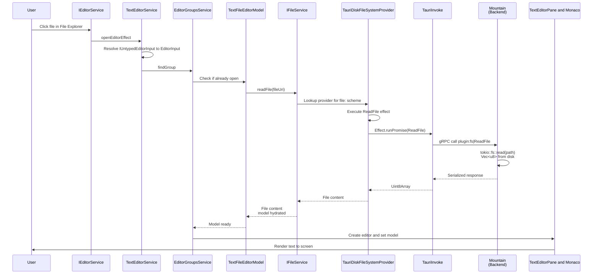

# Workflow Example #2: Opening a File from the UI

**Goal:**

- The user clicks a file in the File Explorer.
- The File Explorer belongs to the `Wind` and `Sky` UI.
- The file content is loaded into an editor.

This workflow demonstrates the interplay between:

- The UI.
- The editor services.
- The filesystem provider.
- The backend.

---

## Table of Contents 📑

1. [Flow Map](#flow-map)
2. [Phase 1: User Interaction](#phase-1-user-interaction)
3. [Phase 2: Editor and Filesystem Logic](#phase-2-editor-and-filesystem-logic)
4. [Phase 3: Native File I/O and Response](#phase-3-native-file-io-and-response)
5. [Phase 4: Data Unwinds and UI Renders](#phase-4-data-unwinds-and-ui-renders)
6. [openTextDocument Variants](#opentextdocument-variants)
7. [Related Documentation](#related-documentation)

---

## Flow Map 🗺️

---

## Phase 1: User Interaction 🖱️

`Wind` and `Sky` own this phase.

1. **File Explorer UI (React, Vue, or another framework).**
   - **Action:** The user clicks a `
` representing `my-file.ts` in the File Explorer component.
   - The `onClick` handler for this `div` is triggered.
   - This handler knows the `URI` of the file it represents.
   - It calls a function to open the file.
   - That function ultimately invokes the `IEditorService`.

2. **`IEditorService.openEditor()`**
   ([`Wind/Source/Effect/WorkbenchEditor`](https://github.com/CodeEditorLand/Wind/tree/Current/Source/Effect/WorkbenchEditor)).
   - **Action:** The UI calls
     [`editorService.openEditor({ resource: fileUri })`](https://github.com/CodeEditorLand/Wind/tree/Current/Source/Effect/WorkbenchEditor).
   - The
     [`openEditorEffect`](https://github.com/CodeEditorLand/Wind/tree/Current/Source/Effect/WorkbenchEditor)
     inside `Definition.ts` is executed.
   - The input is an
     [`IUntypedEditorInput`](https://github.com/CodeEditorLand/Wind/tree/Current/Source/Effect/WorkbenchEditor).
   - The effect first calls the
     [`TextEditorService`](https://github.com/CodeEditorLand/Wind/tree/Current/Source/Effect/WorkbenchEditor).
   - It resolves the input into a concrete
     [`EditorInput`](https://github.com/CodeEditorLand/Wind/tree/Current/Source/Effect/WorkbenchEditor)
     instance.
   - Next, it calls `findGroup`.
   - `findGroup` determines which editor group should handle the opening.
     The currently active group is one option.

---

## Phase 2: Editor and Filesystem Logic 🔗

`Wind` calls into `Mountain` in this phase.

3. **`EditorGroupsService`**
   ([`Wind/Source/Effect/WorkbenchEditor`](https://github.com/CodeEditorLand/Wind/tree/Current/Source/Effect/WorkbenchEditor)).
   - **Action:** The `openEditor` method is called on the target `EditorGroupModel`.
   - The group model checks if an editor for this `fileUri` is already open.
   - If so, it focuses that editor.
   - If not, it begins the process of opening a new editor.
     It uses the `EditorInput`'s `resolve()` method to get the editor model.

4. **`EditorInput.resolve()` calls [`TextFileEditorModel.load()`](https://github.com/CodeEditorLand/Wind/tree/Current/Source/Effect/WorkbenchEditor).**
   - **Action:** To display the content, the editor input needs to load its underlying model.
   - The `TextFileEditorModel` is responsible for this.
   - Its
     [`load()`](https://github.com/CodeEditorLand/Wind/tree/Current/Source/Effect/WorkbenchEditor)
     method needs to get the file's content.
   - It achieves this by calling the
     [`IFileService`](https://github.com/CodeEditorLand/Wind/tree/Current/Source/FileSystem).

5. **`IFileService.readFile()`**
   ([`Wind/Source/FileSystem`](https://github.com/CodeEditorLand/Wind/tree/Current/Source/FileSystem)).
   - **Action:** The file service's `readFile(fileUri)` method is called.
   - It looks up the registered provider for the URI's scheme.
     In this case, the scheme is `file:`.
   - It finds the
     [`TauriDiskFileSystemProvider`](https://github.com/CodeEditorLand/Wind/tree/Current/Source/FileSystem).
   - That provider comes from
     [`FileSystem/Definition.ts`](https://github.com/CodeEditorLand/Wind/tree/Current/Source/FileSystem).

6. **`TauriDiskFileSystemProvider.readFile()`**
   ([`Wind/Source/FileSystem`](https://github.com/CodeEditorLand/Wind/tree/Current/Source/FileSystem)).
   - **Action:** The provider's
     [`readFile`](https://github.com/CodeEditorLand/Wind/tree/Current/Source/FileSystem)
     method is called.
   - This method immediately executes the
     [`ReadFile`](https://github.com/CodeEditorLand/Wind/tree/Current/Source/FileSystem)
     effect from the Tauri `Integration` layer:
     [`Effect.runPromise(ReadFile(fileUri))`](https://github.com/CodeEditorLand/Wind/tree/Current/Source/FileSystem).

7. **`Wind/Source/Service/TauriMainProcessService.ts`**
   - **Action:** The
     [`ReadFile`](https://github.com/CodeEditorLand/Wind/tree/Current/Source/Service/TauriMainProcessService.ts)
     effect executes.
   - It calls
     [`TauriInvoke('plugin:fs|ReadFile', { path: fileUri.fsPath })`](https://github.com/CodeEditorLand/Wind/tree/Current/Source/Service/TauriMainProcessService.ts).
   - This sends the request from the webview to the `Mountain` backend.

---

## Phase 3: Native File I/O and Response 💾

`Mountain` owns this phase.

8. **[`Mountain/Source/Binary/Main/Entry.rs`](https://github.com/CodeEditorLand/Mountain/tree/Current/Source/Binary/Main/Entry.rs) calls the Tauri `fs` Plugin**
   - **Action:** Tauri receives the
     [`plugin:fs|ReadFile`](https://github.com/CodeEditorLand/Wind/tree/Current/Source/Service/TauriMainProcessService.ts)
     command.
   - It routes this to the `tauri-plugin-fs` internal Rust handler.
   - The plugin performs the native filesystem operation:
     `tokio::fs::read(path)`.
   - The file content, as `Vec<u8>`, is read from disk.
   - The result is serialized.
   - It is sent back to the `Wind` webview as the resolution of the `TauriInvoke` promise.

---

## Phase 4: Data Unwinds and UI Renders 🖥️

`Wind` owns this phase.

9. **`TauriMainProcessService.ts` (continued).**
   - **Action:** The `TauriInvoke` promise resolves with the file content.
   - The `ReadFile` Effect succeeds.
   - It yields the `Uint8Array`.

10. **`TextFileEditorModel` (continued).**
    - **Action:** The `load()` method succeeds.
    - The model is now hydrated with the file content.
    - The `EditorInput` is now fully resolved.

11. **`EditorGroupsService` (continued).**
    - **Action:** The `openEditor` method now has a resolved input and model.
    - It creates a new
      [`TextEditorPane`](https://github.com/CodeEditorLand/Wind/tree/Current/Source/Effect/WorkbenchEditor)
      within the editor group.
      A similar UI component is also possible.
    - It sets the `TextFileEditorModel` on the underlying Monaco editor instance within that pane.

12. **Monaco Editor.**
    - **Action:** Monaco receives the new text model.
    - It renders the text content to the screen.
    - The user now sees the file open in the editor.

The translation chain is:

- The UI action reaches `EditorService`.
- `EditorService` reaches `FileService`.
- `FileService` reaches `FileSystemProvider`.
- `FileSystemProvider` reaches the Tauri `Integration` layer.
- That chain becomes a native OS call.

The result flows back up the same chain to update the UI.

---

## openTextDocument Variants 🔬

`vscode.workspace.openTextDocument` supports three calling forms beyond a plain file URI:

- **`{ language, content }`:**
  - Creates an in-memory untitled document.
  - Pre-populates it with `content`.
  - Tags it with `languageId`.
  - Adds the document to `workspace.textDocuments`.
  - Fires `onDidOpenTextDocument` immediately.
  - No `Mountain` round-trip occurs.
- **`"untitled:..."` scheme:**
  - Returns an empty document without any backend call.
  - Content is read from `DocumentContentCache` if a prior write has populated it.
- **Custom scheme, such as `git:` or `output:`:**
  - `Cocoon` checks whether a `TextDocumentContentProvider` has been registered for that scheme.
    Registration happens through `registerTextDocumentContentProvider`.
  - If one is found, `Cocoon` calls `provider.provideTextDocumentContent()` directly.
    There is no `Mountain` round-trip and no 10-second timeout.
  - If no provider is registered and `Mountain` is the authoritative owner, such as output channels:
    - The standard `FileSystem.ReadFile` gRPC route is used instead.

---

## Related Documentation 📖

- [Workflow](Workflow.md) - workflow index and per-Element architecture table
- [Application Startup and Handshake](ApplicationStartupAndHandshake.md) - Workflow #1
- [Invoking a Language Feature (Hover Provider)](InvokingALanguageFeatureHoverProvider.md) - Workflow #3
- [Saving a File with Save Participants](SavingAFileWithSaveParticipants.md) - Workflow #4
- [Executing a Command from the Command Palette](ExecutingACommandFromTheCommandPalette.md) - Workflow #5
- [Creating and Interacting with a Webview Panel](CreatingAndInteractingWithAWebviewPanel.md) - Workflow #6
- [Creating and Interacting with an Integrated Terminal](CreatingAndInteractingWithAnIntegratedTerminal.md) - Workflow #7
- [Source Control Management (SCM)](SourceControlManagementSCM.md) - Workflow #8
- [User Data Synchronization](UserDataSynchronization.md) - Workflow #9
- [Running Extension Tests](RunningExtensionTests.md) - Workflow #10
- [Tier-Gated Implementation Selection](TierGatedImplementationSelection.md) - Workflow #11
- [InterComponentProtocol](../InterComponentProtocol.md) - Tauri IPC, gRPC, and connection lifecycle

---

**Project Maintainers:** Source Open
([Source/Open@Editor.Land](mailto:Source/Open@Editor.Land)) |
[GitHub Repository](https://github.com/CodeEditorLand/Land) |
[Report an Issue](https://github.com/CodeEditorLand/Land/issues)
