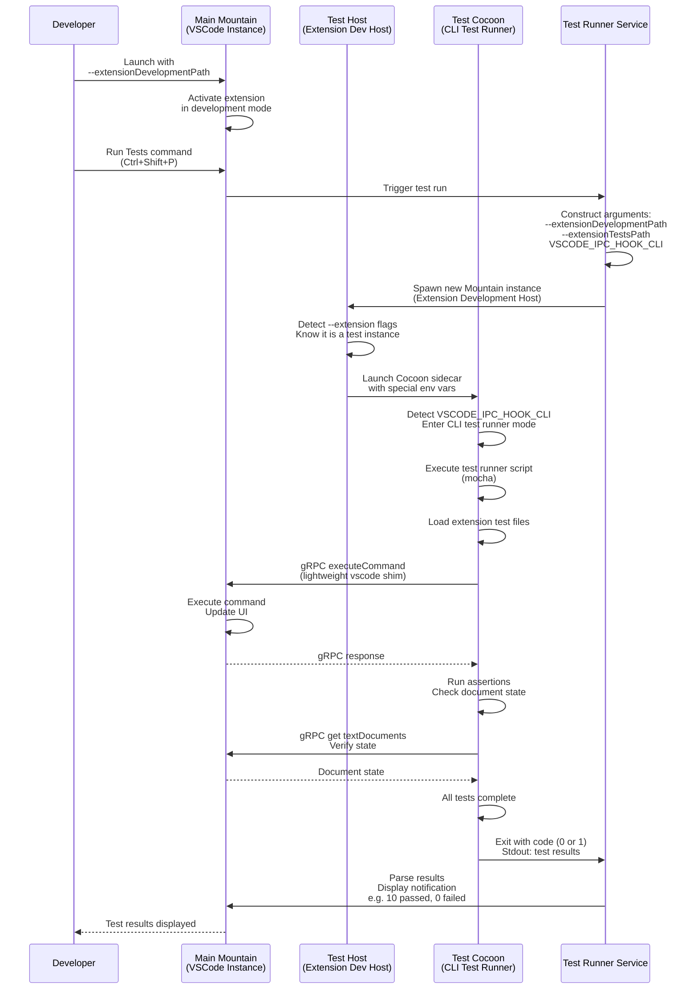

# Workflow Example #10: Running Extension Tests

**Goal:**

- An extension developer wants to run automated tests for their extension.
- The developer triggers a command.
- A new, clean instance of the application is launched.
- This instance is the Extension Development Host.
- The extension's tests run within it.
- The results are reported.

---

## Table of Contents 📑

1. [Verification Status](#verification-status)
2. [Flow Map](#flow-map)
3. [Phase 1: Test Discovery and Command Registration](#phase-1-test-discovery-and-command-registration)
4. [Phase 2: Initiating the Test Run](#phase-2-initiating-the-test-run)
5. [Phase 3: Test Execution in the Development Host](#phase-3-test-execution-in-the-development-host)
6. [Phase 4: Remote Control and Result Reporting](#phase-4-remote-control-and-result-reporting)
7. [Related Documentation](#related-documentation)

---

## Verification Status ⚠️

This workflow describes a conceptual test runner architecture.

- Verify the implementation details against
  [`Element/Mountain/Source/Environment/TestProvider/`](https://github.com/CodeEditorLand/Mountain/tree/Current/Source/Environment/TestProvider/).
- Verify extension activation against
  [`Element/Cocoon/Source/Services/Extension.ts`](https://github.com/CodeEditorLand/Cocoon/tree/Current/Source/Services/Extension.ts).

---

## Flow Map 🗺️



---

## Phase 1: Test Discovery and Command Registration 🔍

1. **Extension Manifest (`package.json`).**
   - **Action:** The extension being developed includes a `"test"` script in its `package.json`.
   - An example is `"test": "node ./test/runTest.js"`.
   - The extension also contributes a command, such as `"command": "my-extension.runTests"`.
   - That command is the entry point for its test runner.

2. **Launching the Main Instance.**
   - **Action:** The developer launches `Mountain` with special flags.
   - The flags point to the extension being developed.
   - An example is
     `mountain --extensionDevelopmentPath /path/to/my-extension`.
   - The `ExtensionHost` in `Cocoon` activates this extension in development mode.

---

## Phase 2: Initiating the Test Run 🚀

3. **User Action.**
   - **Action:** The developer uses the Command Palette in the main `Mountain` window.
   - The shortcut is `Ctrl+Shift+P`.
   - The developer executes a command such as "Run Tests".
   - A Test Runner service within `Mountain` handles this command.

4. **Test Runner Service (`Mountain`).**
   - **Action:** The test runner service prepares to launch a second, separate instance of the application.
   - **Crucial Step:** It constructs a special set of arguments and environment variables for this new instance.
     - `--extensionDevelopmentPath`:
       - The path to the extension under test.
     - `--extensionTestsPath`:
       - A path to a test runner script.
       - An example is `/path/to/my-extension/out/test/suite/index.js`.
     - `VSCODE_IPC_HOOK_CLI`:
       - A special environment variable.
       - It tells the new `Cocoon` instance that it is running in test mode.

5. **Spawning the Test Host (`Mountain`).**
   - **Action:** The Test Runner Service spawns a new `Mountain` process.
   - It uses the special arguments.
   - This new instance is the Extension Development Host.

---

## Phase 3: Test Execution in the Development Host 🧪

6. **Test Host Startup (`Mountain` Test Instance).**
   - **Action:** The new `Mountain` instance starts up.
   - It sees the `--extension...` flags.
   - It knows it is a test instance.
   - It launches its own `Cocoon` sidecar.
   - It passes along the special environment variables, including `VSCODE_IPC_HOOK_CLI`.

7. **Test Mode Activation (`Cocoon` Test Instance).**
   - **Action:** The test `Cocoon` instance starts.
   - Its `bootstrap` logic detects `VSCODE_IPC_HOOK_CLI`.
   - This tells it not to run as a normal extension host.
   - It runs as a special CLI test runner.
   - It does not start its normal gRPC server.
   - It does not wait for the `initExtensionHost` handshake.

8. **Test Runner Script (`Cocoon` Test Instance).**
   - **Action:** Instead of starting the extension host, the test `Cocoon` process requires and executes the script specified by `--extensionTestsPath`.
   - This script is typically a test runner such as `mocha`.

9. **Mocha Test Execution (`Cocoon` Test Instance).**
   - **Action:** The `mocha` runner starts.
   - It loads the extension's test files, such as `my-extension.test.js`.
   - Each test file contains code like:

   ```typescript
   import * as assert from "assert";

   import * as vscode from "vscode";

   test("My Extension Feature", async () => {
   	await vscode.commands.executeCommand("my-extension.doSomething");
   	const document = vscode.workspace.textDocuments[0];
   	assert.strictEqual(document.getText(), "Expected Result");
   });
   ```

   - **Crucial Step:** The `require('vscode')` call inside the test is intercepted.
   - A special, lightweight version of the `RequireInterceptor` performs the interception.
   - This version connects back to the main `Mountain` instance.
   - That is the instance the developer is looking at, not the test instance.
   - This allows the tests to drive the UI of the main window.

---

## Phase 4: Remote Control and Result Reporting 📊

10. **Test API Execution (`Cocoon` Test Instance to `Mountain` Main Instance).**
    - **Action:** The test code calls `vscode.commands.executeCommand(...)`.
    - The lightweight test `vscode` shim sends a gRPC request.
    - The request goes back to the original `Mountain` instance's gRPC server.
    - The main `Mountain` instance receives this request.
    - It executes the command, just as if it had come from its own `Cocoon` instance.
    - The UI of the main window updates.
    - Files are opened.
    - The result is sent back to the test `Cocoon` instance.

11. **Test Assertion.**
    - **Action:** The `executeCommand` promise resolves in the test `Cocoon` instance.
    - The test proceeds to the next line, such as `vscode.workspace.textDocuments[0]`.
    - This is another gRPC call to the main `Mountain` instance.
    - The call gets the state of its documents.
    - The `assert` call checks if the state of the main application is as expected.

12. **Test Completion and Reporting.**
    - **Action:** The `mocha` runner completes all tests.
    - It aggregates the number of passes and failures.
    - It prints the results to its `stdout`.
    - It exits with a specific code, such as `0` for success or `1` for failure.
    - The main `Mountain` instance's Test Runner Service was monitoring the test process.
    - It monitored both `stdout` and the exit code.
    - It parses the test results from the output.
    - It displays a notification in the main window's UI:
      "Tests finished: 10 passed, 0 failed."
    - The test run is complete.

---

## Related Documentation 📖

- [Workflow](Workflow.md) - workflow index and per-Element architecture table
- [Application Startup and Handshake](ApplicationStartupAndHandshake.md) - Workflow #1
- [Opening a File from the UI](OpeningAFileFromTheUI.md) - Workflow #2
- [Invoking a Language Feature (Hover Provider)](InvokingALanguageFeatureHoverProvider.md) - Workflow #3
- [Saving a File with Save Participants](SavingAFileWithSaveParticipants.md) - Workflow #4
- [Executing a Command from the Command Palette](ExecutingACommandFromTheCommandPalette.md) - Workflow #5
- [Creating and Interacting with a Webview Panel](CreatingAndInteractingWithAWebviewPanel.md) - Workflow #6
- [Creating and Interacting with an Integrated Terminal](CreatingAndInteractingWithAnIntegratedTerminal.md) - Workflow #7
- [Source Control Management (SCM)](SourceControlManagementSCM.md) - Workflow #8
- [User Data Synchronization](UserDataSynchronization.md) - Workflow #9
- [Tier-Gated Implementation Selection](TierGatedImplementationSelection.md) - Workflow #11
- [InterComponentProtocol](../InterComponentProtocol.md) - Tauri IPC, gRPC, and connection lifecycle

---

**Project Maintainers:** Source Open
([Source/Open@Editor.Land](mailto:Source/Open@Editor.Land)) |
[GitHub Repository](https://github.com/CodeEditorLand/Land) |
[Report an Issue](https://github.com/CodeEditorLand/Land/issues)
