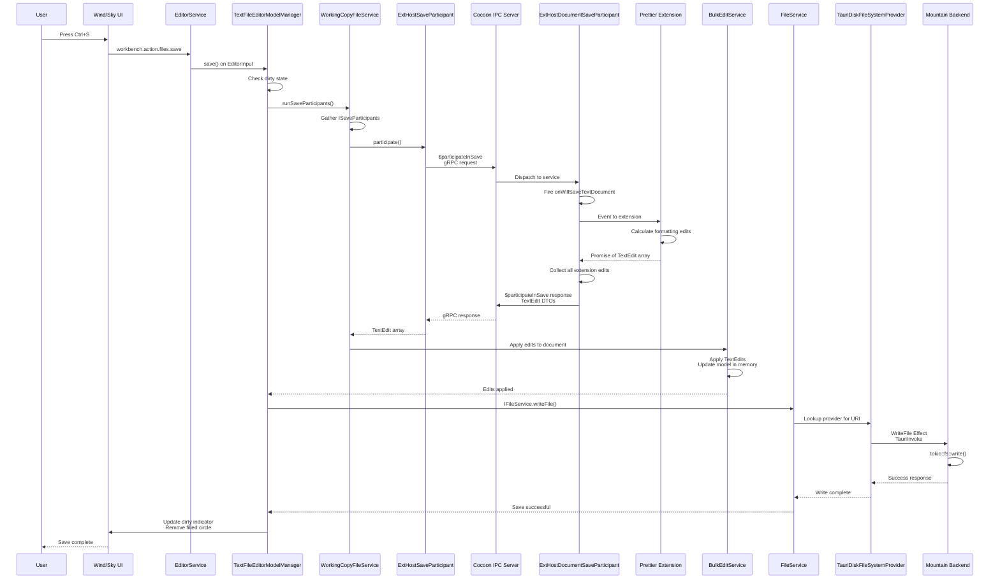

# Workflow Example #4: Saving a File with Save Participants

**Goal:**

- The user presses `Ctrl+S`.
- An extension, such as a Prettier formatter, has registered a Save Participant.
- The Save Participant formats the document before the save is written to disk.
- The file is formatted.
- The file is saved.

---

## Table of Contents 📑

1. [Flow Map](#flow-map)
2. [Phase 1: User Action and Initial Save Trigger](#phase-1-user-action-and-initial-save-trigger)
3. [Phase 2: Orchestration via Save Participants](#phase-2-orchestration-via-save-participants)
4. [Phase 3: Extension Execution](#phase-3-extension-execution)
5. [Phase 4: Applying Edits and Final Save](#phase-4-applying-edits-and-final-save)
6. [applyEdit Round-Trip](#applyedit-round-trip)
7. [saveAll Correction](#saveall-correction)
8. [Related Documentation](#related-documentation)

---

## Flow Map 🗺️

---

## Phase 1: User Action and Initial Save Trigger ⌨️

`Wind` and `Sky` own this phase.

1. **User Input.**
   - **Action:** The user presses `Ctrl+S` in an editor that has unsaved changes.
   - The editor is dirty.
   - The keybinding system dispatches the `workbench.action.files.save` command.

2. **`IEditorService.save()`**
   ([`Element/Wind/Source/Workbench/`](https://github.com/CodeEditorLand/Wind/tree/Current/Source/Workbench/)).
   - **Action:** The `save` method on the `EditorService` is called.
   - It identifies the active editor and its corresponding `EditorInput`.
   - It calls the `save` method on the `EditorInput` instance.

3. **`TextFileEditorModelManager.save()`**
   (`vs/workbench/services/textfile/common/textFileEditorModelManager.ts`).
   - **Action:** The `EditorInput` delegates the save operation to its underlying model.
   - The `TextFileEditorModelManager` manages that model.
   - **Crucial Step:** Before writing to disk, this manager does not immediately call the file service.
   - Instead, it enters the Save Participants phase.
   - It emits a `willSave` event.
   - It waits for all registered Save Participants to complete their work.
   - The `IWorkingCopyFileService` orchestrates this phase.

---

## Phase 2: Orchestration via Save Participants 🔄

`Wind` calls into `Cocoon` and back in this phase.

4. **`WorkingCopyFileService.runSaveParticipants()`**
   (`vs/workbench/services/workingcopy/common/workingCopyFileService.ts`).
   - **Action:** This service is the central orchestrator for the save process.
   - It gathers all registered `ISaveParticipant` objects.
   - One of these participants is the `ExtHostSaveParticipant`.
   - The `ExtHostSaveParticipant` communicates with extensions in `Cocoon`.
   - It calls the `participate()` method on the `ExtHostSaveParticipant`.

5. **`ExtHostSaveParticipant.participate()` (`Cocoon`'s RPC Bridge).**
   - **Action:** This object runs in `Wind` and acts as the bridge.
   - Its `participate` method makes a `$participateInSave` gRPC request to `Cocoon`.
   - It sends the URI of the document being saved.
   - It sends the reason for the save, such as `explicit`.
   - It then awaits the response from `Cocoon`.

---

## Phase 3: Extension Execution ⚙️

`Cocoon` owns this phase.

6. **`IpcProvider` (`Cocoon/src/Service/Ipc/Server.ts`).**
   - **Action:** `Cocoon`'s gRPC server receives the `$participateInSave` request.
   - It dispatches this request to the `ExtHostDocumentSaveParticipant` service.
     This is a new service that would be synthesized.

7. **`ExtHostDocumentSaveParticipant` (`Cocoon`).**
   - **Action:** This service manages the `onWillSaveTextDocument` event emitter.
   - It receives the `$participateInSave` call.
   - It creates a `WillSaveTextDocumentEvent` object.
     The object includes the document and the reason.
   - It fires the `onWillSaveTextDocument` event.
   - The event is delivered to all subscribed extensions.

8. **Prettier Extension (`Cocoon`).**
   - **Action:** The Prettier extension's `onWillSaveTextDocument` listener is executed.
   - The extension calculates the necessary formatting edits for the entire document.
   - It returns a `Promise` that resolves to an array of `TextEdit` objects.

9. **`ExtHostDocumentSaveParticipant` (continued).**
   - **Action:** The service collects all the `Promise<TextEdit[]>` results from all participating extensions.
   - It waits for all promises to resolve.
   - It serializes the collected `TextEdit` objects into DTOs using the `TypeConverter`.
   - It sends the array of `TextEdit` DTOs back to `Wind`.
     This is the response to the `$participateInSave` gRPC request.

---

## Phase 4: Applying Edits and Final Save 💾

`Wind` and `Mountain` own this phase.

10. **`ExtHostSaveParticipant.participate()` (`Wind`, continued).**
    - **Action:** The gRPC call resolves, returning the text edits from the extensions.
    - The `WorkingCopyFileService` receives these edits.

11. **`BulkEditService` (`Wind/Source/Application/BulkEdit/Live.ts`).**
    - **Action:** The `WorkingCopyFileService` does not apply the edits itself.
    - It passes them to the `IBulkEditService`.
    - The `BulkEditService` takes the array of `TextEdit` objects and applies them to the document model in memory.
    - The editor content now reflects the formatted code.

12. **`TextFileEditorModelManager.save()` (`Wind`, continued).**
    - **Action:** All participants have run and their edits have been applied.
    - The `save` operation proceeds.
    - It calls the `IFileService.writeFile()`.

13. **`IFileService`, `TauriDiskFileSystemProvider`, `Integration`, and `Mountain`.**
    - **Action:** The save operation now follows the exact same path as Workflow #2 (Opening a File), but in reverse.
      - `IFileService` calls the `TauriDiskFileSystemProvider`.
      - The provider executes the `WriteFile` Effect from the `Integration` layer.
      - The effect makes a `TauriInvoke` call to the `Mountain` backend.
      - The `FsWriter` implementation in `Mountain` receives the call.

14. [`FileSystem`](https://github.com/CodeEditorLand/Mountain/tree/Current/Source/FileSystem/)
    Providers (`Mountain`).
    - **Action:** The file write operation is executed through the FileSystem provider.
    - It performs the final native OS call: `tokio::fs::write(path, content)`.
    - The formatted document is now saved to disk.
    - The success result flows all the way back up the chain.

15. **Final State Update (`Wind`).**
    - **Action:** The `TextFileEditorModel` is no longer dirty.
    - The UI updates to remove the dirty indicator, the filled circle, from the editor tab.
    - The save operation is complete.

---

## applyEdit Round-Trip 🔁

`workspace.applyEdit(edit)` is a full awaitable round-trip through
`Call(Context, "applyEdit", [edit])`.

- This is a Mountain `sendRequest`, not a fire-and-forget notification.
- The extension's `await workspace.applyEdit(...)` resolves only after Sky's `sky://workspace/applyEdit` handler finishes applying the edit to the Monaco model and returns a success boolean.
- Mountain treats a `null` response from Sky as `true`.
  This matches VS Code's own `MainThreadBulkEdits` behaviour.

The `WorkspaceEdit` payload is normalised inside the Sky bridge to handle multiple wire shapes:

- `_edits` array with `_type: 2` entries, which are extHostTypes text edits.
  - `_range` uses `_start._line` and `_end._line`.
  - These are 0-based and converted to Monaco 1-based.
- `_edits` array with `_type: 1` entries, which are file operations: create, rename, and delete.
- Serialised `vscode.Uri` objects, with `_scheme` and `_path` fields.

`IBulkEditService` is tried first.
If unavailable, the bridge falls back to direct Monaco model operations.

---

## saveAll Correction ✅

- `workspace.saveAll()` previously called `Document.Save` with no arguments.
  This was always an error.
- It now correctly calls `Workspace.SaveAll`.
- `Workspace.SaveAll` routes to `sky://workspace/saveAll`.
- It dispatches `workbench.action.files.saveAll` in the renderer.

Related routing:

- `workspace.save(uri)` routes to `sky://workspace/save`.
  It saves the specific document through `ITextFileService.save` or the workbench save command as a fallback.
- `workspace.saveAs(uri)` routes to `sky://workspace/saveAs`.
  It opens the save-as dialog.
- Both are round-trip request channels.
- Both resolve the extension's awaited promise.

---

## Related Documentation 📖

- [Workflow](Workflow.md) - workflow index and per-Element architecture table
- [Application Startup and Handshake](ApplicationStartupAndHandshake.md) - Workflow #1
- [Opening a File from the UI](OpeningAFileFromTheUI.md) - Workflow #2
- [Invoking a Language Feature (Hover Provider)](InvokingALanguageFeatureHoverProvider.md) - Workflow #3
- [Executing a Command from the Command Palette](ExecutingACommandFromTheCommandPalette.md) - Workflow #5
- [Creating and Interacting with a Webview Panel](CreatingAndInteractingWithAWebviewPanel.md) - Workflow #6
- [Creating and Interacting with an Integrated Terminal](CreatingAndInteractingWithAnIntegratedTerminal.md) - Workflow #7
- [Source Control Management (SCM)](SourceControlManagementSCM.md) - Workflow #8
- [User Data Synchronization](UserDataSynchronization.md) - Workflow #9
- [Running Extension Tests](RunningExtensionTests.md) - Workflow #10
- [Tier-Gated Implementation Selection](TierGatedImplementationSelection.md) - Workflow #11
- [InterComponentProtocol](../InterComponentProtocol.md) - Tauri IPC, gRPC, and connection lifecycle

---

**Project Maintainers:** Source Open
([Source/Open@Editor.Land](mailto:Source/Open@Editor.Land)) |
[GitHub Repository](https://github.com/CodeEditorLand/Land) |
[Report an Issue](https://github.com/CodeEditorLand/Land/issues)
