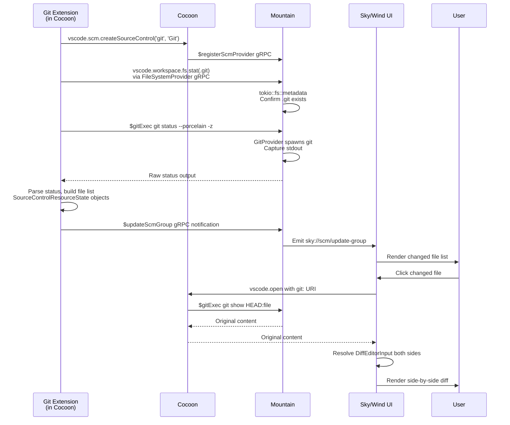

# Workflow Example #8: Source Control Management (SCM)

**Goal:**

- A user opens a project that is a Git repository.
- The SCM view in the side bar populates with a list of changed files.
- The user can click a file to see a diff view.

---

## Table of Contents 📑

1. [Verification Status](#verification-status)
2. [Flow Map](#flow-map)
3. [Phase 1: Extension Registration and Repository Discovery](#phase-1-extension-registration-and-repository-discovery)
4. [Phase 2: Populating the SCM View with Changes](#phase-2-populating-the-scm-view-with-changes)
5. [Phase 3: Rendering the SCM View](#phase-3-rendering-the-scm-view)
6. [Phase 4: Viewing a Diff](#phase-4-viewing-a-diff)
7. [SCM Provider State Setters](#scm-provider-state-setters)
8. [sky://scm/provider/changed](#skyscmproviderchanged)
9. [sky://scm/register Retry](#skyscmregister-retry)
10. [Related Documentation](#related-documentation)

---

## Verification Status ⚠️

This workflow describes SCM provider registration and Git integration.

- Verify against
  [`Element/Cocoon/Source/Services/Extension.ts`](https://github.com/CodeEditorLand/Cocoon/tree/Current/Source/Services/Extension.ts)
  for extension activation.
- Verify against Mountain's Git provider implementation.

---

## Flow Map 🗺️

---

## Phase 1: Extension Registration and Repository Discovery 🔍

`Cocoon` and `Mountain` own this phase.

1. **Built-in Git Extension Activation (`Cocoon`).**
   - **Action:** On startup, `Cocoon` activates its built-in Git extension.
   - This extension is responsible for providing all core Git functionality.
   - The extension's `activate()` function is called.

2. **`vscode.scm.createSourceControl()` (`Cocoon`).**
   - **Action:** The Git extension calls
     `vscode.scm.createSourceControl('git', 'Git')`.
   - This registers the extension as the provider for the Git SCM.
   - A new `ScmProvider` service in `Cocoon` handles the call.
   - This service manages the state of all registered SCM providers.
   - The `ScmProvider` sends a `$registerScmProvider` gRPC request to `Mountain`.
   - The request informs `Mountain` that a provider for 'git' now exists.
   - `Cocoon` manages that provider.

3. **Repository Detection (`Cocoon`, `Mountain`, and `Cocoon`).**
   - **Action:** The Git extension needs to find out if the open workspace is a Git repository.
   - It uses the `vscode.workspace.workspaceFolders` API to get the root path.
   - It then needs to check for a `.git` directory.
   - It cannot use `require('fs')`.
   - It uses the `vscode.workspace.fs` API instead:
     `vscode.workspace.fs.stat(Uri.joinPath(root, '.git'))`.
   - This `stat` call travels through `Cocoon`'s `FileSystemProvider`.
   - It crosses over gRPC to `Mountain`.
   - `Mountain` performs the native `tokio::fs::metadata` call.
   - It returns the result, confirming the directory exists.

---

## Phase 2: Populating the SCM View with Changes 📋

`Cocoon` and `Mountain` own this phase.

4. **Running `git status` (`Cocoon` and `Mountain`).**
   - **Action:** The Git extension now knows it is in a Git repository.
   - It needs to get the status of the files.
   - It cannot spawn a `git` process directly.
   - It relies on a custom `vscode.git` API, which would be provided by `Mountain`.
   - The API exposes a function such as
     `git.exec(repoPath, ['status', '--porcelain', '-z'])`.
   - This API call is translated into a `$gitExec` gRPC request to `Mountain`.
   - The request carries the repository path and the command arguments.

5. **Native Git Execution (`Mountain`).**
   - **Action:** `Mountain`'s gRPC server receives the `$gitExec` request.
   - It dispatches the request to a new `GitProvider` implementation.
   - That implementation lives on the `MountainEnvironment`.
   - The `GitProvider` handler logic safely spawns a native `git` child process.
   - It uses `std::process::Command` with the provided arguments.
   - It runs the process in the specified directory.
   - It captures the `stdout` of the `git status` command.
   - It sends the raw output string back to `Cocoon`.
   - This is the successful response to the gRPC request.

6. **Parsing Status and Updating State (`Cocoon`).**
   - **Action:** The Git extension in `Cocoon` receives the raw output from `git status`.
   - It parses this output to build a list of changed files.
   - Examples are "M src/main.ts" and "A new-file.txt".
   - For each changed file, it creates a `SourceControlResourceState` object.
   - The object includes the file's `URI`.
   - It includes decorations, such as the "M" for modified.
   - It updates the `SourceControl` object's `resourceGroups`.
   - For example, it sets the `resourceStates` property of the "Changes" group.
   - The value is the array of new `SourceControlResourceState` objects.

---

## Phase 3: Rendering the SCM View 🖼️

`Cocoon`, `Mountain`, `Wind`, and `Sky` own this phase.

7. **`SourceControl.resourceStates` Setter (`Cocoon`).**
   - **Action:** The extension updates the `resourceStates` property.
   - The `ScmProvider` service in `Cocoon` detects this change.
   - It serializes the entire list of `SourceControlResourceState` objects into DTOs.
   - It sends a `$updateScmGroup` gRPC notification to `Mountain`.
   - The notification contains the provider ID.
   - It contains the group ID, "Changes".
   - It contains the list of resource state DTOs.

8. **SCM State Update (`Mountain`).**
   - **Action:** `Mountain` receives the `$updateScmGroup` notification.
   - The `ScmProvider` handler updates its view of the SCM state.
   - The state lives in `AppState.ActiveScmProviders`.
   - It then emits a Tauri event to the UI:
     `AppHandle.emit("sky://scm/update-group", { ProviderId: 'git', GroupId: 'Changes', Resources: [...] })`.

9. **SCM UI Component (`Wind/Sky`).**
   - **Action:** The SCM View component in `Wind` listens for the `sky://scm/update-group` event.
   - It receives the list of resource DTOs.
   - It updates its internal React, Vue, or other framework state.
   - This causes the UI to re-render.
   - The File Explorer now shows a list of modified files.

---

## Phase 4: Viewing a Diff 🔀

`Wind`, `Cocoon`, and `Mountain` own this phase.

10. **User Clicks a Changed File (`Wind/Sky`).**
    - **Action:** The user clicks `src/main.ts` in the SCM view.
    - The `onClick` handler for this UI element knows it is an SCM resource.
    - It executes a command like `vscode.open`.
    - It uses a special URI that includes information about the original file from the `HEAD` revision.
    - An example is `git:/src/main.ts?{"ref":"HEAD"}`.

11. **Diff Editor Opening (`Wind`, `Cocoon`, and `Mountain`).**
    - **Action:** The `EditorService` handles the `vscode.open` command.
    - The `EditorService` recognizes the `git:` scheme as a request for a diff view.
    - It creates a `DiffEditorInput`.
    - The `DiffEditorInput` needs to resolve its two sides: the original and the modified.
      - **Modified:**
        - It loads the content from the workspace file `file:///path/to/src/main.ts`.
        - It uses the `IFileService`.
        - This is a standard file read.
      - **Original:**
        - It needs the content from `HEAD`.
        - It calls a Content Provider associated with the `git:` scheme.
        - This request goes to `Cocoon`.
    - `Cocoon`'s Git extension receives the content request for the `git:` URI.
    - It makes another `$gitExec` gRPC call to `Mountain`.
    - The call is `git.exec(repoPath, ['show', 'HEAD:src/main.ts'])`.
    - `Mountain` runs the command.
    - It gets the original content and sends it back.
    - `Cocoon` returns the content to `Wind`.

12. **Diff View Rendered (`Wind`).**
    - **Action:** The `DiffEditorInput` now has both the original and modified content.
    - It resolves successfully.
    - The `EditorService` opens the `DiffEditor`.
    - It passes the resolved input to the `DiffEditor`.
    - The user now sees a side-by-side diff of their changes.

---

## SCM Provider State Setters ⚙️

Three `SourceControl` setters are wired to Mountain through `$scm:updateSourceControl`.
This is a `sendRequest` round-trip, not a fire-and-forget notification.

- **`inputBox.value`:**
  - The setter sends `{ inputBoxValue: V }` to Mountain.
  - Mountain updates the workbench commit input box.
- **`inputBox.placeholder`:**
  - The setter sends `{ inputBoxPlaceholder: V }`.
  - It maps to `SourceControlUpdateDTO.InputBoxPlaceholder`.
- **`commitTemplate`:**
  - The setter sends `{ commitTemplate: V }`.
  - It maps to `SourceControlUpdateDTO.InputBoxPlaceholder` on the Mountain side.
- **`acceptInputCommand`:**
  - The setter sends `{ acceptInputCommand: V }`.
  - It maps to `SourceControlUpdateDTO.AcceptInputCommand`.

---

## sky://scm/provider/changed 🔄

- When Mountain receives a `$scm:updateSourceControl` call, it emits `sky://scm/provider/changed` to the Sky renderer.
- The event carries the updated provider state.
- The `InstallScm.ts` bridge handler finds the matching shim by numeric handle.
- It applies `InputModel.setValue(newValue)`, or `applyEdits` as a fallback.
- The workbench commit input then reflects the extension-set text.
- It then fires `provider.onDidChange` so the SCM panel re-renders.

---

## sky://scm/register Retry 🔁

- `sky://scm/register` registration in the Sky bridge calls `__CEL_SERVICES__.SCM.registerSCMProvider()`.
- `__CEL_SERVICES__.SCM` is populated asynchronously by the Output service accessor.
- This creates a potential race on startup.
- The bridge retries registration up to 10 times.
- It waits 200 ms between attempts.
- It then falls back to the DOM `CustomEvent` path.
- This ensures the SCM viewlet populates even when the workbench service resolves late.

---

## Related Documentation 📖

- [Workflow](Workflow.md) - workflow index and per-Element architecture table
- [Application Startup and Handshake](ApplicationStartupAndHandshake.md) - Workflow #1
- [Opening a File from the UI](OpeningAFileFromTheUI.md) - Workflow #2
- [Invoking a Language Feature (Hover Provider)](InvokingALanguageFeatureHoverProvider.md) - Workflow #3
- [Saving a File with Save Participants](SavingAFileWithSaveParticipants.md) - Workflow #4
- [Executing a Command from the Command Palette](ExecutingACommandFromTheCommandPalette.md) - Workflow #5
- [Creating and Interacting with a Webview Panel](CreatingAndInteractingWithAWebviewPanel.md) - Workflow #6
- [Creating and Interacting with an Integrated Terminal](CreatingAndInteractingWithAnIntegratedTerminal.md) - Workflow #7
- [User Data Synchronization](UserDataSynchronization.md) - Workflow #9
- [Running Extension Tests](RunningExtensionTests.md) - Workflow #10
- [Tier-Gated Implementation Selection](TierGatedImplementationSelection.md) - Workflow #11
- [InterComponentProtocol](../InterComponentProtocol.md) - Tauri IPC, gRPC, and connection lifecycle

---

**Project Maintainers:** Source Open
([Source/Open@Editor.Land](mailto:Source/Open@Editor.Land)) |
[GitHub Repository](https://github.com/CodeEditorLand/Land) |
[Report an Issue](https://github.com/CodeEditorLand/Land/issues)
