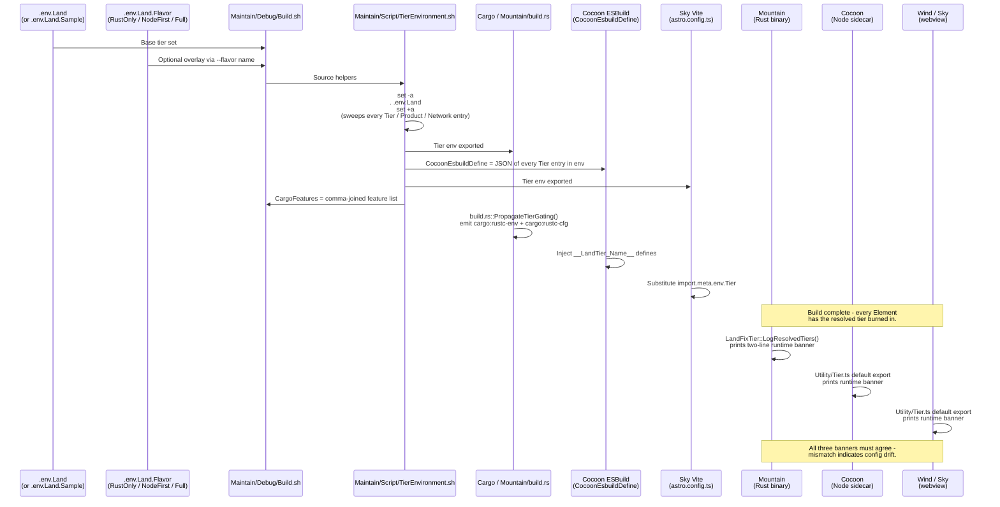

# Workflow Example #11: Tier-Gated Implementation Selection

**Goal:**

- Every capability with more than one viable implementation lives in the codebase simultaneously.
  - File-system access through gRPC versus native `tokio`.
  - Glob compilation in JavaScript versus `globset` in Rust.
  - Extension-host IPC routed to `Mountain` Rust versus `Cocoon` Node.js.
- The active path is selected through a single configuration file, `.env.Land`.
- Call sites are never duplicated.
- The default tier is never regressed.
- The workflow documents how that file propagates through the build tools into `Mountain`, `Cocoon`, `Wind`, and `Sky`.
- The workflow documents how each Element reads the resolved tier at run time.

The system is the foundation used to:

- Test upgrades.
- Keep fallback paths warm.
- Bisect regressions to a specific implementation tier.

---

## Table of Contents 📑

1. [Flow Map](#flow-map)
2. [Phase 1: Authoring the Tier Set](#phase-1-authoring-the-tier-set)
3. [Phase 2: Build-Time Propagation](#phase-2-build-time-propagation)
4. [Phase 3: Mountain - Rust Compile-Time and Runtime Propagation](#phase-3-mountain-rust-compile-time-and-runtime-propagation)
5. [Phase 4: Cocoon - TypeScript Runtime Dispatch](#phase-4-cocoon-typescript-runtime-dispatch)
6. [Phase 5: Wind and Sky - Webview Dispatch](#phase-5-wind-and-sky-webview-dispatch)
7. [Phase 6: Adding a New Tier](#phase-6-adding-a-new-tier)
8. [Failure Modes](#failure-modes)
9. [Related Source Files](#related-source-files)
10. [Related Documentation](#related-documentation)

---

## Flow Map 🗺️



---

## Phase 1: Authoring the Tier Set 📝

1. **Canonical source of truth**
   ([`Land/.env.Land.Sample`](https://github.com/CodeEditorLand/Land/tree/Current/.env.Land.Sample)).
   - Every capability participating in tier gating has exactly one row in `.env.Land.Sample`.
   - The row has the form `Tier<Capability>=<Value>`.
   - The sample file is committed and represents the compiled-in defaults.
   - A per-machine `.env.Land` may override any line.
     - It is gitignored on shipping builds.
     - It is committed in this repo for the team baseline.
   - The current capability set spans two layers.

   **Infrastructure tiers** are Cargo-feature-gated and use compile-time selection.

   | Domain      | Variable                  | Default       | Other values                            |
   | ----------- | ------------------------- | ------------- | --------------------------------------- |
   | Transport   | `TierRemoteProcedureCall` | `gRPC`        | `SharedMemory`                          |
   | Transport   | `TierHTTPProxy`           | `HandRolled`  | `Hyper`                                 |
   | Transport   | `TierLogger`              | `Standard`    | `Ring`                                  |
   | File system | `TierFileSystem`          | `Layer2`      | `Layer3`, `Layer4`                      |
   | File system | `TierFindFiles`           | `Layer3`      | `Layer4`                                |
   | File system | `TierGlob`                | `JavaScript`  | `Native`                                |
   | File system | `TierFileWatcher`         | `Layer4`      | `Stub`                                  |
   | Assets      | `TierSchemeAssets`        | `FileSystem`  | `Embedded`, `Hybrid`                    |
   | VS Code API | `TierConfiguration`       | `Cache`       | `Eager`                                 |
   | VS Code API | `TierDiagnostics`         | `Full`        | `Delta`                                 |
   | VS Code API | `TierClipboard`           | `Layer3`      | `Layer4`, `Layer5`                      |
   | VS Code API | `TierOpenExternal`        | `Layer3`      | `Layer4`                                |
   | VS Code API | `TierDocumentMirror`      | `Full`        | `Lazy`                                  |
   | Lifecycle   | `TierExtensionActivation` | `Parallel8`   | `Sequential`, `Parallel4`, `Parallel16` |
   | Lifecycle   | `TierExtensionScan`       | `Sequential`  | `Parallel`                              |
   | Lifecycle   | `TierModuleCache`         | `Simple`      | `Off`, `Shared`                         |
   | Telemetry   | `TierTelemetry`           | `Synchronous` | `Batched`, `Off`                        |

   **Per-subsystem routing tiers** are runtime-readable.
   They are baked at compile time through `cargo:rustc-env` for every binary.
   Dispatch arms can call `env!()` on them.
   This avoids a `std::env::var` call on the hot path.

   | Variable               | Default    | Routes                                           |
   | ---------------------- | ---------- | ------------------------------------------------ |
   | `TierIPC`              | `Mountain` | `Mountain`, `NodeDeferred`, `Node`               |
   | `TierTerminal`         | `Mountain` | `Mountain`, `Node`                               |
   | `TierSCM`              | `Mountain` | `Mountain`, `Node`                               |
   | `TierDebug`            | `Mountain` | `Mountain`, `Node`                               |
   | `TierLanguageFeatures` | `Mountain` | `Mountain`, `Node`                               |
   | `TierSearch`           | `Mountain` | `Mountain`, `Node`                               |
   | `TierOutputChannel`    | `Mountain` | `Mountain`, `Node`                               |
   | `TierNativeHost`       | `Mountain` | `Mountain`, `Node`                               |
   | `TierTreeView`         | `Mountain` | `Mountain`, `Node`                               |
   | `TierStorage`          | `Mountain` | `Mountain`, `Node`                               |
   | `TierModel`            | `Mountain` | `Mountain`, `Node`                               |
   | `TierTasks`            | `Node`     | `Mountain`, `Node`                               |
   | `TierAuth`             | `Node`     | `Mountain`, `Node`                               |
   | `TierEncryption`       | `Mountain` | `Mountain`, `Node`                               |
   | `TierExtensionHost`    | `Process`  | `Process`, `WebWorker`, `Disabled`               |
   | `TierWebSocket`        | `Disabled` | `Disabled`, `Mountain`, `Mist`                   |
   | `TierShim`             | `None`     | `None`, `Proxy`, `Replace`, `Own`, `Preempt`     |

   **Notable entries:**

   - `TierIPC` is the global IPC routing switch.
     - `Wind`'s `TauriMainProcessService.ts` reads this variable at module initialisation time.
       This happens before any IPC call is made.
     - It then selects one of three dispatch paths.
       - `Mountain`, the default:
         - All calls go directly to Mountain through `@tauri-apps/api` `invoke`.
       - `NodeDeferred`:
         - Mountain is tried first.
         - On a miss or an `undefined` result, the call falls through to Cocoon through the `cocoon:request` bridge.
       - `Node`:
         - All calls go directly to Cocoon.
         - Mountain is used only for window management and PTY.
   - `TierTasks` defaults to `Node`.
     - Task execution relies on Cocoon's `ExtHostTaskService` for provider enumeration and execution.
   - `TierAuth` defaults to `Node`.
     - Authentication flows go through Cocoon's `ExtHostAuthentication` shim.

2. **Naming convention.**
   - Variables use `PascalCase` with the `Tier` prefix.
   - Infrastructure values use `Layer2..Layer5`.
     - L2 is a round-trip RPC.
     - L3 is a native in-language fallback.
     - L4 is a pure-Rust implementation.
     - L5 is an OS-level integration.
   - For non-layered infrastructure, values use descriptive labels.
     - Examples are `gRPC`, `SharedMemory`, `HandRolled`, and `Hyper`.
   - Per-subsystem routing values are always one of `Mountain`, `Node`, `Process`, `WebWorker`, `Disabled`, or `Mist`.
   - The table above shows which set applies to each variable.

3. **Flavor overlays.**
   - Three pre-built tier sets ship at the repo root.
   - They allow every subsystem to be flipped at once.
     - `.env.Land.RustOnly`:
       - Every subsystem routes to Mountain Rust where a native implementation exists.
       - Cocoon is still spawned to run extension code that needs Node.js APIs.
     - `.env.Land.NodeFirst`:
       - Every API surface routes to Cocoon Node.js.
       - Mountain becomes a thin IPC pass-through.
       - Useful for upstream-VS-Code behaviour validation.
     - `.env.Land.Full`:
       - Native Rust where it exists.
       - Mist WebSocket is on for high-frequency calls.
       - This is the "ship it" flavor.
   - Source one with `sh Maintain/Debug/Build.sh --flavor RustOnly`.
     - The alternatives are `--flavor NodeFirst` and `--flavor Full`.
     - The flag sources the overlay BEFORE `TierEnvironment.sh` runs.
     - Every downstream tool then sees the overlay values as if they came from `.env.Land` directly.

   **ProductFlavor encoding:**
   Each flavor overlay sets `ProductFlavor` to a 10-character code.
   The code encodes routing decisions in 5 two-char groups.

   | Group | Encodes                                            | Values                                                              |
   | ----- | -------------------------------------------------- | ------------------------------------------------------------------- |
   | G1    | IPC mode and WebSocket                             | `IW`=IPC Mtn + WS Dis, `IF`=IPC NodeDef + WS Mist, `IN`=IPC Node + WS Dis |
   | G2    | Tasks and Auth and Encryption                      | `TN`=Tasks Node + Auth Node + Enc Mtn, `TA`=all Mountain            |
   | G3    | Terminal and SCM and Debug                         | `MM`=all Mountain, `NN`=all Node                                    |
   | G4    | Search and Language and Output and TreeView and NativeHost | `MM`=all Mountain                                           |
   | G5    | Storage and Model and FileSystem                   | `MM`=all Mountain                                                   |

   **Flavor reference:**

   | Flavor         | Code         | Identity            |
   | -------------- | ------------ | ------------------- |
   | Default (full) | `IWTNMMMMMM` | `fiddee-IWTNMMMMMM` |
   | RustOnly       | `IWTAMMMMMM` | `fiddee-IWTAMMMMMM` |
   | Node           | `INTNNNNNNN` | `fiddee-INTNNNNNNN` |
   | Full + Mist WS | `IFTNMMMMMM` | `fiddee-IFTNMMMMMM` |

   - Set `ProductFlavorLong=true` to use short human-readable names.
     - The names are `fiddee-F8`, `fiddee-FR`, `fiddee-FN`, and `fiddee-FC`.
     - These replace the 10-char encoding.
   - The flavor code is appended to every filesystem identity.
     - The identities are the data folder, the URL protocol, and the binary identifier.
   - Each flavor therefore runs in complete isolation.
     - There is no shared state.
     - There are no collisions.

---

## Phase 2: Build-Time Propagation ⚙️

`Maintain/Debug/Build.sh` calls `TierEnvironment.sh`.

1. **Env file discovery and overlay**
   ([`Land/Maintain/Debug/Build.sh`](https://github.com/CodeEditorLand/Land/tree/Current/Maintain/Debug/Build.sh),
   [`Land/Maintain/Script/TierEnvironment.sh`](https://github.com/CodeEditorLand/Land/tree/Current/Maintain/Script/TierEnvironment.sh)).
   - The build script handles `--flavor <name>` first.
   - It sources `.env.Land.<name>` into the current shell with `set -a; . FILE; set +a`.
   - Then it sources `TierEnvironment.sh`.
   - That script resolves the base `.env.Land`.
   - It falls through to `.env.Land.Sample` when the override file is absent.
   - It re-applies any shell-exported `Tier*` entry.
   - A one-off command such as
     `export TierStorage=Node ./Maintain/Debug/Build.sh ...` always wins.
   - The resolved tier set is echoed before the build starts.
   - CI logs therefore show the exact configuration for each run.

2. **Cargo feature derivation.**
   - Non-default infrastructure values activate Cargo features named `Tier<Capability><Value>`.
   - An example is `TierFileSystem=Layer4` becoming `--features TierFileSystemLayer4`.
   - Default infrastructure values do not activate a feature.
     - The default is the always-compiled baseline.
     - Only upgrades add to the build.
   - Per-subsystem routing values do not map to Cargo features.
     - They are compile-time string constants.
     - They are consumed at runtime by `mod.rs:: mountain_ipc_invoke`.
     - Consumption uses `env!()` plus a `std::env::var` fallback for shell-time overrides.

3. **Cocoon ESBuild define blob.**
   - Every `Tier*` env var in the process at build time becomes a `__LandTier_<Capability>__` replacement token.
   - The tokens are serialised into `$CocoonEsbuildDefine`.
   - That is a JSON string that Node serialises before export.
   - The sweep is a wildcard over `process.env` keys starting with `Tier`.
   - New tiers added to `.env.Land` are picked up automatically.
   - No source changes are needed.

4. **Vite and Astro define.**
   - Sky's
     [`astro.config.ts`](https://github.com/CodeEditorLand/Sky/tree/Current/astro.config.ts)
     forwards every `Tier*` env var to the Vite `define` map.
   - The webview bundle therefore carries the baked-in values as `import.meta.env.Tier*` substitutions.
   - This uses the same wildcard pattern as the Cocoon sweep.
   - New tiers pass through without code changes.

---

## Phase 3: Mountain - Rust Compile-Time and Runtime Propagation 🦀

`Mountain` owns this phase.

1. **`build.rs` tier propagation**
   ([`Land/Element/Mountain/build.rs`](https://github.com/CodeEditorLand/Mountain/tree/Current/build.rs)).
   - Mountain's build script calls `PropagateTierGating()` once per compile.
   - `EmitTierDefaults()` emits
     `cargo:rustc-env=Tier<Capability>=<Default>`.
   - It does so for every infrastructure tier and every per-subsystem tier.
   - `env!()` therefore always resolves at compile time, even when `.env.Land` is absent.
   - The override pass reads the resolved `.env.Land` and re-emits values.
   - File entries take precedence over the defaults.
   - For infrastructure tiers, it emits `cargo:rustc-cfg=feature="Tier<...>"`.
   - It does so for every non-default pair that matches a declared feature.
   - It emits `cargo:rerun-if-changed=<envfile>`.
   - Touching `.env.Land` therefore invalidates the compile.
   - `TierExtensionHost=WebWorker` activates `cargo:rustc-cfg=no_node_host`.
   - That config gates `CocoonManagement.rs` out of the binary entirely.

2. **Feature whitelist.**
   - `IsDeclaredTierFeature` mirrors Mountain's
     [`Cargo.toml` `[features]` block](https://github.com/CodeEditorLand/Mountain/tree/Current/Cargo.toml).
   - `IsDefaultTierValue` lists every valid `(Key, Value)` pair.
   - It includes defaults and non-default routing values.
   - Any pair absent from both tables produces a `cargo:warning`.
   - Typos in `.env.Land` therefore fail loud at `cargo build`.
   - They do not silently no-op at runtime.

3. **Runtime dispatch in `mod.rs`**
   ([`Land/Element/Mountain/Source/IPC/WindServiceHandlers/mod.rs`](https://github.com/CodeEditorLand/Mountain/tree/Current/Source/IPC/WindServiceHandlers/mod.rs)).
   - `mountain_ipc_invoke` declares
     `const TIER_<Name>: &str = env!("Tier<Name>", "<default>");` at the top.
   - Each per-subsystem dispatch arm therefore reads its tier from a compile-time string constant.
   - `tier_routes_to_node(BakedConst, EnvKey)` returns whether the resolved value is `"Node"`.
     - The env override takes priority.
     - The baked const is the fallback.
   - Dispatch arms gate on this:

   ```rust
   "git:exec" | "git:clone" /* ... */
       if tier_routes_to_node(TIER_SCM, "TierSCM") =>
   {
       forward_to_cocoon!("scm", command, Arguments)
   },
   "git:exec" => { Git::HandleExec::Fn(Arguments).await },
   ```

   - The same pattern guards `storage:*`, `debug:*`, and every subsystem with a native Mountain handler.

4. **Boot banner**
   ([`Land/Element/Mountain/Source/LandFixTier.rs`](https://github.com/CodeEditorLand/Mountain/tree/Current/Source/LandFixTier.rs)).
   - `LogResolvedTiers()` is called from
     [`Binary::Main::Entry::Fn`](https://github.com/CodeEditorLand/Mountain/tree/Current/Source/Binary/Main/Entry.rs).
   - The call happens before the Tokio runtime spins up.
   - Two lines are emitted.
     - The first lists every compile-baked infrastructure tier.
       It uses `env!()` literals, so it has zero runtime cost.
     - The second lists every runtime-readable per-subsystem tier.
       It uses `std::env::var` with the baked `env!()` fallback, exactly what `mod.rs` reads.

---

## Phase 4: Cocoon - TypeScript Runtime Dispatch ⚙️

`Cocoon` owns this phase.

1. **`CocoonMain.ts` prelude**
   ([`Land/Element/Cocoon/Source/Bootstrap/Implementation/Cocoon/Main.ts`](https://github.com/CodeEditorLand/Cocoon/tree/Current/Source/Bootstrap/Implementation/Cocoon/Main.ts)).
   - The very first statements of the bundled Cocoon main file populate `globalThis.__LandTiers`.
   - The values come from the esbuild-substituted `__LandTier_<Capability>__` identifiers.
   - They fall through to `process.env.Tier<Capability>`.
   - They finally fall through to the hard-coded defaults.
   - One `declare const __LandTier_<Name>__: string` line exists per tier.
   - This keeps TypeScript checks passing.
   - esbuild's `define` substitutes the literal at bundle time.
   - The prelude runs before the `Tier` utility is first imported.

2. **`Utility/Tier.ts` default export**
   ([`Land/Element/Cocoon/Source/Utility/Tier.ts`](https://github.com/CodeEditorLand/Cocoon/tree/Current/Source/Utility/Tier.ts)).
   - The module exposes a single `const Tier = { ... } as const` object.
   - Its keys match the capability names.
   - Reads are synchronous and side-effect-free.
   - Every per-subsystem tier has a `TierXValue` union type.
   - The `Pick<...>(...)` calls resolve from `globalThis.__LandTiers` first.
   - They then resolve from `process.env.TierX`.
   - They finally resolve to the baked default.
   - On first import, the module emits the Cocoon runtime banner through `LandFixLog.Info`.
   - The boot log therefore documents exactly which tier set the process is using.

3. **Dispatch patterns.**
   - **Static dispatch**, preferred for infrastructure tiers:

   ```typescript
   export default Tier.Glob === "Native" ? CompileNative : CompileJavaScript;
   ```

   - esbuild's `define` substitutions dead-code-eliminate the inactive arm in production bundles.
   - **Runtime branch**, for per-subsystem tiers:

   ```typescript
   if (Tier.Storage === "Node") { ... } else { ... }
   ```

   - This is used when two arms must coexist in the same bundle.
   - Every subsystem tier is in this category.
   - Mountain to Cocoon routing flips at runtime.

---

## Phase 5: Wind and Sky - Webview Dispatch 🌐

`Wind` and `Sky` own this phase.

1. **`Wind/Source/Utility/Tier.ts`**
   ([`Land/Element/Wind/Source/Utility/Tier.ts`](https://github.com/CodeEditorLand/Wind/tree/Current/Source/Utility/Tier.ts)).
   - The module mirrors Cocoon's module in shape.
   - It reads from `import.meta.env.Tier<Capability>`.
     - Vite substitutes those at build time.
   - It falls through to `globalThis.__LandTiers`.
   - It finally falls through to hard-coded defaults.
   - The type-export set is identical.
   - The `Pick<...>(...)` table is identical.
   - The only differences are:
     - The env source, `import.meta.env` versus `process.env`.
     - The banner, `console.info` versus `LandFixLog`.

2. **Cross-Element agreement.**
   - All three banners, from `Mountain`, `Cocoon`, and `Wind`, must report identical values.
   - They must agree for each capability.
   - A mismatch means one build tool read a different env file.
   - It can also mean a polyfill failed to populate `globalThis.__LandTiers`.
   - Both paths are grep-able from the boot log.

---

## Phase 6: Adding a New Tier ➕

1. **Declare the capability.**
   - Add a row to `.env.Land.Sample` and `.env.Land` with the default value.

2. **Bake the default in Mountain.**
   - Add `(name, default)` to `EmitTierDefaults()` in `Mountain/build.rs`.
   - Add every legal `(Key, Value)` pair to `IsDefaultTierValue()`.
   - If the new tier should gate a Cargo feature:
     - Add the feature name to `IsDeclaredTierFeature()`.
     - Add the matching entry to `Mountain/Cargo.toml [features]`.

3. **Add to `turbo.json`.**
   - Add the variable name to `globalEnv`.
   - Turbo then treats it as a cache-invalidating input.

4. **Extend the TypeScript type declarations.**
   - Add a `Tier<Capability>Value` union type in `Element/Cocoon/Source/Utility/Tier.ts`.
   - Add a `Pick<...>(...)` call in that file.
   - Mirror the change in `Element/Wind/Source/Utility/Tier.ts`.
   - Add the `declare const __LandTier_<Name>__: string;` line in
     `Element/Cocoon/Source/Bootstrap/Implementation/Cocoon/Main.ts`.
   - Add the matching `__LandTiers` entry in that file.

5. **Wire the dispatch arm.**
   - In `Mountain/Source/IPC/WindServiceHandlers/mod.rs`:
     - Add `const TIER_<NAME>: &str = env!("Tier<Name>", "<default>");` near the other tier consts.
     - Wrap the relevant command group with
       `if tier_routes_to_node(TIER_<NAME>, "Tier<Name>") => { forward_to_cocoon!(...) }`.

6. **Update flavor overlays.**
   - Add the tier, with the correct flavor-specific value, to all three overlay files.
   - The files are `.env.Land.RustOnly`, `.env.Land.NodeFirst`, and `.env.Land.Full`.

7. **Extend the runtime banner.**
   - Add the variable to `LogResolvedTiers()` in `Mountain/Source/LandFixTier.rs`.
   - The new capability then appears in the boot log.

---

## Failure Modes ⚠️

- **`.env.Land` missing:**
  - `Build.sh` falls back to `.env.Land.Sample`.
  - `build.rs` falls back to the `EmitTierDefaults` table.
  - `Utility/Tier.ts` falls back to the same defaults.
  - All four paths converge on the same baseline.
- **Typo in `.env.Land`:**
  - The Rust build surfaces
    `cargo:warning=Tier<...>=<...> declared in <file> but has no matching Cargo feature`.
  - TypeScript accepts the value as an opaque string.
    Union literals apply at the type level only.
  - The banner shows the typo verbatim, so it is visible at boot.
- **Banner disagreement:**
  - Compare the three `[LandFix:Tier] ...` lines in the boot log.
  - If they disagree on a capability, one build tool did not see the override.
  - The usual cause is that the shell that launched the build did not source `.env.Land`.
  - Re-run under `./Maintain/Debug/Build.sh`.
    This is the sole supported entry point.
- **Flavor override surprises:**
  - A `--flavor` argument overrides everything in `.env.Land`.
  - Confirm the flavor line in `Build.sh`'s startup banner matches what you expect.
  - The resolved tier table is echoed shortly after.
- **`TierWebSocket=Mist` requires `Mist::WebSocket` infrastructure:**
  - Setting this without a Mist build boots the listener.
  - No handlers are registered.
  - Check the Mountain boot log for
    `[Lifecycle] [Setup] TierWebSocket=Mist - starting WebSocket transport`.

---

## Related Source Files 📚

| Element   | Path                                                                                                                                                                    | Role                                         |
| --------- | ----------------------------------------------------------------------------------------------------------------------------------------------------------------------- | -------------------------------------------- |
| Repo root | [`.env.Land`](https://github.com/CodeEditorLand/Land/tree/Current/.env.Land)                                                                                            | Active tier set, overrides Sample           |
| Repo root | [`.env.Land.Sample`](https://github.com/CodeEditorLand/Land/tree/Current/.env.Land.Sample)                                                                              | Canonical default tier set                   |
| Repo root | [`.env.Land.RustOnly`](https://github.com/CodeEditorLand/Land/tree/Current/.env.Land.RustOnly)                                                                          | Flavor overlay: native Rust everywhere       |
| Repo root | [`.env.Land.NodeFirst`](https://github.com/CodeEditorLand/Land/tree/Current/.env.Land.NodeFirst)                                                                        | Flavor overlay: Cocoon Node.js everywhere    |
| Repo root | [`.env.Land.Full`](https://github.com/CodeEditorLand/Land/tree/Current/.env.Land.Full)                                                                                  | Flavor overlay: native plus Mist WebSocket   |
| Repo root | [`turbo.json`](https://github.com/CodeEditorLand/Land/tree/Current/turbo.json)                                                                                          | Tier names registered in `globalEnv`         |
| Maintain  | [`Maintain/Debug/Build.sh`](https://github.com/CodeEditorLand/Land/tree/Current/Maintain/Debug/Build.sh)                                                                | `--flavor` argument and env fan-out          |
| Maintain  | [`Maintain/Release/Build.sh`](https://github.com/CodeEditorLand/Land/tree/Current/Maintain/Release/Build.sh)                                                            | Same flavor support for release builds       |
| Maintain  | [`Maintain/Script/TierEnvironment.sh`](https://github.com/CodeEditorLand/Land/tree/Current/Maintain/Script/TierEnvironment.sh)                                          | Cargo feature derivation and esbuild define  |
| Mountain  | [`Element/Mountain/build.rs`](https://github.com/CodeEditorLand/Mountain/tree/Current/build.rs)                                                                         | Cargo feature and `rustc-env` propagation    |
| Mountain  | [`Element/Mountain/Source/LandFixTier.rs`](https://github.com/CodeEditorLand/Mountain/tree/Current/Source/LandFixTier.rs)                                               | Runtime banner, both layers                 |
| Mountain  | [`Element/Mountain/Source/IPC/WindServiceHandlers/mod.rs`](https://github.com/CodeEditorLand/Mountain/tree/Current/Source/IPC/WindServiceHandlers/mod.rs)               | Per-subsystem `tier_routes_to_node` dispatch |
| Cocoon    | [`Element/Cocoon/Source/Utility/Tier.ts`](https://github.com/CodeEditorLand/Cocoon/tree/Current/Source/Utility/Tier.ts)                                                 | Node-side dispatcher                         |
| Cocoon    | [`Element/Cocoon/Source/Bootstrap/Implementation/Cocoon/Main.ts`](https://github.com/CodeEditorLand/Cocoon/tree/Current/Source/Bootstrap/Implementation/Cocoon/Main.ts) | `globalThis.__LandTiers` prelude             |
| Wind      | [`Element/Wind/Source/Utility/Tier.ts`](https://github.com/CodeEditorLand/Wind/tree/Current/Source/Utility/Tier.ts)                                                     | Webview-side dispatcher                      |
| Sky       | [`Element/Sky/astro.config.ts`](https://github.com/CodeEditorLand/Sky/tree/Current/astro.config.ts)                                                                     | Vite `define` forwarding, wildcard sweep    |

---

## Related Documentation 📖

- [Workflow](Workflow.md) - workflow index and per-Element architecture table
- [Application Startup and Handshake](ApplicationStartupAndHandshake.md) - Workflow #1
- [Opening a File from the UI](OpeningAFileFromTheUI.md) - Workflow #2
- [Invoking a Language Feature (Hover Provider)](InvokingALanguageFeatureHoverProvider.md) - Workflow #3
- [Saving a File with Save Participants](SavingAFileWithSaveParticipants.md) - Workflow #4
- [Executing a Command from the Command Palette](ExecutingACommandFromTheCommandPalette.md) - Workflow #5
- [Creating and Interacting with a Webview Panel](CreatingAndInteractingWithAWebviewPanel.md) - Workflow #6
- [Creating and Interacting with an Integrated Terminal](CreatingAndInteractingWithAnIntegratedTerminal.md) - Workflow #7
- [Source Control Management (SCM)](SourceControlManagementSCM.md) - Workflow #8
- [User Data Synchronization](UserDataSynchronization.md) - Workflow #9
- [Running Extension Tests](RunningExtensionTests.md) - Workflow #10
- [InterComponentProtocol](../InterComponentProtocol.md) - Tauri IPC, gRPC, and connection lifecycle

---

**Project Maintainers:** Source Open
([Source/Open@Editor.Land](mailto:Source/Open@Editor.Land)) |
[GitHub Repository](https://github.com/CodeEditorLand/Land) |
[Report an Issue](https://github.com/CodeEditorLand/Land/issues)
