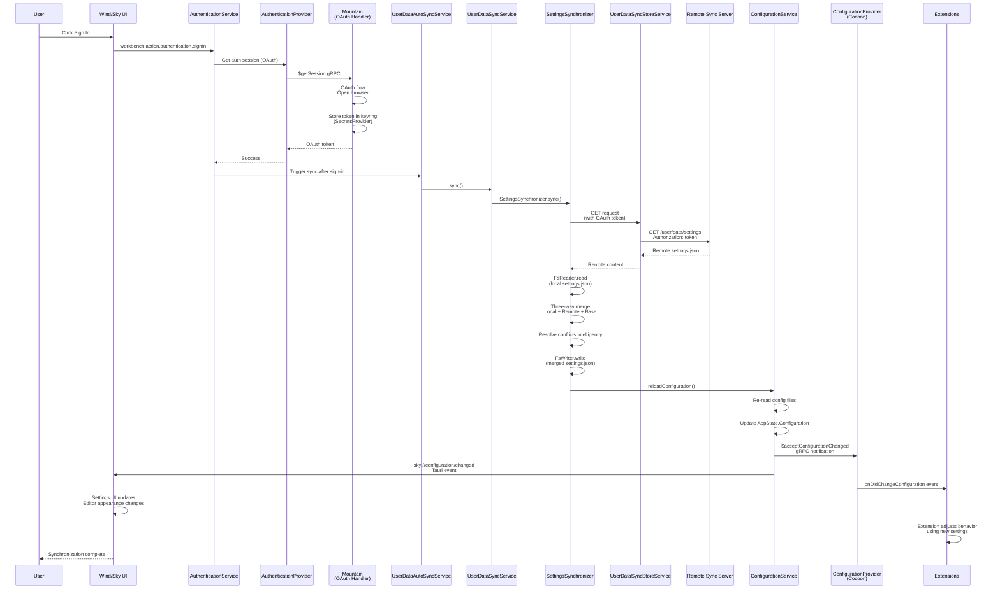

# Workflow Example #9: User Data Synchronization

**Goal:**

- A user logs into their account on a new machine.
- The application downloads their settings, `settings.json`.
- The application downloads their keybindings.
- The application downloads their list of installed extensions.
- The downloads come from a remote server.
- The application applies everything to the new installation.

---

## Table of Contents 📑

1. [Verification Status](#verification-status)
2. [Flow Map](#flow-map)
3. [Phase 1: User Authentication](#phase-1-user-authentication)
4. [Phase 2: Triggering the Synchronization](#phase-2-triggering-the-synchronization)
5. [Phase 3: Synchronizing a Specific Resource](#phase-3-synchronizing-a-specific-resource)
6. [Phase 4: Applying the Merged State](#phase-4-applying-the-merged-state)
7. [Phase 5: UI and Extension Host React to Changes](#phase-5-ui-and-extension-host-react-to-changes)
8. [Extension Storage via Mountain](#extension-storage-via-mountain)
9. [Extension Secrets via Mountain Encryption](#extension-secrets-via-mountain-encryption)
10. [Related Documentation](#related-documentation)

---

## Verification Status ⚠️

This workflow describes the user data synchronization architecture.

- Verify against
  [`Element/Mountain/Source/Environment/SynchronizationProvider.rs`](https://github.com/CodeEditorLand/Mountain/tree/Current/Source/Environment/SynchronizationProvider.rs)
  for the actual implementation.

---

## Flow Map 🗺️

---

## Phase 1: User Authentication 🔐

`Wind`, `Cocoon`, and `Mountain` own this phase.

1. **User Action (`Wind/Sky`).**
   - **Action:** The user clicks the "Sign In" button in the Account menu.
   - This triggers the `workbench.action.authentication.signIn` command.

2. **Authentication Flow (`Wind`, `Cocoon`, and `Mountain`).**
   - **Action:** The `AuthenticationService` in `Wind` receives the command.
   - This triggers a request to `Cocoon`'s `AuthenticationProvider`.
   - The request asks for an authentication session.
   - The session may use OAuth against GitHub or another service.
   - The `AuthenticationProvider` in `Cocoon` makes a `$getSession` gRPC call to `Mountain`.
   - `Mountain`'s `AuthenticationProvider` implementation handles the OAuth flow.
   - This likely involves opening a browser window and listening for a callback URI.
   - **Result:** A successful authentication results in an OAuth token.
   - The token is stored securely, for example in the system keyring via `SecretsProvider`.
   - The user is now signed in.
   - The `UserDataSyncAccountService` now knows the user's identity.
   - It has a token to make authenticated API calls.

---

## Phase 2: Triggering the Synchronization 🔄

`Mountain` owns this phase.

3. **`UserDataAutoSyncService` (`Mountain`).**
   - **Action:** After a successful sign-in, the `UserDataAutoSyncService` is triggered.
   - Alternatively, the user can trigger it manually.
   - It can also be triggered on a regular interval.
   - This service is the central orchestrator for the entire sync process.
   - It decides what to sync, such as settings and extensions.
   - It decides the order of the sync.
   - It begins by calling the `IUserDataSyncService.sync()`.

4. **`UserDataSyncService.sync()` (`Mountain`).**
   - **Action:** The `sync()` method iterates through a list of registered synchronizers.
   - Examples are `SettingsSynchronizer` and `ExtensionsSynchronizer`.
   - For each synchronizer, it calls its `sync()` method.
   - The following steps follow the `SettingsSynchronizer`.

---

## Phase 3: Synchronizing a Specific Resource ⚙️

`Mountain` and the remote server own this phase.

5. **`SettingsSynchronizer.sync()` (`Mountain`).**
   - **Action:** The settings synchronizer needs the latest version of `settings.json` from the remote server.
   - It uses a `UserDataSyncStoreService`, which is an HTTP client under the hood.
   - It makes an authenticated `GET` request to a predefined cloud endpoint.
   - An example is `https://my-sync-service.com/user/data/settings`.
   - It includes the user's OAuth token in the request headers.

6. **Remote Sync Service (External Server).**
   - **Action:** The cloud service receives the request.
   - It validates the token.
   - It fetches the user's stored `settings.json` content from its database.
   - It returns the content as the HTTP response.

7. **Merging Changes (`Mountain`).**
   - **Action:** The `SettingsSynchronizer` in `Mountain` receives the remote `settings.json` content.
   - It also reads the user's local `settings.json` file using the `FsReader` effect.
   - **Crucial Step:** It now performs a three-way merge.
   - It compares the local version.
   - It compares the remote version.
   - It compares a base version, the state from the last successful sync, which is stored locally.
   - This merge logic is defined in a file such as
     `vs/platform/userDataSync/common/settingsMerge.ts`.
   - It intelligently combines the changes.
   - If the user added a setting locally and a different setting on another machine, the merge result contains both.
   - If there is a direct conflict on the same key, it might be flagged for the user to resolve.

---

## Phase 4: Applying the Merged State 💾

`Mountain` owns this phase.

8. **Applying Settings (`Mountain`).**
   - **Action:** The `SettingsSynchronizer` now has the final, merged `settings.json` content.
   - It uses the `FsWriter` effect to write this new content back to the local `settings.json` file.
   - This overwrites the file.

9. **Configuration Reload (`Mountain`).**
   - **Action:** After the file is written, the `SettingsSynchronizer` tells the rest of the application to recognize the changes.
   - It calls a method on the `ConfigurationService`, such as `reloadConfiguration()`.
   - The `ConfigurationService` re-reads all settings files from disk.
   - It reconstructs the effective configuration.
   - It updates the `Configuration` object in `AppState`.

10. **Notifying `Cocoon` and `Wind/Sky`.**
    - **Action:** The `ConfigurationService` in `Mountain` detects that the configuration has changed.
    - It sends a `$acceptConfigurationChanged` gRPC notification to `Cocoon`.
    - The notification includes a summary of the keys that changed.
    - It also emits a `sky://configuration/changed` Tauri event to the `Wind/Sky` frontend.

---

## Phase 5: UI and Extension Host React to Changes 📢

`Cocoon`, `Wind`, and `Sky` own this phase.

11. **`ConfigurationProvider` (`Cocoon`).**
    - **Action:** The `ConfigurationProvider` in `Cocoon` receives the `$acceptConfigurationChanged` notification.
    - It updates its internal cache of the configuration.
    - It fires its `onDidChangeConfiguration` event.
    - The event is exposed to all extensions as `vscode.workspace.onDidChangeConfiguration`.

12. **UI Update (`Wind/Sky`).**
    - **Action:** Components in the UI listen for the `sky://configuration/changed` event.
    - The Settings UI, for example, re-renders to show the new values.
    - The editor re-reads settings such as `editor.fontSize`.
    - The editor updates its appearance.

13. **Extension Reaction (`Cocoon`).**
    - **Action:** An extension listening for configuration changes receives the event.
    - It might call `vscode.workspace.getConfiguration('myExtension')`.
    - This gets its new settings.
    - It adjusts its behavior accordingly.
    - The synchronization process for settings is now complete.
    - The same pattern is repeated for keybindings, snippets, and extensions.

---

## Extension Storage via Mountain 🗄️

- Extension `workspaceState` and `globalState` (`Memento`) are backed by Mountain.
- The backing uses `storage:get` and `storage:set` IPC, not a local file.
- The `Memento` implementation in `Handler/Extension/Host/ActivateExtension.ts` reads initial values.
- It reads them through `storage:get` during activation.
- It writes through `storage:set` on every `update()` call.
- Extension state therefore persists across Cocoon restarts.
- The extension does not need to manage its own storage file.

---

## Extension Secrets via Mountain Encryption 🔑

`context.secrets` uses Mountain's AES-256-GCM encryption layer, not plaintext storage.

- **`secrets.store(key, value)`:**
  - Calls Mountain `encryption:encrypt` with the plaintext value.
  - Then calls `storage:set` with the ciphertext.
- **`secrets.get(key)`:**
  - Calls `storage:get` for the ciphertext.
  - Then calls `encryption:decrypt` to recover the plaintext.
- **`secrets.delete(key)`:**
  - Calls `storage:set` with an empty string.

The encryption key is derived from a SHA-256 hash of the machine UUID.
The derivation lives in `Encryption/Key.rs`.
This makes the key machine-stable across sessions.

- Secrets are never written to disk in plaintext.
- The `onDidChange` event fires after every `store` or `delete` call.

---

## Related Documentation 📖

- [Workflow](../Workflow.md) - workflow index and per-Element architecture table
- [Application Startup and Handshake](ApplicationStartupAndHandshake.md) - Workflow #1
- [Opening a File from the UI](OpeningAFileFromTheUI.md) - Workflow #2
- [Invoking a Language Feature (Hover Provider)](InvokingALanguageFeatureHoverProvider.md) - Workflow #3
- [Saving a File with Save Participants](SavingAFileWithSaveParticipants.md) - Workflow #4
- [Executing a Command from the Command Palette](ExecutingACommandFromTheCommandPalette.md) - Workflow #5
- [Creating and Interacting with a Webview Panel](CreatingAndInteractingWithAWebviewPanel.md) - Workflow #6
- [Creating and Interacting with an Integrated Terminal](CreatingAndInteractingWithAnIntegratedTerminal.md) - Workflow #7
- [Source Control Management (SCM)](SourceControlManagementSCM.md) - Workflow #8
- [Running Extension Tests](RunningExtensionTests.md) - Workflow #10
- [Tier-Gated Implementation Selection](TierGatedImplementationSelection.md) - Workflow #11
- [InterComponentProtocol](../InterComponentProtocol.md) - Tauri IPC, gRPC, and connection lifecycle

---

**Project Maintainers:** Source Open
([Source/Open@Editor.Land](mailto:Source/Open@Editor.Land)) |
[GitHub Repository](https://github.com/CodeEditorLand/Land) |
[Report an Issue](https://github.com/CodeEditorLand/Land/issues)
