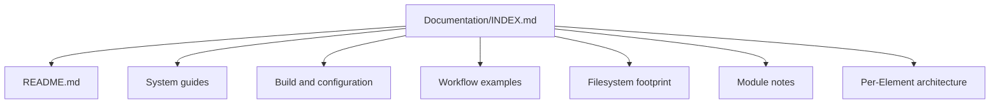

# Land Documentation Index

This index is the entry point for the `Land` documentation set.
It links to the root [`README.md`](../README.md), every system guide under
[`Documentation/GitHub/`](GitHub/README.md), every workflow example, every
filesystem footprint note, every module note and the architecture document
of all 16 Elements.

---

**Table of Contents**

1. [Root and System Guides](#root-and-system-guides)
2. [Build and Configuration](#build-and-configuration)
3. [Workflow Guides](#workflow-guides)
4. [Filesystem Footprint](#filesystem-footprint)
5. [Module Notes](#module-notes)
6. [Per-Element Architecture](#per-element-architecture)
7. [Related Documentation](#related-documentation)

---

## Root and System Guides 📋

| Document | Purpose |
| -------- | ------- |
| [`README.md`](../README.md) | Root overview of `Land`, its Elements and its architecture |
| [`GitHub/README.md`](GitHub/README.md) | Catalogue of the `Documentation/GitHub/` set |
| [`GitHub/Architecture.md`](GitHub/Architecture.md) | Process model, component map, data flow and service layers |
| [`GitHub/EditorCore.md`](GitHub/EditorCore.md) | Workbench adaptation and the `Wind` service layer |
| [`GitHub/InterComponentProtocol.md`](GitHub/InterComponentProtocol.md) | `Tauri` IPC and `Vine` `gRPC` contracts |
| [`GitHub/RustInfrastructure.md`](GitHub/RustInfrastructure.md) | `Rust` workspace, `Common` traits, `Echo` scheduler and native Elements |
| [`GitHub/VSCode-API-Coverage-Matrix.md`](GitHub/VSCode-API-Coverage-Matrix.md) | `vscode.*` API coverage across `Sky`, `Cocoon` and `Mountain` |
| [`GitHub/Polyfills.md`](GitHub/Polyfills.md) | Preload shims and compatibility layers |
| [`GitHub/Shim.md`](GitHub/Shim.md) | Shim and preload entry points |

---

## Build and Configuration 📦

| Document | Purpose |
| -------- | ------- |
| [`GitHub/Building.md`](GitHub/Building.md) | Build entry points, flavors and profiles |
| [`GitHub/BuildMatrix.md`](GitHub/BuildMatrix.md) | Build matrix across platforms and targets |
| [`GitHub/BuildPipeline.md`](GitHub/BuildPipeline.md) | Build pipeline and artifact flow |
| [`GitHub/EnvironmentVariables.md`](GitHub/EnvironmentVariables.md) | Environment variables, defaults and readers |

---

## Workflow Guides 🚀

| Document | Purpose |
| -------- | ------- |
| [`GitHub/Workflow.md`](GitHub/Workflow.md) | Workflow catalogue and per-Element reference table |
| [`GitHub/Workflow/ApplicationStartupAndHandshake.md`](GitHub/Workflow/ApplicationStartupAndHandshake.md) | Startup and handshake sequence |
| [`GitHub/Workflow/CreatingAndInteractingWithAnIntegratedTerminal.md`](GitHub/Workflow/CreatingAndInteractingWithAnIntegratedTerminal.md) | Integrated terminal creation and interaction |
| [`GitHub/Workflow/CreatingAndInteractingWithAWebviewPanel.md`](GitHub/Workflow/CreatingAndInteractingWithAWebviewPanel.md) | Webview panel creation and interaction |
| [`GitHub/Workflow/ExecutingACommandFromTheCommandPalette.md`](GitHub/Workflow/ExecutingACommandFromTheCommandPalette.md) | Command palette execution path |
| [`GitHub/Workflow/InvokingALanguageFeatureHoverProvider.md`](GitHub/Workflow/InvokingALanguageFeatureHoverProvider.md) | Hover provider invocation |
| [`GitHub/Workflow/OpeningAFileFromTheUI.md`](GitHub/Workflow/OpeningAFileFromTheUI.md) | File opening from the UI |
| [`GitHub/Workflow/RunningExtensionTests.md`](GitHub/Workflow/RunningExtensionTests.md) | Extension test execution |
| [`GitHub/Workflow/SavingAFileWithSaveParticipants.md`](GitHub/Workflow/SavingAFileWithSaveParticipants.md) | Save flow with save participants |
| [`GitHub/Workflow/SourceControlManagementSCM.md`](GitHub/Workflow/SourceControlManagementSCM.md) | Source control management flow |
| [`GitHub/Workflow/TierGatedImplementationSelection.md`](GitHub/Workflow/TierGatedImplementationSelection.md) | Tier-gated implementation selection |
| [`GitHub/Workflow/UserDataSynchronization.md`](GitHub/Workflow/UserDataSynchronization.md) | User data synchronization |

---

## Filesystem Footprint 🗺️

| Document | Purpose |
| -------- | ------- |
| [`GitHub/FilesystemFootprint.md`](GitHub/FilesystemFootprint.md) | Filesystem footprint index and ownership domains |
| [`GitHub/FilesystemFootprint/Cleanup.md`](GitHub/FilesystemFootprint/Cleanup.md) | Cleanup lifecycle and removable directories |
| [`GitHub/FilesystemFootprint/Encapsulation.md`](GitHub/FilesystemFootprint/Encapsulation.md) | Directory encapsulation proposals |
| [`GitHub/FilesystemFootprint/EnvironmentVariables.md`](GitHub/FilesystemFootprint/EnvironmentVariables.md) | Filesystem-related environment variables |
| [`GitHub/FilesystemFootprint/PerElement.md`](GitHub/FilesystemFootprint/PerElement.md) | Per-Element ownership matrix |
| [`GitHub/FilesystemFootprint/PlatformPaths.md`](GitHub/FilesystemFootprint/PlatformPaths.md) | Per-platform path map |
| [`GitHub/FilesystemFootprint/UserDotfile.md`](GitHub/FilesystemFootprint/UserDotfile.md) | User dotfile fallback chain |

---

## Module Notes 🧩

| Document | Purpose |
| -------- | ------- |
| [`Module/Telemetry/Overview.md`](Module/Telemetry/Overview.md) | Telemetry overview and tier policy |
| [`Module/Telemetry/Effect-OTel.md`](Module/Telemetry/Effect-OTel.md) | Event capture and export path |
| [`Module/Telemetry/Sidecars.md`](Module/Telemetry/Sidecars.md) | Telemetry sidecars and their wiring |
| [`Module/Telemetry/Tree-Shaking.md`](Module/Telemetry/Tree-Shaking.md) | Telemetry tree-shaking and tier gates |

---

## Per-Element Architecture 🏗️

Each entry is the architecture document of its own Element repository.

| Element | Document |
| ------- | -------- |
| `Air` | [`Air`](https://github.com/CodeEditorLand/Air/tree/Current/Documentation/GitHub/Architecture.md) |
| `Cache` | [`Cache`](https://github.com/CodeEditorLand/Cache/tree/Current/Documentation/GitHub/Architecture.md) |
| `Cocoon` | [`Cocoon`](https://github.com/CodeEditorLand/Cocoon/tree/Current/Documentation/GitHub/Architecture.md) |
| `Common` | [`Common`](https://github.com/CodeEditorLand/Common/tree/Current/Documentation/GitHub/Architecture.md) |
| `Echo` | [`Echo`](https://github.com/CodeEditorLand/Echo/tree/Current/Documentation/GitHub/Architecture.md) |
| `Grove` | [`Grove`](https://github.com/CodeEditorLand/Grove/tree/Current/Documentation/GitHub/Architecture.md) |
| `Maintain` | [`Maintain`](https://github.com/CodeEditorLand/Maintain/tree/Current/Documentation/GitHub/Architecture.md) |
| `Mist` | [`Mist`](https://github.com/CodeEditorLand/Mist/tree/Current/Documentation/GitHub/Architecture.md) |
| `Mountain` | [`Mountain`](https://github.com/CodeEditorLand/Mountain/tree/Current/Documentation/GitHub/Architecture.md) |
| `Output` | [`Output`](https://github.com/CodeEditorLand/Output/tree/Current/Documentation/GitHub/Architecture.md) |
| `Rest` | [`Rest`](https://github.com/CodeEditorLand/Rest/tree/Current/Documentation/GitHub/Architecture.md) |
| `SideCar` | [`SideCar`](https://github.com/CodeEditorLand/SideCar/tree/Current/Documentation/GitHub/Architecture.md) |
| `Sky` | [`Sky`](https://github.com/CodeEditorLand/Sky/tree/Current/Documentation/GitHub/Architecture.md) |
| `Vine` | [`Vine`](https://github.com/CodeEditorLand/Vine/tree/Current/Documentation/GitHub/Architecture.md) |
| `Wind` | [`Wind`](https://github.com/CodeEditorLand/Wind/tree/Current/Documentation/GitHub/Architecture.md) |
| `Worker` | [`Worker`](https://github.com/CodeEditorLand/Worker/tree/Current/Documentation/GitHub/Architecture.md) |

---

## Related Documentation 📖

- [`GitHub/README.md`](GitHub/README.md) - catalogue of the `Documentation/GitHub/` documents
- [`../README.md`](../README.md) - root overview of `Land`

---

**Project Maintainers:** Source Open
([Source/Open@Editor.Land](mailto:Source/Open@Editor.Land)) |
[GitHub Repository](https://github.com/CodeEditorLand/Land) |
[Report an Issue](https://github.com/CodeEditorLand/Land/issues)
